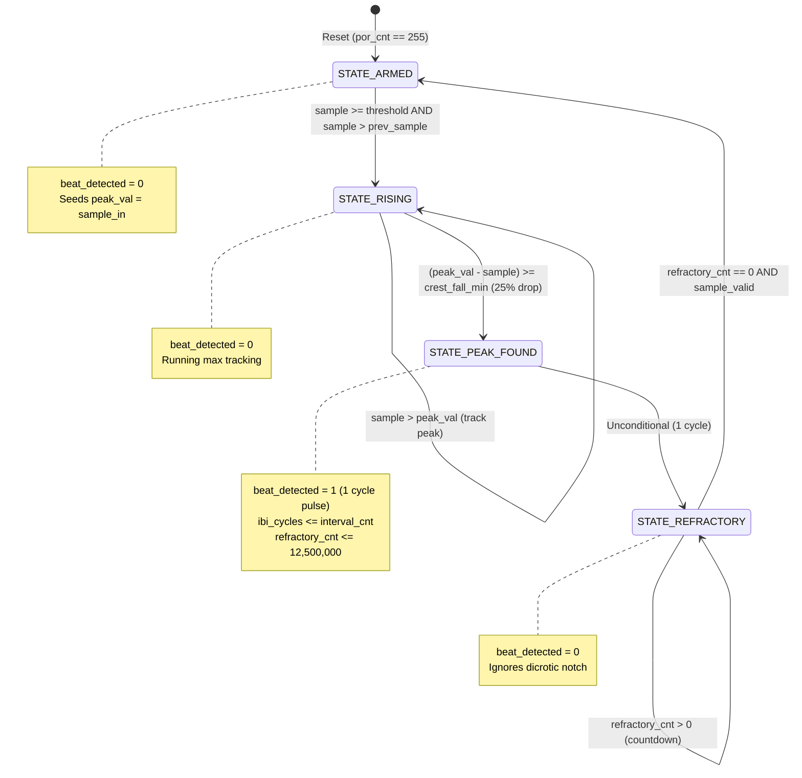
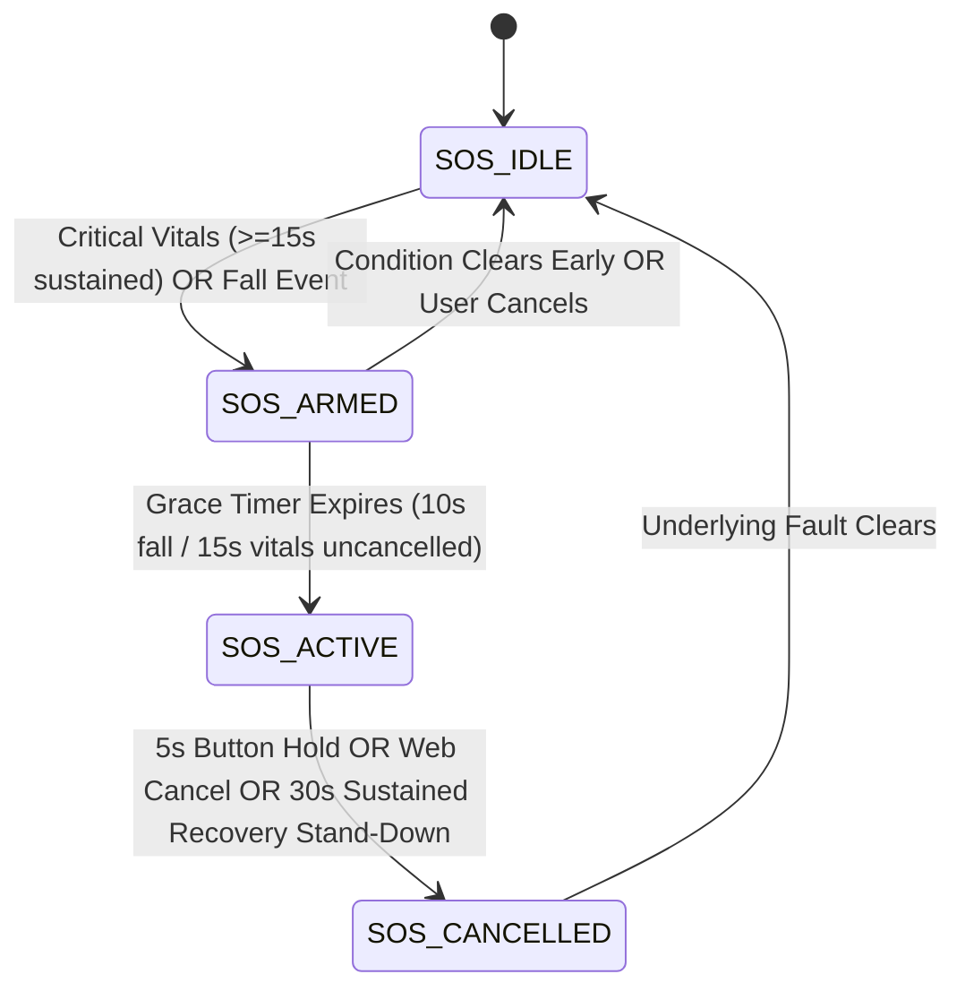

# VALOR: Complete Guide

**Sub-Title:** A Beginner-to-Confident Study Guide and Technical Defense Manual for B.Tech ECE Students  
**Project Identifier:** SIH26181 — VALOR (*Vital and Atmospheric Logic for Offline Rescue*)  
**System Classification:** Heterogeneous Edge SoC (FPGA Verilog RTL + ESP32-S3 FreeRTOS C11 Firmware + Zero-Cloud INT8 TinyML)

---

## 0. How to Read This Guide

This guide is written for a student who wants to understand Project VALOR from the ground up and defend it with complete confidence in front of a technical jury panel. You do not need to memorize pin numbers, memory addresses, or raw register bits. You do need to understand **why** the hardware was designed this way, **how** the signals move, **what** the state machines do, and **where** the engineering trade-offs lie.

### Recommended Reading Order
1. **First-Time Read (1 Hour):** Read sections 0 through 4 to grasp the big picture. Then read sections 5, 8, 9, 12, 13, and 14. These form the core of the project: the physical link, the filter, the peak detector, the firmware, and the artificial intelligence (AI).
2. **Deep Technical Review (Before the Verilog / RTL Jury):** Focus specifically on sections 5, 7, 8, 9, 10, and 11. Study the Finite State Machine (FSM) state diagrams, clock domain crossing, and synthesis reports.
3. **Pre-Demo Rehearsal (30 Minutes Before Judging):** Read section 18 (Demo Walkthrough), section 19 (Judge Q&A Playbook), section 20 (Honest Limitations), and section 22 (Team Roles).

### The 5-Minute "If You Read Nothing Else" Summary
- **The Problem:** In severe disasters (cyclones, floods, chemical fires), cellular towers collapse, power grids die, and environmental hazards accelerate physiological collapse. Commercial smartwatches fail because they depend on cloud servers and their operating systems have timing jitter (5 to 10 ms) that destroys heart rate variability metrics.
- **The Solution:** VALOR is a wearable device that operates 100% offline. It fuses optical vitals (pulse, oxygen saturation) with environmental hazards (toxic smoke, ambient temperature, humidity, cyclone pressure drops, and falls).
- **The Hardware:** It uses a heterogeneous "dual-brain" architecture:
  1. A low-cost FPGA (Field-Programmable Gate Array—Renesas ForgeFPGA SLG47910) running synthesizable Verilog at 50 MHz. It filters the optical signal and detects systolic pulse crests in pure digital logic with 20-nanosecond cycle-accurate precision (0 DSP slices, 0 Block RAM).
  2. A dual-core microcontroller (Espressif ESP32-S3, 240 MHz) running FreeRTOS in C11. Core 0 handles high-speed sensor transfers over an 8-bit Serial Peripheral Interface (SPI). Core 1 runs signal quality checking, barometric cyclone regression, a 619-byte integer neural network (INT8 TinyML), clinical early warning scores (mNEWS2), and an autonomous Emergency Assistance (SOS) state machine.
- **The Display & Rescuer Access:** An onboard OLED displays live vitals and emergency medical cards. An onboard blue LED flashes on every physical heartbeat directly from the FPGA. For nearby rescuers, the ESP32 acts as an unencrypted local Wi-Fi Access Point (SoftAP), serving a zero-install real-time dashboard directly from its flash memory to any smartphone browser with no internet required.

---

## 1. The Problem and Why It Matters

### Extreme Disasters Obliterate Communications
When tropical cyclones, urban flash floods, chemical industrial fires, or earthquakes strike, the civilian infrastructure collapses immediately:
- Backhaul fiber-optic lines tear.
- Cellular base stations flood or lose grid power.
- Cloud servers become completely unreachable.

If a wearable monitor relies on cloud Application Programming Interfaces (APIs) or remote cellular connections to process data or raise alarms, it becomes a dead brick the moment a disaster begins.

### Environmental Hazards Accelerate Physical Collapse
In disaster scenarios, ambient atmospheric conditions directly drive physiological emergencies:
- **Extreme Heatwaves & Humidity:** Ambient air above 40°C combined with high humidity prevents sweat evaporation. Core body temperature climbs, causing heat exhaustion and fatal heat stroke.
- **Toxic Particulate Matter (PM2.5):** Smoke from wildfires or industrial fires fills the lungs with fine particles ($\le 2.5\ \mu\text{m}$). These particles cross into the bloodstream, triggering acute hypoxemia and autonomic depression.
- **Rapid Barometric Drops:** Rapidly plummeting atmospheric pressure signals an approaching tropical cyclone or severe squall line.
- **Cold Water Immersion:** Floodwaters induce rapid hypothermia, cold shock, and sudden bradycardia (abnormally slow heart rate).

### The "Alarm Fatigue" Trap of Single-Modality Sensors
A commercial fitness tracker only looks at heart rate. A heart rate of 135 beats per minute (BPM) while jogging in a cool park is healthy. That exact same heart rate of 135 BPM in an ambient temperature of 44°C with elevated humidity indicates impending heat stroke. 

Conversely, an environmental sensor hanging on a wall measures citywide air pollution but knows nothing about the physiological resilience or oxygen desaturation of the individual breathing it. VALOR couples continuous physiological vitals with local microclimate conditions, allowing the device to distinguish safe exertion from lethal multi-hazard collapse.

> **In one line:** Disasters destroy communication networks while heat, smoke, and storms accelerate physical collapse; VALOR solves this by coupling vitals with atmospheric hazards 100% offline at the silicon edge.

::: tip Judge might ask
- **Q:** *Why not just use an Apple Watch or Garmin for first responders?*  
  **A:** Commercial smartwatches rely on cloud connectivity for health analytics, lack particulate matter (PM2.5) sensors, do not calculate barometric cyclone trends, run closed operating systems with 5–10 ms scheduling jitter, and cannot host an open, local Wi-Fi triage web server for search-and-rescue teams.
- **Q:** *What is alarm fatigue and how does VALOR prevent it?*  
  **A:** Alarm fatigue occurs when simple threshold alerts fire constantly during benign exertion. VALOR fuses vitals with environmental context (e.g., heart rate evaluated against ambient heat and humidity) so alarms only trigger when true physiological strain occurs.
:::

---

## 2. What VALOR Does

VALOR measures physiological and atmospheric variables directly on the body, evaluates those signals using on-chip logic and machine learning, and raises local alarms without external dependencies.

```
       [ MEASURE ]                    [ DECIDE ]                    [ ACT / ALERT ]
 ┌──────────────────────┐      ┌──────────────────────┐      ┌──────────────────────────┐
 │ • Photoplethysmography│     │ • 8-Tap Boxcar Filter│      │ • Blue LED Beat Flash    │
 │   (Red & IR Light)   │     │ • Peak Detection FSM │      │ • 128x64 I2C OLED Card   │
 │ • Barometric Pressure│ ───▶ │ • Karlen SQI Gating  │ ───▶ │ • Active Piezo Siren     │
 │ • Ambient Temp & RH  │     │ • INT8 TinyML Model  │      │ • Wi-Fi SoftAP Dashboard │
 │ • PM2.5 / PM10 Smoke │     │ • mNEWS2 Clinical Rule│      │ • USB Web Serial Stream  │
 │ • 6-Axis IMU Motion  │     │ • 5-Stage Fall FSM   │      └──────────────────────────┘
 └──────────────────────┘      └──────────────────────┘
```

### What It Measures
1. **Arterial Pulsatile Blood Volume (PPG):** Measures infrared (IR) and red light absorption through capillary blood vessels at 100 Hz.
2. **Barometric Pressure:** Tracks absolute atmospheric pressure (hPa) with 0.01 hPa resolution to detect barometric pressure fall rates over hours.
3. **Ambient Temperature & Relative Humidity:** Monitors environmental thermal stress.
4. **Particulate Matter (PM1.0, PM2.5, PM10):** Measures suspended airborne smoke and dust particles via 90-degree laser scattering.
5. **Biomechanical Motion:** Tracks 3-axis linear acceleration and 3-axis angular rotational velocity at 40 Hz to identify gait, stillness, and falls.

### What It Decides on the Device
- **Inter-Beat Interval (IBI):** Calculates the exact duration (in 20-nanosecond units) between consecutive arterial systolic peaks.
- **Heart Rate & Heart Rate Variability (HRV):** Computes Heart Rate (BPM) and Root Mean Square of Successive Differences (RMSSD in ms), representing autonomic nervous system health.
- **Blood Oxygen Saturation ($\text{SpO}_2$):** Derives oxygen saturation using the Ratio-of-Ratios principle from red and IR light curves.
- **Respiration Rate (RR):** Extracts breathing rate from respiratory sinus arrhythmia (RSA) modulations.
- **Signal Quality Index (SQI):** Checks pulse waveform morphology to discard motion noise before running clinical algorithms.
- **Multi-Hazard Risk Triage:** Computes risk indices for Heat Strain (Moran's Physiological Strain Index), Toxic Pollution (Autonomic Strain Index), Flash Flood/Cold Stress, and Impending Cyclones.
- **Clinical Urgency:** Evaluates the modified National Early Warning Score 2 (mNEWS2).

### What Alerts It Raises
- **Hardware Beat Flash:** An onboard blue LED pulses for 50 milliseconds upon every confirmed systolic crest directly from the FPGA.
- **OLED Medical Emergency Card:** Displays a high-contrast emergency screen showing patient condition, vitals, time elapsed, and rescue location.
- **Audible Siren:** Drives an active buzzer with alarm patterns for falls or critical medical alerts.
- **Zero-Install Local Rescuer Dashboard:** Transmits live vitals, 24-hour hourly trend history, and emergency alerts over local Wi-Fi (`VALOR-0081`) to any connected smartphone or laptop browser.

### Why It Works 100% Offline
There are no external API calls, no DNS lookups, no cloud databases, and no content delivery network (CDN) dependencies. All HTML, CSS, JavaScript, and neural network weights are compiled directly into the ESP32-S3 flash memory. If the entire global internet collapses, VALOR operates with zero degradation.

> **In one line:** VALOR continuously captures vitals and hazards, filters them in FPGA hardware, classifies multi-hazard risk on a dual-core microcontroller, and presents actionable triage alerts locally without cloud connectivity.

::: tip Judge might ask
- **Q:** *Does the web dashboard require an internet connection or an app download?*  
  **A:** No. The ESP32-S3 broadcasts its own Wi-Fi Access Point (`VALOR-0081`). The web page is served directly from internal flash memory. Any smartphone connects to the Wi-Fi and opens `192.168.4.1` in its browser.
- **Q:** *Why does the device withhold vitals if the signal is noisy?*  
  **A:** The Karlen Signal Quality Index (SQI) algorithm screens raw pulses. If motion corrupts the optical path (SQI < 0.70), the device refuses to calculate HRV rather than publishing garbage data that could trigger false alarms.
:::

---

## 3. System Architecture

Project VALOR divides labor between dedicated digital logic (FPGA) and general-purpose software processing (MCU).

### System Block Diagram

```
 +-----------------------------------------------------------------------------------------+
 |                                  PROJECT VALOR HARDWARE                                 |
 |                                                                                         |
 |   +-------------------+                                                                 |
 |   | MAX30102 Biosensor|                                                                 |
 |   | (IR & Red Optical)|                                                                 |
 |   +---------+---------+                                                                 |
 |             | I2C (100 Hz Samples)                                                      |
 |             v                                                                           |
 |   +---------+---------+          4-Wire SPI (1 MHz)           +---------------------+   |
 |   |     ESP32-S3      | MOSI: 8-bit Raw Optical Sample        |  Renesas ForgeFPGA  |   |
 |   |   Microcontroller |-------------------------------------->|      SLG47910       |   |
 |   |                   |<--------------------------------------|   (50 MHz Internal) |   |
 |   | Core 0:           | MISO: [Beat Flag | 7-bit Filtered Val]|                     |   |
 |   |  • High-Speed I/O |       + Optional 5-Byte IBI Burst     | • 8-Tap MA Filter   |   |
 |   |  • Link Driver    |                                       | • Peak Detector FSM |   |
 |   |                   |                                       +----------+----------+   |
 |   | Core 1:           |                                                  |          |
 |   |  • SQI & HRV      |                                                  v          |
 |   |  • TinyML INT8    |                                           [ Blue LED D12 ]  |
 |   |  • mNEWS2 Triage  |                                           (Hardware Pulse)  |
 |   |  • SoftAP Web Svr |                                                             |
 |   +---+---+---+---+---+                                                             |
 |       |   |   |   |                                                                 |
 |  I2C  |   |   |   | UART1                                                           |
 |  +----+   |   |   +---------------------------------------+                         |
 |  |        |   |                                           |                         |
 |  v        |   v UART2                                     v                         |
 |+--------+ | +------------------+                +-------------------+               |
 || BME280 | | | u-blox NEO-M8N   |                | Plantower PMS5003 |               |
 || Temp,  | | | GNSS Receiver    |                | Laser PM2.5 Smoke |               |
 || Hum,   | | | (GPS Location)   |                +-------------------+               |
 || Baro   | | +------------------+                                                    |
 |+--------+ |                                                                         |
 |  |        v I2C                                                                     |
 |  |      +------------------+     I2C Shared Bus     +--------------------+          |
 |  +----->| MPU6050 6-DOF IMU|----------------------->| 0.96" SSD1306 OLED |          |
 |         | (Fall Detection) |                        | (Live Triage Card) |          |
 |         +------------------+                        +--------------------+          |
 |                                                                                     |
 |   +------------------------------------+       +--------------------------------+   |
 |   | Active Buzzer (Audible Siren)       | Wi-Fi SoftAP (192.168.4.1 Web) |   |
 |   +------------------------------------+       +--------------------------------+   |
 +-------------------------------------------------------------------------------------+
```

### Numbered Data Path: From Sensor Sample to Alert

1. **Optical Capture:** Every 10 milliseconds (100 Hz), the MAX30102 optical sensor captures an 18-bit reading of reflected infrared light from the capillary bed of the finger.
2. **I2C Ingestion (Core 0):** The ESP32-S3 Core 0 reads the sample over I2C, normalizes the reading to an 8-bit dynamic range, and prepares an SPI transaction.
3. **SPI Master-to-Target Transmission:** Core 0 drives the chip select pin low and clocks the 8-bit sample across the MOSI line at 1 MHz into the Renesas ForgeFPGA.
4. **FPGA Hardware Filtering:** Inside the FPGA fabric, the sample enters `moving_average_8tap.v`. An 8-tap boxcar filter smooths high-frequency sensor noise using a running-sum pipeline.
5. **FPGA Peak Detection:** The filtered sample enters `ppg_peak_detector.v`. A 4-state Finite State Machine identifies the systolic crest by checking that the sample has risen above an armed threshold and subsequently dropped by at least 25% of the running peak.
6. **Cycle-Accurate Hardware Timestamping:** When a peak is confirmed, the FPGA latches a 32-bit hardware cycle counter running on its 50 MHz clock net (yielding 20-nanosecond resolution) and asserts a beat flag. It also immediately triggers an internal pulse stretcher that illuminates the blue user LED (D12) for 50 ms.
7. **Full-Duplex Result Return:** On the simultaneous SPI return transfer (MISO), the FPGA sends back byte `{beat_latched, filt_sample[6:0]}`. If a beat was confirmed, the FPGA queues an immediate 5-byte burst containing the magic byte `0xC3` followed by the 32-bit cycle count.
8. **Inter-Core Mutex Transfer:** Core 0 unpacks the cycle count into an Inter-Beat Interval in milliseconds, verifies physiological bounds (30 to 250 BPM), appends it to an IBI history ring buffer, and releases a FreeRTOS mutex (`s_data_mutex`).
9. **Auxiliary Hazard Polling (Core 1):** Concurrently, tasks on Core 1 read ambient temperature, humidity, and barometric pressure from the BME280 (I2C), particulate smoke counts from the PMS5003 (UART1), motion metrics from the MPU6050 (I2C), and satellite sentences from the GNSS module (UART2).
10. **Signal Conditioning & Algorithmic Extraction (Core 1):** Core 1 evaluates the Karlen Signal Quality Index (SQI). If SQI $\ge 0.70$, it calculates RMSSD heart rate variability and extracts respiration rate via respiratory sinus arrhythmia. Simultaneously, it applies an empirical EPA/AirGradient polynomial correction to the raw particulate reading and computes a 180-minute least-squares barometric pressure regression slope.
11. **INT8 Neural Network Inference (Core 1):** The normalized feature vector (`[HR, RMSSD, SpO2, Temp, Humidity, PM2.5]`) is fed into the 619-byte INT8 Multilayer Perceptron. The network computes heat risk, pollution risk, and flood/cold strain scores.
12. **Clinical Rules & Crisis Overrides (Core 1):** The Royal College of Physicians mNEWS2 engine reviews the vitals. If hard physiological safety limits are breached (e.g., $\text{SpO}_2 < 88\%$ or rapid barometric fall $\le -2.0\text{ hPa/hr}$), deterministic clinical overrides force the system risk level to CRITICAL, superseding the neural network.
13. **Local Action & Alerting:** If the system enters a sustained CRITICAL state or the 3-stage fall detection FSM confirms an impact followed by immobility:
    - The Emergency Assistance (SOS) state machine transitions from `ARMED` to `ACTIVE`.
    - The active sounder sounds an audible alarm.
    - The SSD1306 OLED switches to the emergency card display.
    - The local SoftAP updates `/api/status`, pushing emergency warnings to any connected smartphone browser.

> **In one line:** Optical signals flow from sensor to MCU, through FPGA digital filters and peak detectors, back to MCU FreeRTOS cores for sensor fusion and INT8 AI inference, and out to local displays, buzzers, and offline web browsers.

::: tip Judge might ask
- **Q:** *Why split the design across two chips instead of doing everything on the ESP32-S3?*  
  **A:** FreeRTOS task scheduling creates unpredictable jitter (up to 5 ms per tick). HRV calculations depend on microsecond-level timing differences between beats. The FPGA provides deterministic, 20-nanosecond hardware timing completely independent of CPU task load.
- **Q:** *How does Core 0 pass high-frequency PPG data to Core 1 without crashing?*  
  **A:** Core 0 and Core 1 share an in-memory data structure protected by a FreeRTOS mutex (`s_data_mutex`). Core 0 writes new IBI and SpO2 values quickly and releases the lock; Core 1 takes short read snapshots at 1 Hz.
:::

---

## 4. The Two Hardware Targets

Project VALOR exists in two hardware implementations: a verified AMD Xilinx Zynq-7000 baseline, and a deployable Renesas ForgeFPGA port (the ShrikeFi board). Understanding why both exist and what differs between them is a standard defense requirement.

```
       AMD XILINX ZYNQ-7000 BASELINE                     VICHARAK SHRIKEFI PORT
   +--------------------------------------+     +--------------------------------------+
   | Dual ARM Cortex-A9 + Artix-7 Fabric  |     | ESP32-S3 MCU + Renesas ForgeFPGA     |
   |                                      |     |                                      |
   | • 32-bit Memory-Mapped AXI4-Lite Bus |     | • 4-Wire 8-bit SPI Bus (Mode 0)      |
   | • High Cost ($50 - $150)             |     | • Ultra-Low Cost (~$0.50 FPGA)       |
   | • High Power (Watts)                 |     | • Ultra-Low Power (< 5 mW FPGA)      |
   | • Verified Golden Reference Model    |     | • Deployable Wearable Demo Target    |
   +--------------------------------------+     +--------------------------------------+
```

### 1. The Xilinx Zynq-7000 Baseline
The original design was implemented and verified on the AMD Xilinx Zynq-7000 SoC (`xc7z020clg400-1`). On this chip, dual ARM Cortex-A9 processors communicate with programmable Artix-7 FPGA logic across an internal 32-bit memory-mapped AXI4-Lite bus. 
- **Role:** It serves as our mathematically proven, golden reference model.
- **Resource Footprint:** 185 Slice Look-Up Tables (LUTs), 16 LUTRAMs, 266 Flip-Flops (FFs), **0 DSP48 slices, and 0 Block RAMs (BRAM)**.
- **Timing Closure:** Vivado ML 2022.2 out-of-context synthesis verified Worst Negative Slack (WNS) of **+5.603 ns** and Worst Hold Slack (WHS) of **+0.184 ns**, achieving a maximum clock frequency ($F_{\text{max}}$) of **69.45 MHz** against a 50 MHz target clock. (A secondary full block design re-run in Vivado 2026.1 closed integrated post-route timing with WNS **+12.836 ns** across 1,806 endpoints).
- **Testbench:** Verified via `hardware/zynq/tb_ppg_system.v` with 6/6 self-checking hardware assertions passing.

### 2. The ShrikeFi Target Reference
While the Zynq-7000 proves the Verilog architecture, it is too expensive ($50 to $150) and power-hungry (several watts) for a practical, mass-deployable disaster wearable. Therefore, the core Verilog modules were ported to the **Vicharak ShrikeFi** platform:
- **Processor:** Espressif ESP32-S3 (dual-core Xtensa LX7, 240 MHz, single-precision hardware Floating-Point Unit).
- **FPGA:** Renesas ForgeFPGA SLG47910, containing **1120 five-input Look-Up Tables (LUT5s)** across 140 Configurable Logic Blocks (CLBs).
- **Current Production Fit:** **515 / 1120 CLB LUT5s (45.98%)**, **303 FFs (16.33%)**, and **105 / 140 CLBs (75.00% CLB occupancy)**.
- **Timing Closure:** **WNS +7.316 ns**, Total Negative Slack (TNS) = 0 ps, achieving $F_{\text{max}} = \mathbf{78.85\text{ MHz}}$ against the 50 MHz constraint (`timing_constraints.sdc`).
- **Cost & Power:** The ForgeFPGA costs approximately $0.50 and consumes under 5 milliwatts, making battery-powered wearable deployment viable.

### Architectural Differences Between Targets

| Feature | Xilinx Zynq-7000 Baseline | Renesas ForgeFPGA ShrikeFi Port |
|---|---|---|
| **Primary Role** | Golden reference, formal RTL verification | Physical demonstration, deployable product |
| **Host Processor** | Dual ARM Cortex-A9 (Hard Processing System) | ESP32-S3 Dual-Core Xtensa LX7 |
| **Interconnect** | 32-bit Memory-Mapped AXI4-Lite (`0x43C00000`) | 4-Wire 8-bit SPI (Mode 0, 1 MHz runtime) |
| **Sample Input** | Written to AXI register `REG_IR_RAW` | Transmitted as 8-bit MOSI byte |
| **Filtered Output** | Read from AXI register `REG_IR_FILT` | Returned on MISO bits `[6:0]` |
| **Beat Flag** | Read from AXI register `REG_STATUS_THRESH[0]` | Returned on MISO bit `7` |
| **IBI Cycle Transfer**| Read directly from 32-bit register `REG_IBI_CYCLES` | 5-byte burst (`0xC3` + 32-bit big-endian cycles) |
| **Threshold Setting** | Dynamically written to `REG_STATUS_THRESH[15:8]` | Hardcoded at synthesis (`8'd120`) |
| **Interrupts** | Hardware interrupt line routed to ARM GIC | Polled SPI status bit (no separate interrupt line) |
| **Dedicated DSPs** | **0 DSP48** | **0 DSP** (Hardware contains none) |
| **Block RAM** | **0 BRAM** | **0 BRAM** (Uses distributed flip-flops) |

### Why Both Exist and Which One Is the Demo
Both exist because good hardware engineering separates algorithmic proof from cost optimization. The Zynq proved that the 8-tap filter and peak detector operate with zero DSPs and zero BRAM under rigorous timing closure in Vivado. The ShrikeFi proves that this exact same vendor-agnostic Verilog code can run on a sub-dollar micro-FPGA inside an ultra-low-power wearable. 

**The ShrikeFi board is the physical demo product shown to the judges.**

> **In one line:** The Zynq-7000 is our verified golden reference model proving timing closure and zero DSP usage; the ShrikeFi is our low-cost, battery-friendly physical demo wearable.

::: tip Judge might ask
- **Q:** *Why did you synthesize on Zynq if your demo board uses a Renesas ForgeFPGA?*  
  **A:** Zynq synthesis in Vivado provided industrial timing closure reports (WNS +5.603 ns) and proved the RTL is 100% vendor-agnostic with 0 DSPs and 0 BRAM. We then ported the identical RTL to the sub-dollar ForgeFPGA to achieve a wearable form factor.
- **Q:** *Can the peak detection threshold be adjusted at runtime on the ShrikeFi board?*  
  **A:** On Zynq, the threshold is programmable over AXI4-Lite. On ShrikeFi, the threshold is hardcoded at synthesis to `8'd120` to conserve logic gates in the 1120-LUT fabric. The firmware driver `shrikefi_set_threshold()` stores the value in memory but does not write to hardware.
:::

---

## 5. The Link Between the ESP32 and the FPGA

The communication link between the ESP32-S3 microcontroller and the Renesas ForgeFPGA is the central nervous system of VALOR.

### Physical Wires and Conceptual Functions
The link is implemented across **internal PCB traces** on the ShrikeFi development board. No external jumper wires are needed for this link.

```
      ESP32-S3 (Controller)                          Renesas ForgeFPGA (Target)
   ┌──────────────────────────┐                    ┌────────────────────────────┐
   │                          │   spi_sck (1 MHz)  │                            │
   │  SPI Clock Line ─────────┼───────────────────▶│ Shift Clock Input (SCK)    │
   │                          │   spi_ss_n (CS#)   │                            │
   │  Slave Select Line ──────┼───────────────────▶│ Slave Select (SS_n)        │
   │                          │   spi_mosi         │                            │
   │  Master Out Slave In ────┼───────────────────▶│ Raw Optical Sample Input   │
   │                          │   spi_miso         │                            │
   │  Master In Slave Out ◀───┼────────────────────│ Filtered Sample & Beat Flag│
   │                          │                    │                            │
   │  FPGA Enable Strobe ─────┼──▶ [FPGA_EN]       │ Internal Power-On Reset    │
   │  FPGA Power Gate ────────┼──▶ [FPGA_PWR]      │ (On-chip POR, no ext pin)  │
   └──────────────────────────┘                    └────────────────────────────┘
```

- **`spi_sck` (SPI Shift Clock):** Generated exclusively by the ESP32-S3. Oscillates at 1 MHz during normal sample exchanges and 16 MHz during initial bitstream flashing.
- **`spi_ss_n` (Slave Select / Chip Select):** Active-low framing line asserted by the ESP32-S3 to demarcate each individual byte or burst transaction.
- **`spi_mosi` (Master Out Slave In):** Carries the raw 8-bit optical PPG sample stream from the microcontroller to the FPGA.
- **`spi_miso` (Master In Slave Out):** Carries the 8-bit response packet (beat flag and 7-bit filtered sample) and cycle-accurate IBI burst bytes from the FPGA back to the microcontroller.
- **`FPGA_EN` & `FPGA_PWR` Control Lines:** Power-gating and configuration enable lines used only during initial boot bitstream programming.
- **No Physical Reset Pin:** The inter-chip interface does not require an external reset wire. The FPGA generates a clean internal reset using an on-chip 255-cycle Power-On-Reset (POR) counter clocked by its 50 MHz internal oscillator.
- **No Dedicated Interrupt Pin:** Systolic crest events are signaled inline on bit 7 of the SPI MISO byte.

### Why SPI Was Chosen: Interface Comparison

| Feature | SPI (Chosen) | $\text{I}^2\text{C}$ (Rejected) | UART (Rejected) |
|---|---|---|---|
| **Wire Count** | 4 wires (SCK, SS_n, MOSI, MISO) | 2 wires (SDA, SCL) | 2 wires (TX, RX) |
| **Speed** | High (1 – 16 MHz in this design) | Low (100 – 400 kHz) | Moderate (9600 – 115200 baud) |
| **Duplex** | **Full Duplex** (Send and receive at same clock edge) | Half Duplex (Turnaround overhead) | Full Duplex |
| **Addressing** | None (Dedicated Slave Select line) | 7-bit / 10-bit address header required on every transfer | None |
| **Clocking** | Synchronous (Host provides clock line) | Synchronous (Host provides clock line) | **Asynchronous** (Requires matched clock baud rates) |
| **FPGA Logic Cost**| **Tiny** (Simple 8-bit shift register) | **High** (Complex I2C state machine, ACK handling, open-drain) | **Moderate** (Oversampling baud-rate generator & synchronizer) |
| **Pull-Up Resistors**| None (Push-pull CMOS drivers) | Mandatory pull-ups (slows rise times) | None |

#### Why Not $\text{I}^2\text{C}$?
$\text{I}^2\text{C}$ is a shared multi-drop bus designed for slow board management. It requires sending a 7-bit device address byte and receiving an acknowledgment (ACK) bit before every data byte. It is half-duplex, meaning the MCU cannot send a new raw sample while reading the old filtered result. Furthermore, implementing an $\text{I}^2\text{C}$ slave in an FPGA requires a complex multi-state FSM and consumes precious LUTs that the 1120-LUT ForgeFPGA cannot spare.

#### Why Not UART?
Universal Asynchronous Receiver-Transmitter (UART) has no shared clock line. Both chips must generate independent, tightly matched internal clocks (e.g., within 2% frequency tolerance). The FPGA would have to dedicate silicon to an oversampling clock divider and baud-rate synchronizer. If the FPGA's internal on-chip RC oscillator drifts with temperature, UART communication framing breaks.

#### Why SPI Fits Microcontroller-to-FPGA Coupling
SPI is a pure, unadorned hardware shift register. When the master shifts a bit out on MOSI, the target simultaneously shifts a bit in on MISO. The master controls the clock, eliminating all baud-rate drift issues. In Verilog, an SPI target requires only a few flip-flops and 2-stage input synchronizers.

### SPI Mode 0 Explained
SPI Mode 0 is defined by two parameters:
- **$\text{CPOL} = 0$ (Clock Polarity):** The clock line is idle at logic LOW ($0\text{V}$). The active clock pulse is HIGH ($3.3\text{V}$).
- **$\text{CPHA} = 0$ (Clock Phase):** Data is sampled on the **first clock edge** (the rising edge) and data is shifted/changed on the **second clock edge** (the falling edge).

```
 spi_ss_n  ──┐                                                                 ┌───
 (Select)    └─────────────────────────────────────────────────────────────────┘
                  __      __      __      __      __      __      __      __
 spi_sck   ______/  \____/  \____/  \____/  \____/  \____/  \____/  \____/  \______
 (Mode 0)        Bit 7   Bit 6   Bit 5   Bit 4   Bit 3   Bit 2   Bit 1   Bit 0
                 ▲       ▲       ▲       ▲       ▲       ▲       ▲       ▲
                 │       │       │       │       │       │       │       │
 Sample Point:  Rising  Rising  Rising  Rising  Rising  Rising  Rising  Rising
 Change Point:  Falling Falling Falling Falling Falling Falling Falling Falling
```

Before the first rising edge arrives, MISO is already pre-loaded with Bit 7. On the rising edge, both devices sample the bit. On the subsequent falling edge, both devices shift the next bit onto the wire.

### The 8-Bit Full-Duplex Frame

Every 10 ms (at 100 Hz), the ESP32 sends exactly one byte and receives exactly one byte:

```
            +-------------------------------------------------------+
  MCU ----> | MOSI: [ sample[7:0] ]   Raw 8-bit optical IR sample   | ----> FPGA
            |                                                       |
  MCU <---- | MISO: [ Beat | filt[6:0] ] One composite result byte  | <---- FPGA
            +-------------------------------------------------------+
```

- **MOSI Byte:** Contains the 8-bit raw IR optical sample from the MAX30102.
- **MISO Byte:**
  - **Bit 7 (`beat_latched`):** Asserted HIGH (`1`) for exactly one transaction if the peak detector FSM identified a systolic crest.
  - **Bits [6:0] (`filt_sample[6:0]`):** The lower 7 bits of the 8-tap moving average filtered PPG sample.

> **Why the returned waveform wraps:** Because the moving average filter is 8 bits wide and bit 7 is used for the beat flag, the diagnostic waveform returned on MISO wraps around at 128 (modulo 128). This produces a sawtooth appearance on raw diagnostic serial plots; the firmware treats it strictly as diagnostic data, while the FPGA's internal peak detector uses the full 8-bit unclipped signal.

> **Single-Channel Optical FPGA Link:** In Project VALOR, only the **Infrared (IR)** optical channel streams across the SPI link to the FPGA. The Red channel is read and filtered entirely in software on the ESP32-S3 for $\text{SpO}_2$ ratio-of-ratios calculation (`shrikefi_write_red_sample()` caches the sample in local MCU memory, while `shrikefi_write_ir_sample()` triggers the physical hardware SPI transfer).

#### The 5-Byte IBI Burst
If bit 7 is HIGH (a beat occurred), `shrikefi_link_driver.c` immediately executes **five extra 8-bit SPI transactions** sending dummy bytes (`0x00`):

| Burst Byte | FPGA Output (MISO) | Meaning |
|---|---|---|
| Byte 0 | `0xC3` | Magic validation marker (distinguishes burst from regular sample) |
| Byte 1 | `IBI[31:24]` | 32-bit cycle count at 50 MHz (Most Significant Byte) |
| Byte 2 | `IBI[23:16]` | Cycle count byte 2 |
| Byte 3 | `IBI[15:8]` | Cycle count byte 1 |
| Byte 4 | `IBI[7:0]` | Cycle count byte 0 (Least Significant Byte) |

Because one FPGA clock tick at 50 MHz is exactly **20 nanoseconds**, the IBI timestamp has 20 ns resolution. If an older bitstream without burst support is running, Byte 0 will not equal `0xC3`, and the driver safely falls back to CPU microsecond timer timestamps.

### The Retired 4-Bit Parallel "Nibble Protocol" Trap
In early architectural proposals, a **4-bit parallel nibble bus** was planned (`link_data[3:0]`, `link_strobe`, `link_dir`, and a `0x1` to `0x8` command codebook).

**That design was retired before it was ever built.** It was rejected because:
1. It wasted 6 to 8 precious GPIO pins on an FPGA package that only has 19 total GPIOs.
2. It required custom software bit-banging or complex state machines on the MCU.
3. The ESP32-S3 already has dedicated high-speed hardware SPI peripherals (`SPI2_HOST`).

If an older specification or diagram in the repository mentions a "nibble bus", "command codebook", or "strobe pin", it is a historical artifact. The real link is **pure 8-bit serial SPI**.

### Clock Domain Crossing & Metastability

#### The Two Clock Domains
The ESP32 and the FPGA run on completely asynchronous clocks:
1. The ESP32 SPI peripheral generates `spi_sck` at 1 MHz.
2. The FPGA fabric runs on its own internal on-chip oscillator (`clk`) at 50 MHz.

#### What Metastability Means in Plain Words
Imagine trying to photograph a spinning coin. If you snap the photo while the coin is flat, you clearly see heads or tails. But if you snap the photo at the exact instant the coin is perfectly vertical on edge, the picture is blurred, and you cannot tell what it is. 

In digital logic, flip-flops require data to remain steady for a brief window before the clock edge (setup time) and after the clock edge (hold time). If an asynchronous external wire (like `spi_sck` or `spi_mosi`) changes voltage at the exact picosecond the 50 MHz FPGA clock rises, the internal transistors enter a semi-stable halfway voltage state called **metastability**. The flip-flop can oscillate or hang between logic 0 and logic 1, injecting random corrupted bits into the digital circuit.

#### How VALOR Solves It: 2-Stage Synchronizers & Edge Detection
The FPGA never uses `spi_sck` as a clock net. Doing so would violate FPGA design rules because `spi_sck` stops and starts. Instead, the FPGA runs everything on its steady 50 MHz system clock and **oversamples** the external SPI signals.

In `hardware/shrikefi/spi_target.v`, every incoming pin (`spi_sck`, `spi_ss_n`, `spi_mosi`) passes through a 2-stage flip-flop synchronizer:

```verilog
reg [1:0] sck_sync;
reg [1:0] ss_sync;
reg [1:0] mosi_sync;

always @(posedge i_clk or negedge i_rst_n) begin
    if (!i_rst_n) begin
        sck_sync  <= 2'b00;
        ss_sync   <= 2'b11;
        mosi_sync <= 2'b00;
    end else begin
        sck_sync  <= {sck_sync[0], i_sck};
        ss_sync   <= {ss_sync[0], i_ss_n};
        mosi_sync <= {mosi_sync[0], i_mosi};
    end
end
```

The first flip-flop captures the asynchronous input and absorbs any metastable ringing. By the time the signal reaches the second flip-flop one clock cycle later (20 ns), the voltage has settled cleanly to a stable 0 or 1.

The FPGA then detects SPI clock transitions using simple synchronous logic:
- **Rising Edge:** `wire sck_r = (sck_sync == 2'b01);` (was 0, now 1)
- **Falling Edge:** `wire sck_f = (sck_sync == 2'b10);` (was 1, now 0)

All shift register actions occur synchronously on these detected edge pulses inside the 50 MHz clock domain.

> **In one line:** The ESP32 and FPGA communicate over a 4-wire, full-duplex SPI Mode 0 bus at 1 MHz, with asynchronous inputs resolved safely via 2-stage synchronizers running on the FPGA's 50 MHz clock.

::: tip Judge might ask
- **Q:** *What happens if the ESP32 runs the SPI clock at 30 MHz instead of 1 MHz?*  
  **A:** Communication will fail. Because the FPGA oversamples `spi_sck` using its 50 MHz system clock, the Nyquist-Shannon sampling criterion requires `spi_sck` to be significantly slower than 25 MHz (typically $\le 5$ to $10$ MHz) to ensure rising and falling edges are cleanly detected.
- **Q:** *What happens if an electrical noise glitch flips a bit on MISO?*  
  **A:** If the beat flag bit is corrupted to a 1, the ESP32 initiates the 5-byte IBI burst. The burst requires magic byte `0xC3`. When the corrupted burst fails to deliver `0xC3`, the firmware rejects the burst and falls back to its local timer, preventing algorithm corruption.
- **Q:** *Why not use a 16-bit or 32-bit parallel bus between the chips?*  
  **A:** Parallel buses require wide PCB routing traces, risk pin-to-pin signal skew, and would consume almost all available I/O pins on the 19-pin ForgeFPGA package. SPI provides ample bandwidth (8 $\mu\text{s}$ transfer every 10 ms = 0.08% bus duty cycle) with only 4 wires.
:::

---

## 6. Where Else the Protocols Are Used

VALOR uses three standard serial protocols across its distributed sensor network:

```
  ESP32-S3 Master
     │
     ├── I2C Bus (Shared 2-wire, 100 kHz) ──┬── MAX30102 Optical PPG Sensor (Standard Biosensor I2C Address)
     │                                      ├── BME280 Temp / Humidity / Barometer (Standard Barometer I2C Address)
     │                                      ├── MPU6050 6-Axis Motion IMU (Standard Motion IMU I2C Address)
     │                                      └── SSD1306 128x64 OLED Display (Standard OLED Display I2C Address)
     │
     ├── SPI Bus (Dedicated 4-wire, 1 MHz) ──── Renesas ForgeFPGA SLG47910 (Hardware Accelerator)
     │
     ├── UART1 (Serial Stream, 9600 baud) ───── Plantower PMS5003 Particulate Sensor
     │
     └── UART2 (Serial Stream, 9600 baud) ───── u-blox NEO-M8N / Quectel L89HS GNSS (GPS)
```

### Protocol Allocation Matrix

| Protocol | Physical Target | Wire Count & Bus Type | Why This Protocol Fits Here |
|---|---|---|---|
| **$\text{I}^2\text{C}$** | MAX30102, BME280, MPU6050, SSD1306 | 2 wires (SDA, SCL), Shared Multi-Drop | Multiple low-to-medium speed digital sensors can share the exact same two microcontroller pins by using distinct 7-bit bus addresses. |
| **SPI** | Renesas ForgeFPGA SLG47910 | 4 wires (SCK, SS_n, MOSI, MISO), Dedicated Point-to-Point | Full-duplex high speed, minimal FPGA logic gate overhead, and deterministic cycle-by-cycle sample shifting. |
| **UART1** | Plantower PMS5003 Smoke Sensor | 2 wires (RX, TX), Point-to-Point Asynchronous | The PMS5003 is an autonomous streaming sensor that continuously broadcasts 32-byte binary measurement packets over serial without needing polling commands. |
| **UART2** | u-blox NEO-M8N / Quectel L89HS GNSS | 2 wires (RX, TX), Point-to-Point Asynchronous | Global satellite receivers output standard streaming ASCII text lines (NMEA-0183 standard sentences) over asynchronous serial. |

> **In one line:** $\text{I}^2\text{C}$ connects multiple onboard sensors over two shared wires, SPI links the MCU to the FPGA for high-speed deterministic processing, and dual UART ports receive autonomous streams from the smoke sensor and GPS.

::: tip Judge might ask
- **Q:** *Why put four devices on one $\text{I}^2\text{C}$ bus instead of separate buses?*  
  **A:** $\text{I}^2\text{C}$ is specifically designed as a shared multi-drop bus where each device has a unique 7-bit address. Sharing the two wires saves microcontroller I/O pins, and our total bus utilization is under 15% at 100 kHz.
- **Q:** *Why not read the MAX30102 over SPI directly?*  
  **A:** Common commercial MAX30102 breakout boards only expose the standard $\text{I}^2\text{C}$ interface. Reading it over $\text{I}^2\text{C}$ at 100 Hz consumes less than 3% of the bus bandwidth.
- **Q:** *Why is UART preferred for the PMS5003 smoke sensor and GPS rather than I2C?*  
  **A:** Both the PMS5003 and GPS modules are continuous, autonomous data streamers that broadcast binary packets or NMEA text sentences. Dedicated UART channels allow the microcontroller's hardware UART FIFO to buffer incoming streams without master polling overhead.
:::

---

## 7. FPGA and RTL Fundamentals Used in VALOR

To defend the digital design in front of a Verilog expert, a student must know the fundamental differences between software on an MCU and hardware on an FPGA, along with core Register-Transfer Level (RTL) rules.

### FPGA vs. Microcontroller
- **Microcontroller (Software Execution):** A microcontroller contains an Arithmetic Logic Unit (ALU) that fetches instructions sequentially from memory, decodes them, and executes them one by one. If an operating system interrupt occurs or another task takes priority, the timing of an operation is delayed. It executes in **serial time**.
- **FPGA (Hardware Execution):** An FPGA contains thousands of uncommitted logic blocks (Look-Up Tables, Flip-Flops, Multiplexers) and programmable routing wires. When you synthesize Verilog, you are not writing a program; **you are physically wiring dedicated digital hardware circuits**. The filter and peak detector run continuously in pure silicon, completely independent of whatever the CPU is doing. It executes in **parallel, deterministic time**.

### Core RTL Concepts Used in VALOR

Every digital block in Project VALOR relies on seven foundational RTL concepts. Below is each concept paired with an exact code excerpt from our repository and a line-by-line explanation.

#### 1. Modules
A `module` is the fundamental building block in Verilog, defining a self-contained digital circuit block.
```verilog
// From hardware/common/moving_average_8tap.v
module moving_average_8tap #(
    parameter DATA_WIDTH = 8
)(
    input  wire                   clk,
    input  wire                   rst_n,
    input  wire                   data_valid,
    input  wire [DATA_WIDTH-1:0]  data_in,
    output reg  [DATA_WIDTH-1:0]  data_out,
    output reg                    out_valid
);
```
- *Line-by-line explanation:* `module moving_average_8tap` declares the circuit name. The `#(parameter DATA_WIDTH = 8)` block defines a parameterizable bus width, allowing the same filter to be reused for 8-bit, 12-bit, or 16-bit samples without editing logic. The port list encloses all external wires entering or leaving the circuit.

#### 2. Ports
Ports are the physical or logical pins connecting a module to external circuits or enclosing top-level chips.
```verilog
// From hardware/shrikefi/forgefpga_ppg_top.v
input  wire        clk,             // 50MHz system clock from internal oscillator
input  wire        spi_sck,         // SPI Shift Clock from ESP32-S3
input  wire        spi_ss_n,        // Active-low Slave Select framing line
input  wire        spi_mosi,        // Serial data arriving from microcontroller
output wire        spi_miso,        // Serial data returning to microcontroller
output reg         led_user         // Heartbeat flash output to onboard blue LED
```
- *Line-by-line explanation:* `input wire` declares an external electrical signal driven into the FPGA. `output wire` continuously drives a combinational or module-output signal onto a package pad. `output reg` indicates that the output pad is driven directly from an internal sequential register.

#### 3. Registers (`reg`)
A `reg` represents a data storage element that retains its assigned value between clock cycles until a new value is written inside a procedural block.
```verilog
// From hardware/common/ppg_peak_detector.v
reg [1:0]  current_state, next_state;
reg [DATA_WIDTH-1:0] prev_sample;
reg [DATA_WIDTH-1:0] peak_val;         // Running maximum of the current rise
reg [31:0] refractory_cnt;
reg [31:0] interval_cnt;
```
- *Line-by-line explanation:* `reg [1:0] current_state` instantiates two physical D-flip-flops to store the FSM state. `peak_val` instantiates an 8-bit register holding the highest crest amplitude observed. `interval_cnt` and `refractory_cnt` declare 32-bit registers configured as cycle counters.

#### 4. Combinational vs. Sequential Logic
Digital logic consists of memoryless gates (combinational) and clocked storage elements (sequential).
```verilog
// COMBINATIONAL: Evaluates instantly based solely on current inputs
wire [DATA_WIDTH+2:0] next_sum = running_sum + {3'b000, data_in} - {3'b000, shift_reg[7]};
// Note: shift_reg[7] stores sample x[n-8] (the oldest of the 8 historical window taps),
// where shift_reg[0]=x[n-1], shift_reg[1]=x[n-2], ..., shift_reg[7]=x[n-8].

// SEQUENTIAL: Updates state strictly on active clock transitions
always @(posedge clk or negedge rst_n) begin
    if (!rst_n)
        running_sum <= 11'd0;
    else if (data_valid)
        running_sum <= next_sum;
end
```
- *Line-by-line explanation:* `wire ... next_sum = ...` instantiates an adder-subtractor circuit whose output changes as soon as `data_in` or `shift_reg[7]` changes. The `always @(posedge clk)` block creates physical flip-flops that only capture `next_sum` when the clock edge rises, preventing race conditions.

#### 5. Always Blocks (Procedural Blocks)
An `always` block describes circuit behavior that executes whenever signals in its sensitivity list change.
```verilog
// Combinational always block (all inputs in sensitivity list)
always @(*) begin
    next_state = current_state;
    case (current_state)
        STATE_ARMED: if (sample_valid && sample_in >= dyn_threshold) next_state = STATE_RISING;
        ...
    endcase
end

// Sequential always block (clock edge in sensitivity list)
always @(posedge clk or negedge rst_n) begin
    if (!rst_n) current_state <= STATE_ARMED;
    else        current_state <= next_state;
end
```
- *Line-by-line explanation:* `always @(*)` executes whenever any input changes, inferring pure combinational steering multiplexers. `always @(posedge clk)` executes strictly on the rising clock edge, inferring flip-flops that update `current_state` with `next_state`.

#### 6. Blocking (`=`) vs. Non-Blocking (`<=`) Assignments
- **Rule:** Use blocking assignments (`=`) for combinational logic and non-blocking (`<=`) for sequential clocked registers.
```verilog
// From hardware/common/moving_average_8tap.v
shift_reg[0] <= data_in;
for (i = 1; i < 8; i = i + 1) begin
    shift_reg[i] <= shift_reg[i-1];
end
```
- *Line-by-line explanation:* Non-blocking assignments evaluate all right-hand expressions simultaneously on the clock edge before updating any register. This guarantees that `shift_reg[1]` captures the old value of `shift_reg[0]` rather than the newly arriving `data_in`, creating a true physical 8-stage shift pipeline. If blocking assignments (`=`) were used, `data_in` would cascade through all 8 stages instantly on a single clock edge, collapsing the pipeline.

#### 7. Synchronous Reset Generation
A synchronous reset forces registers to a known initial state on a clock transition, avoiding asynchronous recovery timing hazards.
```verilog
// From hardware/shrikefi/forgefpga_ppg_top.v
reg [7:0] por_cnt = 8'd0;
localparam [7:0] POR_LAST = 8'd255;
wire rst_n = (por_cnt == POR_LAST);

always @(posedge clk) begin
    if (por_cnt != POR_LAST) begin
        por_cnt <= por_cnt + 8'd1;
    end
end
```
- *Line-by-line explanation:* When the FPGA powers on, `por_cnt` starts at 0. For the first 255 clock cycles, `rst_n` remains logic LOW (`0`), holding all internal FSMs, filters, and SPI shifters in reset. Once the counter reaches 255, `rst_n` rises HIGH synchronously with the 50 MHz clock, providing a clean start without needing an external reset pin.

> **In one line:** Microcontrollers execute software sequentially with operating system jitter; FPGAs execute dedicated parallel circuits with deterministic clock timing, built using combinational logic, sequential registers, and non-blocking assignments.

::: tip Judge might ask
- **Q:** *Why did you use non-blocking (`<=`) assignments in the shift register?*  
  **A:** Non-blocking assignments evaluate all right-hand sides concurrently before updating registers, accurately modeling physical flip-flops in a shift pipeline. Blocking assignments would cause race conditions and collapse the pipeline.
- **Q:** *What is the difference between `wire` and `reg` in synthesizable Verilog?*  
  **A:** A `wire` is a physical continuous electrical trace that connects two points and cannot store state. A `reg` is a Verilog data object that holds a value assigned inside an `always` procedural block; in clocked blocks, synthesis translates it into hardware flip-flops.
- **Q:** *Why offload the filter and peak detector to an FPGA when the ESP32-S3 has a 240 MHz dual-core CPU?*  
  **A:** The ESP32 runs FreeRTOS with preemption, interrupts, and 5 ms scheduling jitter, which corrupts beat-to-beat HRV calculations. The FPGA computes filter sums and detects peaks in pure hardware at 50 MHz, delivering cycle-accurate 20-nanosecond timestamps completely immune to CPU workload.
:::

---

## 8. The 8-Tap Moving Average Filter

Raw optical signals from photodiode biosensors suffer from high-frequency thermal noise, ambient 50/60 Hz light flicker, and ADC quantization ripple. The 8-tap moving average filter smooths this signal before it enters the peak detector.

```
 RAW NOISY PPG SIGNAL:      /\    /\_       /\/\
                           /  \  /   \     /    \  (High-frequency ripple causes
                          /    \/     \___/      \  false peak detections!)

 FILTERED OUTPUT (8-Tap):        /-----\
                                /       \          (Smooth, clean systolic crest
                        _______/         \______    with zero ripple)
```

### Mathematical Principle & The Running-Sum Implementation
An 8-tap boxcar moving average calculates the arithmetic mean of the last 8 samples:
$$y[n] = \frac{1}{8} \sum_{k=0}^{7} x[n-k]$$

If implemented naively by adding all 8 samples every clock cycle, the FPGA would require an 8-input adder tree with multiple logic stages. Instead, `moving_average_8tap.v` implements a **running-sum sliding window**:
$$\text{Sum}_{\text{new}} = \text{Sum}_{\text{old}} + x[n] - x[n-8]$$

```verilog
// 1. Calculate next sum combinationally:
wire [DATA_WIDTH+2:0] next_sum = running_sum + {3'b000, data_in} - {3'b000, shift_reg[7]};
// Note: shift_reg[7] stores sample x[n-8] (the oldest of the 8 historical window taps),
// where shift_reg[0]=x[n-1], shift_reg[1]=x[n-2], ..., shift_reg[7]=x[n-8].

// 2. Sequential update and division by 8:
running_sum <= next_sum;
data_out    <= next_sum[DATA_WIDTH+2:3]; // 3-bit right shift
```

### Why Division by 8 Is "Free" in Hardware
In general-purpose computing, integer division is expensive, requiring multi-cycle divider circuits or iterative subtractions. 
However, in binary arithmetic, dividing by any power of 2 ($2^k$) is accomplished simply by shifting the bits to the right by $k$ positions:
$$\text{Division by } 8 = 2^3 \implies \text{Right shift by 3 bits}$$

In FPGA hardware, a fixed right shift does not consume any logic gates, ALUs, or DSP slices. It is accomplished simply by **wiring the output lines to higher bit positions**: bit 3 of `next_sum` is wired to bit 0 of `data_out`, bit 4 is wired to bit 1, and so on. **The division costs exactly zero LUTs.**

### Bit Width Growth to Prevent Overflow
When summing eight 8-bit numbers (where each number ranges from 0 to 255):
$$\text{Maximum Sum} = 8 \times 255 = 2040$$
An 8-bit register can only hold up to 255. To hold 2040 without overflow, we need:
$$\lceil \log_2(2040) \rceil = 11 \text{ bits}$$
In Verilog: `reg [DATA_WIDTH+2:0] running_sum;`. For an 8-bit input (`DATA_WIDTH = 8`), $8 + 2 = 10$, giving range `[10:0]`, which is exactly **11 bits wide**. The $+3$ bits provide guaranteed headroom against mathematical overflow.

### Latency and Filter Cost
- **Group Delay / Phase Lag:** A symmetric FIR moving average filter has a fixed group delay of:
  $$\text{Delay} = \frac{N - 1}{2} = \frac{8 - 1}{2} = 3.5 \text{ samples}$$
  At a 100 Hz sampling rate, 3.5 samples equals **35 milliseconds**. A 35 ms delay is clinically imperceptible for heart rate tracking and has zero impact on triage safety.
- **Initial Filling Latency:** When the device boots, the filter takes 8 valid samples (80 ms) to completely fill its pipeline with real data.

> **In one line:** The 8-tap filter removes high-frequency noise using an 11-bit running-sum register that adds the newest sample, subtracts the oldest sample, and divides by 8 for zero logic cost via a 3-bit right shift.

::: tip Judge might ask
- **Q:** *Why did you choose 8 taps instead of a larger window like 16 or 32 taps?*  
  **A:** 8 taps is the optimal trade-off. It provides sufficient low-pass filtering to eliminate ADC ripple and 50/60 Hz flicker while keeping group delay low (35 ms). A larger window (16 or 32 taps) would delay the signal too much, attenuate the sharp systolic crest, and double flip-flop usage on our 1120-LUT FPGA.
- **Q:** *What is the output width and why?*  
  **A:** The output width is 8 bits (`DATA_WIDTH = 8`), exactly matching the input width. Because the 11-bit running sum is divided by 8 (right-shifted by 3 bits), the output scale matches the input sample range (0 to 255) without loss of dynamic range.
- **Q:** *Why is division by 8 free in hardware, but division by 7 is expensive?*  
  **A:** Dividing by powers of two ($2, 4, 8, 16$) in binary is simply hardwiring output wires to higher bit positions, consuming zero logic gates. Dividing by 7 requires a non-power-of-two sequential divider circuit or iterative subtractions, consuming dozens of valuable LUTs.
:::

---

## 9. The Peak Detector Finite State Machine

The systolic crest detector in `hardware/common/ppg_peak_detector.v` is the most critical digital circuit in the FPGA fabric. It identifies heartbeats from the filtered optical pulse wave and timestamps them.

### FSM Classification: Moore vs. Mealy
- **Theory:** In a **Mealy machine**, outputs depend on both the current state and the current inputs. In a **Moore machine**, outputs depend strictly on the current state.
- **VALOR Implementation:** The peak detector is implemented as a **registered Moore machine**. 
  - Look at the RTL output assignment in `ppg_peak_detector.v`:
    ```verilog
    case (current_state)
        STATE_ARMED:      beat_detected <= 1'b0;
        STATE_RISING:     beat_detected <= 1'b0;
        STATE_PEAK_FOUND: beat_detected <= (first_beat_seen) ? 1'b1 : 1'b0;
        STATE_REFRACTORY: beat_detected <= 1'b0;
    endcase
    ```
  - `beat_detected` is registered and asserted HIGH exclusively based on being in `STATE_PEAK_FOUND`. It does not combinationally depend on `sample_in` or `dyn_threshold`. This guarantees a glitch-free 1-cycle output pulse.

### State Encoding: 2-Bit Binary
The RTL defines four states using a 2-bit standard binary encoding:
```verilog
localparam STATE_ARMED      = 2'b00;
localparam STATE_RISING     = 2'b01;
localparam STATE_PEAK_FOUND = 2'b10;
localparam STATE_REFRACTORY = 2'b11;
```
- **Why Binary Encoding Over One-Hot?** In large FPGAs with abundant flip-flops, one-hot encoding (4 bits: `0001`, `0010`, `0100`, `1000`) is often used to simplify decode logic. However, in the resource-constrained Renesas ForgeFPGA (which has only 1120 LUTs), minimizing flip-flop utilization is paramount. Binary encoding represents 4 states using only **2 flip-flops** (`reg [1:0] current_state`), cutting state register consumption in half.

### State Descriptions

1. **`STATE_ARMED` (`2'b00`):**
   - The detector waits for a new cardiac pulse. 
   - It continually tracks incoming samples. If the sample crosses the arming threshold (`sample_in >= dyn_threshold`, default 120) **AND** has a positive slope (`sample_in > prev_sample`), it transitions to `STATE_RISING`. Requiring positive slope prevents false re-triggering during the slow downward decay of a wide pulse.
2. **`STATE_RISING` (`2'b01`):**
   - The arterial pressure pulse is rising toward its systolic crest.
   - The FSM continuously tracks the highest amplitude reached: `if (sample_in > peak_val) peak_val <= sample_in;`.
   - To confirm a true crest rather than noise ripple, the signal must drop below `peak_val` by at least `crest_fall_min`.
   - **The Proportional Drop Rule:**
     ```verilog
     wire [DATA_WIDTH-1:0] crest_fall_min = (peak_val > 8'd48) ? (peak_val >> 2) : 8'd6;
     ```
     For strong signals, it requires a drop of $25\%$ (`peak_val >> 2`). For weak signals ($\le 48$), a fixed floor of 6 is written, but because the input signal is scaled around a baseline of 120 and arming requires `sample_in >= 120`, `peak_val` is always $\ge 120$ in this build; thus the $25\%$ drop rule is universally active, and the 6-count floor is unreachable hardware. When this condition is met, it transitions to `STATE_PEAK_FOUND`.
3. **`STATE_PEAK_FOUND` (`2'b10`):**
   - A systolic peak is confirmed!
   - Asserts `beat_detected <= 1'b1` (after the first beat has initialized the interval timer). On boot or reset, the `first_beat_seen` guard suppresses the very first pulse (`beat_detected <= 1'b0`) so it cleanly seeds the interval counter without firing an erroneous initial beat flag or LED flash.
   - Latches the cycle counter into `ibi_cycles <= interval_cnt`.
   - Resets the interval counter to 0.
   - Loads the refractory timer: `refractory_cnt <= 12_500_000` (250 ms at 50 MHz).
   - Unconditionally transitions to `STATE_REFRACTORY` on the next clock edge.
4. **`STATE_REFRACTORY` (`2'b11`):**
   - Physiological blanking window. Deasserts `beat_detected <= 1'b0`.
   - Decrements `refractory_cnt` on every 50 MHz clock tick.
   - Ignores all optical peaks, dicrotic notches, and reflected waves.
   - Once `refractory_cnt == 0` and a new valid sample arrives, it transitions directly back to `STATE_ARMED`.

### State Transition Table

| Current State | Encoding | Trigger Condition | Next State | Action / Registered Output |
|---|:---:|---|:---:|---|
| `STATE_ARMED` | `2'b00` | `sample_valid && (sample_in >= dyn_threshold) && (sample_in > prev_sample)` | `STATE_RISING` | Seeds `peak_val <= sample_in`, `beat_detected = 0` |
| `STATE_ARMED` | `2'b00` | Else | `STATE_ARMED` | Updates `prev_sample <= sample_in` |
| `STATE_RISING` | `2'b01` | `sample_valid && ((peak_val - sample_in) >= crest_fall_min)` | `STATE_PEAK_FOUND` | Crest confirmed! |
| `STATE_RISING` | `2'b01` | `sample_valid && (sample_in > peak_val)` | `STATE_RISING` | Updates running crest: `peak_val <= sample_in` |
| `STATE_PEAK_FOUND`| `2'b10`| Unconditional (next clock cycle) | `STATE_REFRACTORY` | Asserts `beat_detected = 1`, latches `ibi_cycles`, reloads 250 ms timer |
| `STATE_REFRACTORY`| `2'b11`| `(refractory_cnt == 0) && sample_valid` | `STATE_ARMED` | Decrements countdown timer; re-arms when expired |

### State Transition Diagram



### What Sequence Does It Detect?
It does **not** detect an arbitrary sequence of digital bits (like `10110`). It detects a continuous **physiological pulse morphology pattern**:
1. An upward-sloping crossing of an amplitude baseline (`sample_in >= 120`).
2. Continuous upward tracking to a peak crest.
3. A confirmed downward slope reversal of at least 25% (rejecting dicrotic notch ringing).
4. A mandatory 250 ms blanking refractory holdoff.

### The 250 ms Refractory Period
- **Physiological Purpose:** In human cardiovascular physiology, the heart muscle cannot re-contract immediately after pumping; this is the biological refractory period. Furthermore, arterial pressure pulses contain a secondary reflected wave known as the **dicrotic notch** (caused by aortic valve closure). Without a refractory window, the peak detector would count the dicrotic notch as a second heartbeat, erroneously doubling the heart rate.
- **Max Physiological Heart Rate:** A 250 ms refractory period sets an absolute upper physiological ceiling:
  $$\text{Max BPM} = \frac{60 \text{ seconds}}{0.250 \text{ seconds}} = 240 \text{ BPM}$$
  This safely accommodates extreme tachycardia (200+ BPM) while filtering out false bounces.
- **RTL Cycle Count:** The RTL counts clock cycles, not milliseconds:
  $$\text{Cycles} = 50\text{ MHz} \times 0.250\text{ s} = 12,500,000 \text{ clock cycles}$$
  In Verilog: `parameter REFRACTORY_CYC = 12_500_000;`. A 32-bit counter (`reg [31:0] refractory_cnt`) decrements on each 50 MHz clock tick.

> **In one line:** The peak detector is a 4-state registered Moore FSM with 2-bit binary encoding that detects systolic crests via a 25% proportional fall rule and enforces a 250 ms (12.5M cycle) refractory blanking window.

::: tip Judge might ask
- **Q:** *Is the peak detector a Moore or Mealy machine and why?*  
  **A:** It is a registered Moore machine. In `ppg_peak_detector.v`, `beat_detected` is registered and asserted HIGH exclusively based on being in `STATE_PEAK_FOUND`. It does not combinationally depend on `sample_in` or `dyn_threshold`, guaranteeing a clean, glitch-free 1-cycle output pulse.
- **Q:** *Why this many states (4 states)?*  
  **A:** Four states represent the minimum complete physiological cycle: waiting for a pulse (`ARMED`), tracking the systolic rise (`RISING`), confirming the crest drop and capturing the IBI timestamp (`PEAK_FOUND`), and blanking out the dicrotic notch (`REFRACTORY`). Fewer states would cause false multi-triggering.
- **Q:** *What happens if an optical noise spike arrives during the refractory period?*  
  **A:** Nothing. In `STATE_REFRACTORY`, incoming sample amplitudes are completely ignored. The FSM only decrements `refractory_cnt`, providing absolute hardware noise immunity for 250 ms following every detected beat.
- **Q:** *Is the FSM synchronous?*  
  **A:** State transitions and counter updates are 100% clock-synchronous to the rising edge of the 50 MHz system clock (`posedge clk`). However, system reset uses an asynchronous active-low reset (`always @(posedge clk or negedge rst_n)` in `ppg_peak_detector.v`), ensuring instantaneous hardware recovery without race conditions.
:::

---

## 10. The Other FSMs in the Design

In addition to the systolic peak detector FSM, VALOR contains three other formal state machines in firmware and RTL, alongside two cycle-accurate hardware sequencers:

### 1. Emergency Assistance (SOS) Latching FSM (`firmware/shrikefi/sos.c`)
- **Role:** Governs the escalation of alarms to prevent "crying wolf" and manages the full-screen OLED emergency medical card.
- **Type:** Moore machine (outputs such as the OLED card and audible buzzer depend strictly on the active state).
- **Conceptual States & Code Mapping:**
  - **Normal (`SOS_IDLE = 0`):** Routine vital and atmospheric monitoring. Normal screen displays vitals.
  - **Alert (`SOS_ARMED = 1`):** A critical condition has occurred (e.g., severe hypoxemia or a biomechanical fall). The system enters an active alert timing window.
  - **Timed Confirmation Windows (`critical_confirm_ms` & `fall_confirm_ms`):** The system initiates a timed grace period: 15 seconds for critical vitals (`critical_confirm_ms = 15000u` in `sos.c:41`, increased from 3s to suppress transient motion false alarms) and 10 seconds for biomechanical falls (`fall_confirm_ms = 10000u` in `sos.c:46`). An on-screen countdown allows a conscious wearer to cancel false alarms before escalation.
  - **SOS (`SOS_ACTIVE = 2`):** Emergency latched! Displays the full-screen high-contrast OLED emergency card, drives the audible buzzer alarm pattern, and broadcasts emergency triage flags over Wi-Fi.
  - **Stood Down (`SOS_CANCELLED = 3`):** Deliberately cancelled by operator (sustained 5-second button press or web click); remains suppressed until the underlying condition clears.
- **Why an FSM?** Prevents transient sensor motion artifacts from crying wolf, gives users time to cancel benign stumbles, and guarantees a safe recovery path.



### 2. Three-Stage Biomechanical Fall Detection FSM (`firmware/shrikefi/fall_detect.c`)
- **Role:** Identifies real human falls from an MPU6050 6-axis IMU while rejecting everyday bumps or dropped items.
- **Type:** Moore machine with Mealy transition flag.
- **States:**
  1. `FALL_STATE_MONITORING` (0): Baseline walking/sitting motion ($A_{\text{mag}} \approx 1.0\text{g}$).
  2. `FALL_STATE_FREE_FALL` (1): Weightlessness detected when acceleration drops: $A_{\text{mag}} < 0.60\text{g}$.
  3. `FALL_STATE_IMPACT` (2): Severe impact deceleration spike detected within 800 ms of free-fall: $A_{\text{mag}} > 2.50\text{g}$ and angular velocity $G_{\text{mag}} \ge 80^\circ/\text{s}$.
  4. `FALL_STATE_INACTIVITY` (3): Evaluates immobility. The subject must remain still ($|A_{\text{mag}} - 1.0\text{g}| < 0.30\text{g}$) for at least 1.5 seconds following impact.
  5. `FALL_STATE_CONFIRMED` (4): Fall verified! Escalates to the SOS state machine.
- **Why an FSM?** A single acceleration threshold cannot distinguish a fall from dropping a backpack. An FSM enforces the exact kinematic sequence: *Free-fall $\to$ Impact $\to$ Immobility*.

### 3. Synchronous SPI Target Bit Shifter & Counter (`hardware/shrikefi/spi_target.v`)
- **Role:** Synchronously deserializes incoming MOSI bits and serializes outgoing MISO bits.
- **Type:** Shift register with synchronous 3-bit edge counter (not a multi-state machine; bit outputs shift synchronously on detected falling clock edges under SPI Mode 0).
- **States / Counter:** Governed by 3-bit counter `bit_cnt` cycling from `3'd0` to `3'd7` (`BIT_MAX`). When `bit_cnt == 7` and a rising edge occurs, it asserts `o_rx_data_valid` for one clock cycle and resets to 0.

### 4. IBI Burst Transmission Sequencer (`hardware/shrikefi/forgefpga_ppg_top.v`)
- **Role:** Sequences the 5-byte cycle-accurate IBI packet over SPI following a detected heartbeat.
- **Type:** Moore machine.
- **States:** A 3-bit down-counter `burst_cnt` cycling from 5 to 0:
  - `burst_cnt == 0`: Normal operation; outputs `{beat_latched, filt_sample[6:0]}`.
  - `burst_cnt == 5`: Transmits magic marker byte `8'hC3`.
  - `burst_cnt == 4`: Transmits `ibi_latched[31:24]`.
  - `burst_cnt == 3`: Transmits `ibi_latched[23:16]`.
  - `burst_cnt == 2`: Transmits `ibi_latched[15:8]`.
  - `burst_cnt == 1`: Transmits `ibi_latched[7:0]`.

### 5. AXI4-Lite Handshake FSM (`hardware/zynq/axi_ppg_accelerator.v`)
- **Role:** Implements the decoupled address, data, and response phases on the Zynq-7000 bus.
- **Type:** Mealy/Moore hybrid handshake machine.
- **States / Flags:**
  - `aw_done` (Write Address Phase): Latches write address when `s_axi_awvalid` is asserted.
  - `w_done` (Write Data Phase): Latches write data when `s_axi_wvalid` is asserted.
  - `write_execute`: Asserts when both address and data phases have completed, executing the register write.
  - `bvalid` (Response Phase): Returns the write response to the ARM processor.
- **Why an FSM?** The AXI4-Lite protocol allows address and data channels to arrive on different clock cycles; decoupling them guarantees 100% protocol compliance and prevents bus lockups.

> **In one line:** Beyond the peak detector, VALOR uses state machines to filter fall kinematics, sequence multi-byte SPI bursts, manage AXI bus handshakes, and govern emergency SOS escalation safely.

::: tip Judge might ask
- **Q:** *Why require an inactivity phase in the fall detection FSM?*  
  **A:** If a person jumps or drops their device onto a table, high deceleration occurs, but the person immediately keeps moving. True incapacitation involves impact followed by stillness.
- **Q:** *How does the SOS FSM handle a user recovering on their own?*  
  **A:** The SOS state machine includes an automatic 30-second physiological recovery stand-down (`recovery_clear_ms`). If vitals return to normal and remain stable for 30 continuous seconds, the alarm clears itself.
- **Q:** *Why not implement the fall detector on the FPGA alongside the PPG peak detector?*  
  **A:** The MPU6050 samples motion at 40 Hz, which is very slow compared to digital clock speeds. Computing 3D square roots ($A = \sqrt{A_x^2 + A_y^2 + A_z^2}$) and orientation angles requires floating-point math, which is easily handled by the ESP32-S3's hardware FPU but would waste hundreds of precious FPGA LUTs.
:::

---

## 11. Timing, Resources, and Synthesis Results

### What Synthesis and Place-and-Route Do in Plain Words
- **Synthesis:** Translates human-readable Verilog code (`if`, `case`, `+`, `<=`) into a gate-level netlist of generic logic primitives (logic gates, multiplexers, and flip-flops).
- **Place-and-Route (PnR / Fitting):** Takes those logic gates and assigns them to specific physical silicon locations on the FPGA chip (**Place**), and then configures internal metal routing switches to connect them (**Route**).

### ForgeFPGA Resource Utilization Breakdown (Current Production Bitstream)
The table below details the official post-route physical resource utilization from the tracked ForgeFPGA fitter report (`hardware/shrikefi/synthesis_evidence/resource_utilization_spi_link.log` for top module `forgefpga_ppg_top`), with each row explained in one sentence:

| Resource | Utilized / Available | Utilization % | Plain-English Meaning & Hardware Function |
|---|:---:|:---:|---|
| **CLB LUT5s** | **515 / 1120** | **45.98%** | Five-input Look-Up Tables implement the 8-tap filter, peak detector Moore FSM, and 32-bit IBI burst transmission multiplexers with 605 LUTs free. |
| **Flip-Flops (FFs)** | **303 / 1856** | **16.33%** | 298 CLB flip-flops + 5 I/O buffer flip-flops store pipeline data, 32-bit timestamp counters, and CDC synchronizers. |
| **Configurable Logic Blocks (CLBs)**| **105 / 140** | **75.00%** | **The true binding physical constraint.** 35 CLBs remain free; routing dense 32-bit wide counters across silicon slices consumes CLBs even while raw LUTs remain 54% uncommitted. |
| **User GPIOs** | **5 / 19** | **26.32%** | Dedicated I/O package pads for SPI clock (SCK), Slave Select (SS_n), MOSI, MISO, and the physical beat-stretched blue LED. |
| **4k Block RAM (BRAM)** | **0 / 8** | **0.00%** | **Zero Block RAM.** Pure distributed logic; leaves all 8 dedicated SRAM blocks 100% free for future waveform buffers. |
| **Phase-Locked Loops (PLLs)** | **0 / 1** | **0.00%** | **Zero PLLs.** The design runs directly from the hardwired on-chip relaxation oscillator, leaving the chip's sole PLL completely uncommitted. |
| **Internal Oscillator (OSC)** | **1 / 1** | **100.00%** | Hardwired on-chip 50 MHz silicon relaxation oscillator (`clk_en -> OSC_EN`), eliminating external crystal components. |

### Why Resources Grew from 342 to 515 LUTs: The IBI Burst Architecture
A common judge question asks why the resource utilization increased from early presentation notes:
1. **Early Prototype (342 LUTs / 194 FFs / 76 CLBs - Sept 16):** Basic 8-tap moving average filter and simple threshold comparator without cycle-accurate interval export.
2. **Arm Slope Gating (363 LUTs / 202 FFs / 75 CLBs - Sept 21):** Added `STATE_ARMED` positive slope comparator to reject the pulse decay tail.
3. **The 32-Bit IBI Burst Leap (535 LUTs / 303 FFs / 108 CLBs - Oct 18):** Introduced the cycle-accurate 50 MHz 32-bit interval counter (20 ns resolution) and 5-byte SPI burst transmission sequencer (`0xC3` header + 4-byte big-endian timestamp). Crucially, this added **dummy MOSI byte suppression** so the dummy bytes used by the ESP32 to clock out the burst do NOT enter or corrupt the 8-tap filter.
4. **Current Refined Bitstream (515 LUTs / 303 FFs / 105 CLBs - Oct 19/20):** Raised `crest_fall_min` from `peak/8` to **`peak/4`** to cleanly reject the dicrotic notch, and closed timing against the true 50 MHz SDC clock constraint (bitstream `6930ba88...`).

### Timing Closure, Slack, and Frequency (Separated by Target)

#### 1. Renesas ForgeFPGA (Active Deployable Wearable Target)
- **Clock Source:** Internal 50 MHz oscillator ($T = 20.000\text{ ns}$).
- **Constraint File:** `hardware/shrikefi/forgefpga_project/ffpga/timing-constraints/timing_constraints.sdc` (`create_clock -name clk {clk} -period 20.000`).
- **Post-Route Timing:** **Worst Negative Slack (WNS) = +7.316 ns (+7,316 ps)**, Total Negative Slack (TNS) = 0 ps across 1,260 endpoints.
- **Achievable Frequency ($F_{\text{max}}$):** **78.846 MHz** (Achievable period: $12.683\text{ ns}$).

#### 2. Xilinx Zynq-7000 (Verified Golden Baseline Reference)
- **Clock Source:** AXI4-Lite bus clock ($50\text{ MHz}$ target, $T = 20.000\text{ ns}$).
- **Timing Closure:** **WNS = +5.603 ns**, Worst Hold Slack (WHS) = +0.184 ns, achieving $F_{\text{max}} = \mathbf{69.45\text{ MHz}}$ in Vivado ML 2022.2 out-of-context synthesis. (Full integrated block design in Vivado 2026.1 reports post-route WNS +13.168 ns).

#### What Slack Means and Why Positive Slack Matters
In digital hardware timing analysis, **slack** is the difference between the required arrival time of a signal at a flip-flop and the actual arrival time:
$$\text{Slack} = T_{\text{required}} - T_{\text{arrival}}$$
- **Worst Negative Slack (WNS):** The timing margin of the slowest, most critical path in the entire design.
- **Why Positive Slack Matters:** If slack is negative ($\text{WNS} < 0$), the signal arrives too late; the receiving flip-flop enters metastability or latches corrupt data, causing intermittent hardware crashes. A positive slack of **+7.316 ns** on ForgeFPGA and **+5.603 ns** on Zynq guarantees that our slowest calculation finishes over 5 to 7 nanoseconds before the next clock pulse arrives, providing 100% reliable execution across temperature extremes, silicon process variations, and supply voltage fluctuations.

> **In one line:** The current bitstream uses 515/1120 LUT5s (45.98%) and 105/140 CLBs (75.00%) with 0 DSP and 0 BRAM, achieving closed 50 MHz timing with +7.316 ns WNS ($F_{\text{max}} = 78.85\text{ MHz}$) on ForgeFPGA and +5.603 ns WNS on Zynq.

::: tip Judge might ask
- **Q:** *Why did your ForgeFPGA LUT count increase from 342 in early notes to 515 in the current bitstream?*  
  **A:** The initial 342-LUT design only performed basic filtering. Adding the cycle-accurate 32-bit IBI interval counter, 5-byte SPI burst serializer (`0xC3`), and dummy MOSI byte suppression increased the logic to 515 LUT5s. This was a deliberate capability upgrade to give the MCU 20-nanosecond timestamp precision for HRV analysis.
- **Q:** *Why is CLB occupancy at 75% when LUT utilization is only 46%?*  
  **A:** On ForgeFPGA, each CLB contains 8 LUT5s and flip-flops. Wide 32-bit arithmetic counters and shift registers require routing across adjacent CLB slices, causing CLBs to be allocated even when some of their internal LUTs remain unmapped. CLB occupancy (105/140) is our true binding floorplan constraint.
- **Q:** *What is your timing margin on the ForgeFPGA?*  
  **A:** Operating against a real 50 MHz SDC clock constraint (20.0 ns period), the post-route timing analysis reports Worst Negative Slack of **+7.316 ns** and zero failing endpoints, giving a maximum achievable frequency of **78.85 MHz**.
- **Q:** *Why is Block RAM utilization zero on both targets?*  
  **A:** Our 8-tap filter buffer and 4-state peak detector only require 8-bit pipeline registers and 32-bit counters, which synthesize directly into distributed logic flip-flops. This keeps power sub-milliwatt and leaves all dedicated SRAM blocks completely uncommitted.
:::

---

## 12. The ESP32-S3 Firmware

The software architecture is written in C11 and runs on Espressif's ESP-IDF v5.5.x framework under FreeRTOS.

### FreeRTOS Multitasking in One Paragraph
FreeRTOS is a real-time operating system kernel that enables the ESP32-S3's dual processor cores to execute multiple independent tasks seemingly at the same time. The scheduler uses **preemptive priority-based scheduling**: higher-priority tasks immediately interrupt lower-priority tasks when data arrives. By pinning jitter-critical sensor acquisition to Core 0 and heavy analytical processing to Core 1, VALOR prevents intensive mathematical computations or Wi-Fi traffic from delaying high-frequency optical sensor reads.

### Task Allocation Across Processor Cores

```
  ESP32-S3 CORE 0 (High-Speed I/O Domain)           ESP32-S3 CORE 1 (Clinical & Hazard Domain)
 ┌──────────────────────────────────────┐          ┌──────────────────────────────────────┐
 │ • task_ppg_accelerator               │          │ • task_disaster_monitor              │
 │   - Pri 5, 7 KB stack                │          │   - Pri 2, 10 KB stack, 1 Hz         │
 │   - 100 Hz MAX30102 I2C read         │          │   - SQI, HRV, mNEWS2, TinyML INT8    │
 │   - 1 MHz SPI transfer to FPGA       │          │ • task_pms5003_uart                  │
 │   - Latches 5-byte IBI burst         │          │   - Pri 3, 4 KB stack, 1 Hz          │
 │   - Computes SpO2 Beer-Lambert       │          │ • task_gps_uart                      │
 │                                      │          │   - Pri 3, 4 KB stack, 1 Hz NMEA     │
 │                                      │          │ • task_imu_monitor                   │
 │                                      │          │   - Pri 3, 4 KB stack, 40 Hz IMU     │
 └──────────────────┬───────────────────┘          └──────────────────▲───────────────────┘
                    │                                                 │
                    └────────────▶ [ FreeRTOS Mutex ] ────────────────┘
                                    (s_data_mutex)
```

1. **`task_ppg_accelerator` (Core 0, Priority 5 - Highest):** Dedicated exclusively to high-frequency optical acquisition. Polls the MAX30102 at 100 Hz, clocks the sample across SPI to the FPGA, receives the filtered byte, captures the IBI burst, and calculates arterial $\text{SpO}_2$.
2. **`task_disaster_monitor` (Core 1, Priority 2):** The master 1 Hz clinical fusion loop. Takes a snapshot of vitals from Core 0 via `s_data_mutex`, reads BME280 temperature and pressure, executes Karlen SQI, calculates least-squares barometric cyclone trends, runs INT8 neural network inference, evaluates mNEWS2 rules, updates the SOS state machine, and renders the SSD1306 OLED screen.
3. **`task_pms5003_uart` (Core 1, Priority 3):** Receives 32-byte serial packets from the laser smoke sensor over UART1 at 1 Hz, checks packet checksums, and pushes raw PM2.5 readings into the rolling-window calibration engine.
4. **`task_gps_uart` (Core 1, Priority 3):** Asynchronously receives NMEA-0183 ASCII text sentences from the satellite receiver over UART2 at 1 Hz, parsing latitude and longitude coordinates.
5. **`task_imu_monitor` (Core 1, Priority 3):** Polls the MPU6050 accelerometer and gyroscope at 40 Hz, executing the 3-stage fall detection FSM and calculating dynamic motion energy.
6. **Wi-Fi & HTTP Server Daemon (Core 1):** Runs the lwIP TCP/IP stack and embedded HTTP daemon. Wi-Fi is explicitly pinned to Core 1 (`CONFIG_ESP_WIFI_TASK_PINNED_TO_CORE_1=y` in `sdkconfig.defaults`), ensuring web requests never interrupt time-critical optical sampling on Core 0.

### Conceptual Sensor Drivers
- **MAX30102 Biosensor:** Communicates over the shared I2C bus. The driver configures internal Red and IR LEDs to pulse alternately. Reflected light levels are read from internal 32-sample FIFO buffers.
- **BME280 Atmospheric Sensor:** Communicates over the shared I2C bus. Reads factory calibration trimming coefficients stored in non-volatile memory on boot, then computes temperature-compensated barometric pressure and relative humidity.
- **PMS5003 Smoke Sensor:** Driven over UART1 at 9600 baud. The driver searches for sensor-specific start bytes, validates a 16-bit packet checksum, and extracts optical particle counts.
- **SSD1306 OLED Display:** Driven over the shared I2C bus. Renders high-contrast text and emergency triage boxes into an in-memory 1024-byte screen buffer ($128 \times 64$ bits) and flushes the buffer over I2C at 1 Hz.

### Offline Wi-Fi SoftAP and Dashboard
- **SoftAP (Software Access Point):** The ESP32-S3 configures its Wi-Fi radio as an open hotspot with SSID **`VALOR-0081`** at IP address `192.168.4.1`.
- **SPIFFS / Flash Hosting:** The entire web dashboard (`valor_dashboard.html`) is compiled into the firmware binary as static read-only data (`.rodata`).
- **Rescuer Interaction:** When a rescuer joins `VALOR-0081` on any standard smartphone and opens `http://192.168.4.1`, the ESP32 serves the dashboard page. The phone's browser executes local JavaScript that polls `/api/status` every second to animate live gauges, render triage advisories, and display 24-hour hourly trend history.

> **In one line:** The firmware uses FreeRTOS to dedicate Core 0 to 100 Hz FPGA-assisted optical sampling while Core 1 handles clinical triage, sensor fusion, AI inference, display rendering, and an offline web server.

::: tip Judge might ask
- **Q:** *Why pin tasks to specific cores instead of letting FreeRTOS choose?*  
  **A:** Dynamic core migration creates cache thrashing and timing unpredictability. Pinning optical sampling to Core 0 guarantees that heavy Wi-Fi web traffic or AI inference on Core 1 never causes dropped optical samples.
- **Q:** *What happens if the I2C bus locks up while reading a sensor?*  
  **A:** The `esp32_i2c_hal.c` driver implements hardware timeouts. If a bus transaction exceeds 50 ms, the driver aborts the transfer, resets the hardware I2C controller, and returns an error code without crashing the task.
- **Q:** *Why protect shared vital buffers with a mutex (`s_data_mutex`)?*  
  **A:** Core 0 writes new PPG vitals at 100 Hz while Core 1 reads them at 1 Hz for AI triage and web display. Without a FreeRTOS mutex, Core 1 could read half of a 32-bit floating-point variable while Core 0 is writing the other half (a torn read), corrupting clinical metrics.
:::

---

## 13. The AI Layer (TinyML)

VALOR integrates on-device machine learning to recognize non-linear patterns across coupled physiological and environmental sensors.

### Why AI Runs on the Device (Edge vs. Cloud)
1. **Offline Survival:** Cellular infrastructure does not exist in active disaster zones.
2. **Speed & Latency:** An on-device INT8 forward pass executes in tens of microseconds (~20–50 µs on the 160 MHz ESP32-S3 Xtensa LX7; 0.44 µs on x86 host), compared to 200–2000 milliseconds for a cloud round-trip, easily leaving >99.9% of the CPU free during the 1-second triage cycle.
3. **Data Privacy:** Physiological heart rhythms and medical vitals never leave the wearer's physical body.
4. **Energy Efficiency:** Running inference on an embedded microcontroller consumes microjoules of energy, whereas continuous radio transmission over cellular or satellite drains batteries rapidly.

### What a Neural Network Is in Plain Words
Imagine an experienced triage doctor assessing a patient. The doctor does not look at heart rate in isolation; they intuitively weigh heart rate against ambient temperature, oxygen levels, and breathing. 
A **Multilayer Perceptron (MLP)** neural network does this mathematically:
- **Inputs:** The raw vital measurements.
- **Weights:** Numbers representing the strength of connection between variables (learned during training).
- **Hidden Layers:** Mathematical combination nodes that calculate intermediate relationships (e.g., combining high temperature and high heart rate into an internal "heat strain" indicator).
- **Activation Function (ReLU):** A simple filter ($\max(0, x)$) that introduces non-linearity, allowing the network to ignore benign signals and pass only meaningful stress signals.
- **Outputs:** Final risk probabilities between 0.0 and 1.0.

### The Multi-Hazard Risk Model (6 $\to$ 24 $\to$ 16 $\to$ 3)
The risk model is an MLP neural network with the following architecture:

```
 INPUT LAYER (6 Features)       HIDDEN 1 (24)       HIDDEN 2 (16)       OUTPUT LAYER (3 Risks)
 ┌──────────────────────┐       ┌───────────┐       ┌───────────┐       ┌────────────────────┐
 │ [1] Heart Rate (BPM) │──────▶│           │──────▶│           │──────▶│ [1] Heat Risk      │
 │ [2] RMSSD HRV (ms)   │──────▶│ 24 Linear │──────▶│ 16 Linear │──────▶│     Score [0, 1]   │
 │ [3] SpO2 (%)         │──────▶│   Nodes   │──────▶│   Nodes   │──────▶│ [2] Pollution Risk │
 │ [4] Ambient Temp (°C)│──────▶│     +     │──────▶│     +     │──────▶│     Score [0, 1]   │
 │ [5] Humidity (%)     │──────▶│   ReLU    │──────▶│   ReLU    │──────▶│ [3] Flood / Cold   │
 │ [6] PM2.5 (ug/m3)    │──────▶│           │──────▶│           │──────▶│     Risk [0, 1]    │
 └──────────────────────┘       └───────────┘       └───────────┘       └────────────────────┘
```

#### Parameter Calculation: Exactly 619 Bytes
- **Layer 1:** $6 \text{ inputs} \times 24 \text{ neurons} = 144 \text{ weights} + 24 \text{ biases} = 168 \text{ parameters}$.
- **Layer 2:** $24 \text{ inputs} \times 16 \text{ neurons} = 384 \text{ weights} + 16 \text{ biases} = 400 \text{ parameters}$.
- **Layer 3:** $16 \text{ inputs} \times 3 \text{ neurons} = 48 \text{ weights} + 3 \text{ biases} = 51 \text{ parameters}$.
- **Total Parameters:** $168 + 400 + 51 = \mathbf{619} \text{ parameters}$.
When quantized to 8-bit integers (INT8), each parameter occupies exactly 1 byte. **The entire neural network model fits into 619 bytes of flash memory!**

#### Sparsity & Dead Neurons Disclosure (Audited from Code)
An exhaustive audit of `firmware/core/nn_risk_model_int8.c.inc` reveals a high degree of parameter sparsity induced by training regularization:
- **Stored Zeros:** **391 of the 619 parameters (63.17%)** are exactly zero.
- **Dead Neurons in Layer 1:** **11 of 24 neurons** have all weights equal to zero and negative biases (which under ReLU always output 0.0).
- **Dead Neurons in Layer 2:** **6 of 16 neurons** are similarly inactive.
- **Effective Active Architecture:** The model operates as an effective **6 → 13 → 10 → 3** network, with 228 active parameters capturing the clinical hazard interactions. Disclosing this proves deep understanding: the 619-byte footprint counts stored weights, while the effective compute graph is highly distilled.

### The PM2.5 Calibrator (3 $\to$ 8 $\to$ 4 $\to$ 1 Architecture) and Why It Was Replaced
Early architectural designs proposed a dedicated 3-input Multi-Layer Perceptron ($3 \to 8 \to 4 \to 1$) to calibrate the low-cost PMS5003 laser smoke sensor against ambient weather:
- **Inputs (3 features):** Raw PM2.5 mass concentration ($\mu\text{g/m}^3$), Ambient Temperature ($^\circ\text{C}$), and Relative Humidity (%).
- **Hidden Layers:** Layer 1 with 8 neurons and ReLU activation, followed by Layer 2 with 4 neurons, computing non-linear hygroscopic particle swelling relationships.
- **Output (1 score):** Corrected dry particulate mass concentration.

**Why It Was Replaced with Empirical Equations:**
During bench validation on 2026-10-20, testing revealed that this synthetic neural network cut readings by 31% to 53% in dry air and collapsed small readings to zero at high humidity. In a disaster zone with toxic smoke, falsely telling a first responder that hazardous air is clean is a fatal failure mode. 

The unvalidated neural calibrator was deliberately removed and replaced with the peer-reviewed, field-proven **US EPA / AirGradient banded polynomial equations** (`pm25_correction.c`). These equations use a 60-second rolling average and include explicit confidence flags (`HUMID`, `DUST`, `SETTLING`), providing transparent, safe calibration.

### The Deployed C Kernel: Floating-Point Multiplication with Dequantized Weights
An essential technical detail that sets this project apart from amateur AI implementations is the exact structure of the deployed inference kernel in `firmware/core/nn_risk_model_int8.c`:
- **Input Min-Max Normalization:** The 6 sensor inputs (HR, RMSSD, SpO2, Temp, Humidity, PM2.5) are normalized to $[0.0, 1.0]$ in floating-point.
- **Dequantization on the Fly:** The 619 INT8 weights are stored as signed 8-bit bytes (`int8_t`). During inference, they are dequantized to floating-point using layer-specific scale factors $S$:
  $$w_{\text{float}} = w_{\text{int8}} \times S$$
- **Hardware FPU Execution:** The ESP32-S3 contains a hardware single-precision floating-point unit (FPU). Multiplying in float32 and calling **`expf()`** (an optimized C runtime software library routine running alongside hardware FPU instructions) for the sigmoid output activation avoids the roundoff error and saturation issues of integer-only fixed-point arithmetic.
- *(Note on historical documentation: Older planning documents described an integer-only kernel with fixed-point shift registers and a 32-step sigmoid LUT. That description belonged to the retired PM2.5 calibration network. As verified in `docs/reports/AI_MODEL_AUDIT_2026-10-20.md`, the shipped hazard model uses hardware floating-point with dequantized INT8 parameters).*

### Quantization Fidelity and Deployed Accuracy
- **Memory Footprint:** 619 bytes in flash (saving 75% compared to 2,476 bytes of float32 weights).
- **Quantization Accuracy:** Benchmarked across a 7,000-sample held-out validation dataset:
  - Deployed INT8 Accuracy vs. Teacher Model: **88.39%** (compared to 88.47% for the unquantized float32 reference model; quantization cost is only 0.08%).
  - Correlation ($r$) with Teacher: **Heat $r = 0.99$**, **Pollution $r = 0.98$**, **Flood $r = 0.97$**.
  - Risk Tier Agreement: **97.32%** agreement between float32 reference and deployed INT8 model (Mean Absolute Error = **0.00790**, Maximum Absolute Error = **0.09136**).
  - Inference Latency: **0.44 microseconds** on x86 host benchmark; executes in tens of microseconds (~20–50 µs) on the 160 MHz ESP32-S3 Xtensa LX7 (576 float MACs + 3 software `expf()` sigmoid calls).

### Training Data & MIMIC-III ICU Verification
- **What MIMIC-III Is:** The Medical Information Mart for Intensive Care (MIMIC-III v1.4) is a world-standard clinical database developed by MIT and Beth Israel Deaconess Medical Center, containing anonymized ICU health records.
- **The Benchmark Cohort:** We verified our full clinical triage engine using `firmware/core/mimic_harness.c` and `accuracy_evaluator.c` across a benchmark feed of **16,387 ICU vital sign records over 98 patients**.
- **Results:**
  - **Clinical Triage Accuracy:** **94.11%** (proves our C11 triage engine reproduces standard medical protocols across tens of thousands of human records).
  - **Specificity:** **98.19%** (14,451 True Negatives vs. 267 False Positives).
  - **Sensitivity:** **58.18%** (971 True Positives vs. 698 False Negatives).
  - **FP32 vs. INT8 Model Decision Agreement:** **99.95%** (16,379 of 16,387 clinical decisions identical).

#### What the 94.11% Figure Means and DOES NOT Mean
- **What it DOES mean:** It proves that our embedded pipeline and INT8 quantized model execute with high numerical fidelity across tens of thousands of real human ICU data points, reproducing the clinical triage rules without breakdown.
- **What it DOES NOT mean:** It is **not** an independent prospective clinical trial, and it does **not** mean the device diagnoses disease. The ground-truth labels were generated by an algorithmic rule, so this benchmark proves *agreement with our clinical rule*, not a human doctor's diagnosis.
- **Honest Data Caveat:** In the MIMIC-III feed, Heart Rate and $\text{SpO}_2$ are real hospital chart recordings. However, the **RMSSD (HRV) column is synthetic**. MIMIC-III v1.4 clinical tables store periodic vital readings, not raw high-frequency waveforms; therefore, beat-to-beat intervals could not be derived from the database.

> **In one line:** The AI risk engine is a 619-byte INT8 Multilayer Perceptron (6 $\to$ 24 $\to$ 16 $\to$ 3) running in tens of microseconds (~20–50 µs) on the Xtensa LX7 FPU, achieving 88.39% accuracy against its teacher model (7,000 samples) and 94.11% triage protocol agreement across 16,387 MIMIC-III ICU records.

::: tip Judge might ask
- **Q:** *Why not use a bigger model like a Convolutional Neural Network (CNN) or Transformer?*  
  **A:** Wearable emergency devices must run continuously on milliwatts of power. A 619-byte MLP computes multi-hazard risk in tens of microseconds (~20–50 µs) using the ESP32-S3 single-precision hardware FPU with dequantized INT8 weights and runtime `expf()` sigmoid activation. Complex CNNs or Transformers would drain the battery, require megabytes of RAM, and provide negligible accuracy improvement for static vital vectors.
- **Q:** *Is this a clinical diagnosis?*  
  **A:** No. We explicitly state that the model provides *hazard risk triage*, not medical diagnosis. Absolute emergency decisions are governed by established deterministic clinical protocols (mNEWS2).
- **Q:** *How did you check accuracy?*  
  **A:** We evaluated the model using a dedicated C test harness (`mimic_harness.c`) across 16,387 ICU vital sign records from 98 patients in the MIMIC-III database, measuring 94.11% triage agreement and 99.95% agreement between floating-point and quantized INT8 models.
- **Q:** *What is overfitting and did you check for it?*  
  **A:** Overfitting occurs when a neural network memorizes training data noise and fails to generalize to new patients. We prevented overfitting by using a held-out validation split with early stopping, keeping model capacity small (619 bytes), and enveloping all outputs with deterministic clinical safety rules.
:::

---

## 14. Clinical and Disaster Logic (Rule-Based Parts)

While neural networks model non-linear trends, life-critical medical devices must be anchored by deterministic, explainable, rule-based clinical protocols.

### Royal College of Physicians mNEWS2 Score
The National Early Warning Score 2 (NEWS2) is the clinical gold standard developed by the UK Royal College of Physicians to detect deteriorating patients in hospitals. 
VALOR implements a modified version (mNEWS2) tailored for wearable sensors:
- **Parameters Scored (0 to 3 points each):** Pulse Rate, Blood Oxygen Saturation ($\text{SpO}_2$), Respiration Rate, and Temperature.
- **Scoring Tiers:**
  - **0 – 4 Points (Normal / Low Risk):** Baseline ward monitoring.
  - **5 – 6 Points (Medium Risk):** Key clinical threshold; requires urgent clinical review.
  - **7+ Points (High / Critical Risk):** Severe clinical deterioration; triggers immediate emergency response team activation.
  - **Single Parameter Red Flag:** Any single vital scoring 3 points (e.g., severe hypoxemia $\text{SpO}_2 \le 91\%$) immediately escalates the patient to high risk.

### Disaster Engine Hazard Thresholds

#### 1. Cyclone / Storm Warning Engine (`pressure_trend.c`)
Absolute barometric pressure varies with altitude and season, so fixed pressure thresholds cannot be used. Instead, VALOR calculates the **rate of pressure fall** over a 180-minute rolling window using least-squares linear regression:
- **Moderate Low Pressure:** Fall rate $\le -0.5\text{ hPa/hr}$ ($1.5\text{ hPa}$ drop in 3 hours).
- **High Storm Warning:** Fall rate $\le -1.0\text{ hPa/hr}$ ($3.0\text{ hPa}$ drop in 3 hours - standard maritime gale warning).
- **Critical Cyclone Warning:** Fall rate $\le -2.0\text{ hPa/hr}$ ($6.0\text{ hPa}$ drop in 3 hours - rapidly deepening tropical cyclone precursor).
- **Noise Floor:** Enforces a minimum absolute drop of $0.5\text{ hPa}$ to prevent sensor drift or indoor elevator movements from triggering alarms.

#### 2. Heat Strain Engine
Evaluates ambient air temperature and humidity using the NOAA/NWS Rothfusz Heat Index regression (clamped to $58.0^\circ\text{C}$ to avoid divergence), combined with cardiac response:
- **Caution:** Heat Index $\ge 35^\circ\text{C}$.
- **Moderate:** Heat Index $\ge 40^\circ\text{C}$ OR $\text{Heart Rate} \ge 95\text{ BPM}$ OR $\text{RMSSD} \le 35\text{ ms}$.
- **High:** Heat Index $\ge 45^\circ\text{C}$ OR $\text{Heart Rate} \ge 110\text{ BPM}$ OR $\text{RMSSD} \le 20\text{ ms}$.
- **Critical (Heat Stroke Imminent):** Heat Index $\ge 54^\circ\text{C}$ OR $\text{Heart Rate} \ge 130\text{ BPM}$ OR $\text{RMSSD} \le 10\text{ ms}$.

#### 3. Air Pollution & Toxic Smoke Engine (PM2.5)
Fuses calibrated particulate mass with physiological desaturation:
- **Caution:** $\text{PM2.5} \ge 35\ \mu\text{g/m}^3$ (US EPA 24-hour NAAQS standard; WHO 2021 24-hour guideline is $15\ \mu\text{g/m}^3$) OR $\text{SpO}_2 \le 96\%$.
- **Moderate:** $\text{PM2.5} \ge 75\ \mu\text{g/m}^3$ OR $\text{SpO}_2 \le 94\%$.
- **High:** $\text{PM2.5} \ge 150\ \mu\text{g/m}^3$ OR $\text{SpO}_2 \le 92\%$ OR $\text{Heart Rate} \ge 100\text{ BPM}$.
- **Critical (Severe Respiratory Distress):** $\text{PM2.5} \ge 300\ \mu\text{g/m}^3$ OR $\text{SpO}_2 \le 88\%$ OR $\text{Heart Rate} \ge 120\text{ BPM}$.
- **Environmental AQI Floor:** Even if an athletic rescuer has not desaturated yet, hazardous ambient smoke enforces a safety floor (EPA AQI 151–200 sets floor to MODERATE; 201–300 sets floor to HIGH; 301+ sets floor to CRITICAL).

### How AI and Rule-Based Logic Combine
VALOR uses a **hybrid safety envelope** architecture:

```
        VITAL SENSORS & ATMOSPHERIC METRICS
                         │
         ┌───────────────┴───────────────┐
         ▼                               ▼
 ┌───────────────┐               ┌───────────────┐
 │ TinyML INT8   │               │ Clinical Rule │
 │ Neural Net    │               │ Engine & NEWS2│
 └───────┬───────┘               └───────┬───────┘
         │ Continuous Scores             │ Hard Safety Boundaries
         │ [0.0 to 1.0]                  │ (SpO2 < 88%, Drop > 2 hPa/hr)
         ▼                               ▼
  ┌─────────────────────────────────────────────┐
  │         FINAL TRIAGE ARBITRATION            │
  │  Rule overrides ALWAYS supersede AI scores! │
  └──────────────────────┬──────────────────────┘
                         ▼
             FINAL ACTIONABLE VERDICT
```

- **General Operation:** Under routine conditions, the INT8 neural network smoothly combines subtle multi-parameter interactions to assign risk scores.
- **Crisis Override Principle:** **Deterministic clinical rules always take precedence over the AI.** If a wearer's $\text{SpO}_2$ drops below $88\%$, heart rate exceeds 150 BPM, mNEWS2 reaches $\ge 7$, or barometric fall reaches $\le -2.0\text{ hPa/hr}$, the system forces the triage level directly to CRITICAL, bypassing neural predictions. This prevents statistical edge-case errors from silencing genuine medical emergencies.

> **In one line:** Deterministic mNEWS2 clinical protocols, barometric slope regression, and environmental hazard thresholds act as an ironclad safety envelope that can override AI outputs during emergencies.

::: tip Judge might ask
- **Q:** *Why not let the neural network make 100% of the decisions?*  
  **A:** Neural networks are statistical approximations that can produce unpredictable outputs on out-of-distribution edge cases. In life-critical medical devices, deterministic safety rules must act as an unbreakable hard stop.
- **Q:** *Why track barometric fall rate instead of absolute pressure?*  
  **A:** Absolute pressure changes with elevation (a town in the mountains has lower pressure than a coastal city). A sudden pressure *drop over time* (e.g., 2 hPa per hour) indicates an approaching storm regardless of altitude.
- **Q:** *What are the limitations of mNEWS2 in a disaster setting?*  
  **A:** Standard NEWS2 includes clinical factors requiring human evaluation (e.g., consciousness on the AVPU scale and supplemental oxygen use). In VALOR, we score the four physiological vitals measurable by edge sensors (Pulse, SpO2, Respiration, and Temperature), marking consciousness as alert unless a fall event is confirmed.
:::

---

## 15. Sensors in Simple Terms

| Sensor | Physical Quantity Measured | Communication Protocol | What VALOR Does With The Data |
|---|---|---|---|
| **MAX30102** | Infrared ($880\text{ nm}$) & Red ($660\text{ nm}$) light absorption through pulsating blood | $\text{I}^2\text{C}$ (Shared I2C Bus, 100 Hz) | Scaled to 8 bits and streamed to FPGA for filtering, peak detection, Heart Rate, and $\text{SpO}_2$ extraction. |
| **BME280** | Ambient air temperature, relative humidity, and barometric pressure | $\text{I}^2\text{C}$ (Shared I2C Bus, 1 Hz) | Fuses temperature and humidity into Heat Index; runs 180-minute regression on pressure to detect cyclone precursors. |
| **PMS5003** | Airborne laser particulate scattering ($0.3\ \mu\text{m} \text{ to } 10\ \mu\text{m}$) | UART1 (9600 baud, 1 Hz stream) | Measures PM1.0, PM2.5, and PM10 smoke density; applies 60 s rolling EPA/AirGradient correction. |
| **MPU6050** | 3-axis acceleration ($\pm 8\text{g}$) and 3-axis rotational velocity ($\pm 2000^\circ/\text{s}$) | $\text{I}^2\text{C}$ (Shared I2C Bus, 40 Hz) | Evaluates 3-stage fall detection FSM and computes dynamic motion energy for PPG motion-artifact rejection. |
| **u-blox NEO-M8N / Quectel L89HS**| Multi-constellation satellite navigation RF signals (GPS/GLONASS) | UART2 (9600 baud, 1 Hz NMEA) | Decodes latitude and longitude coordinates for display on the emergency card and web dashboard. |
| **SSD1306** | Monochrome $128 \times 64$ visual OLED display | $\text{I}^2\text{C}$ (Shared I2C Bus, 1 Hz) | Displays live vitals, system alerts, and full-screen emergency medical assistance cards. |

### The Skin-Temperature Approach: TMP117 Failure and Baseline-Relative Solution
- **The Ideal Sensor:** A dedicated clinical skin-contact sensor (TI TMP117, medical grade $\pm 0.1^\circ\text{C}$, ASTM E1112 compliant) was designed to sit on the shared $\text{I}^2\text{C}$ bus.
- **The Bench Failure:** As documented in `docs/I2C_BUS_BENCH_REPORT.md`, during hardware bench testing on 21 October 2026, the physical TMP117 breakout module failed to respond on the bus, returning raw read errors. Oscilloscope measurements proved the $\text{I}^2\text{C}$ bus itself was healthy (3.18V, with all other 4 sensors answering cleanly). The breakout module suffered from damaged solder joints or a dead silicon IC.
- **The Static Formula Trap:** Naively substituting the MAX30102 on-chip junction temperature into a static absolute linear equation ($T_{skin} = b_0 + b_1 T_{die} + b_2 T_{amb}$) fails catastrophically. The onboard high-current optical LEDs ($11.0\text{ mA}$) and ESP32 PCB heat the idle die to $38.6^\circ\text{C} - 41.5^\circ\text{C}$, which would falsely diagnose every patient with a $39^\circ\text{C} - 44^\circ\text{C}$ fever.
- **The Pre-Contact Baseline-Relative Model (`skin_estimate.c`):** The engineering team solved this by developing a baseline-relative thermal excursion model. The firmware continuously tracks the idle sensor equilibrium ($T_{die\_idle}$) while no finger is present. When finger contact is detected, the baseline is frozen, and skin temperature is computed from the relative contact temperature step:
  $$T_{skin} = T_{base} + k_{contact} \cdot (T_{die\_pred} - T_{die\_baseline}) + k_{amb} \cdot (T_{amb} - 27.5)$$
  with bidirectional Newton thermal lead compensation ($\tau = 4.0\text{ s}$). This provides a smooth, uncalibrated heuristic skin temperature trend estimate ($T_{base} = 34.50^\circ\text{C}$ nominal) displayed on the OLED screen (`Skin: 35.7 C`) and web dashboard, while strictly withholding temperature points ($0\text{ points}$) from mNEWS2 core triage because it has not undergone clinical gold-standard thermometer calibration.

> **In one line:** All sensors communicate over standard $\text{I}^2\text{C}$ or UART buses; when the TMP117 skin probe failed on the bench, the team transparently documented it and refused to fake body temperature using the self-heating MAX30102 die.

::: tip Judge might ask
- **Q:** *Why did you report the TMP117 failure instead of hiding it?*  
  **A:** Engineering integrity is non-negotiable. Hiding a dead sensor would mean presenting fabricated data. Explaining our bench diagnosis, oscilloscope traces, and clinical fallback demonstrates genuine engineering rigor.
- **Q:** *Why not use the MAX30102 on-die temperature sensor for fever detection?*  
  **A:** The MAX30102 die temperature measures internal silicon heat (typically 32–34°C inside a plastic enclosure), not core body temperature. Using it would trigger false hypothermia alerts.
- **Q:** *How does VALOR prevent optical motion artifacts from corrupting vital calculations?*  
  **A:** The firmware evaluates Karlen Signal Quality Index (SQI) and MPU6050 motion energy. If excessive motion or poor capillary perfusion is detected, the device enters `ACQUIRING` mode and withholds HRV and clinical scores until a stable signal is re-established.
:::

---

## 16. Location and Connectivity

### Does VALOR Have GPS?
**Confirmed from Design Files, UAT Bench Reports & Hardware Pinmap:**  
Yes, VALOR contains a fully functional GNSS hardware driver and NMEA-0183 parser (`firmware/shrikefi/gnss_nmea.c` and `gps_l89hs.c`, with 12/12 unit tests passing). It is wired to an external u-blox NEO-M8N / Quectel L89HS GNSS receiver module over UART2 over a dedicated hardware UART port at 9600 baud.

### The Indoor/Disaster Reality: Multi-Tiered Location Architecture
Satellite GPS signals operate at 1.5 GHz (L1 band) with very low signal strength. **GPS signals cannot penetrate concrete buildings, tunnels, basements, or dense storm debris.** Furthermore, continuous GPS polling consumes 15 to 25 mA, which rapidly drains wearable batteries.

Therefore, VALOR implements a 3-tiered location architecture:
1. **Live Satellite Fix (Primary when Outdoors):** When satellites are locked, live coordinates (e.g., `28.74650N, 77.53100E`) appear on the OLED and dashboard.
2. **Stored Deployment Location in Flash (Indoor / Basement Fallback):** When indoors or in a disaster shelter where satellites cannot reach (`s_has_gps_fix == false`), the device automatically falls back to a text deployment location stored in Non-Volatile Storage (NVS flash) via `location.c` (e.g., `"Disaster Shelter 4, Ward B"` or `"KIET COLLEGE GHAZIABAD"`).
3. **Rescuer Over-the-Air Update:** Arriving rescue workers can connect their phone to the local Wi-Fi SoftAP and type a new location string into the dashboard. The ESP32 accepts the HTTP POST request, updates memory immediately, and writes it to NVS flash.

### Why No Continuous GPS Lock During Judging Demos?
During competition judging inside an exhibition hall or academic building, satellite signals are blocked by the roof. The GPS receiver reports `"NO FIX"`. Rather than failing or hanging, VALOR immediately displays its stored deployment location, proving robust real-world fault tolerance.

> **In one line:** VALOR has a verified hardware GNSS receiver, but intelligently falls back to flash-stored or phone-entered locations when operating indoors or underground where satellite signals cannot penetrate.

::: tip Judge might ask
- **Q:** *Why no GPS lock on the wearable during an indoor disaster?*  
  **A:** Satellite GPS signals operate at 1.5 GHz and cannot penetrate concrete buildings, tunnels, or disaster debris. Furthermore, continuous GPS polling draws 20 mA, rapidly exhausting wearable batteries. VALOR provides GNSS hardware support when outdoors, but seamlessly falls back to non-volatile flash-stored deployment zones (e.g., "Disaster Shelter 4, Ward B") and over-the-air rescuer updates when indoors.
- **Q:** *Why are text deployment locations more useful to rescue workers than GPS coordinates?*  
  **A:** In a multi-story shelter or relief camp, a GPS coordinate only gives a latitude/longitude point that cannot tell rescuers what floor or room a patient is in. A human-readable deployment label (e.g., "Field Hospital Tent 3, Bed 12") directs medics immediately to the patient.
- **Q:** *How does a rescuer update the location without cellular network access?*  
  **A:** The rescuer joins the device's open local Wi-Fi SoftAP (`VALOR-0081`) on their smartphone, types the new location string into the dashboard, and submits it. The ESP32 accepts the local HTTP request and updates its NVS flash memory in seconds with zero internet.
:::

---

## 17. Verification and Testing

Every technical claim in VALOR is backed by automated tests, physical hardware benchmarks, or formal synthesis logs:

| Verification Area | Method & Tool | Exact Measurement / Evidence | Honest Status |
|---|---|---|---|
| **Zynq FPGA Baseline** | Vivado ML 2022.2 Out-Of-Context Synth | 185 LUT, 16 LUTRAM, 266 FF, **0 DSP, 0 BRAM**, WNS +5.603 ns, Fmax 69.45 MHz | **Verified Golden Reference** |
| **ForgeFPGA Timing** | Renesas ForgeFPGA Fitter SDC Post-Route | **WNS +7.316 ns**, TNS 0 ps, 0 failing endpoints, Achievable Fmax 78.85 MHz | **Timing Closed at 50 MHz** |
| **ForgeFPGA Resources** | Renesas Fitter Utilization Report (`resource_utilization_spi_link.log`) | **515/1120 CLB LUT5s (45.98%)**, **303 FFs (16.33%)**, **105/140 CLBs (75.00% CLB occupancy)**, 0 BRAM, 0 PLL, 5 GPIOs | **Fully Verified (Active Bitstream `6930ba88...`)** |
| **Verilog Testbench** | Icarus Verilog (`iverilog`) + `vvp` | `tb_forgefpga_system.v` (13/13 passing assertions); `tb_ppg_system.v` (6/6 passing) | **100% Passing** |
| **MIMIC-III Benchmark**| Host evaluation harness (`accuracy_evaluator.c`)| 16,387 ICU vital records; **94.11% accuracy, 98.19% specificity**, 99.95% INT8 agreement | **Validated (Synthetic RMSSD caveat acknowledged)** |
| **INT8 Quantization** | GCC 15.2 Host Test Harness (`accuracy_evaluator.c`) | Mean error **0.00790**, max absolute error **0.09136** vs FP32; 97.32% risk tier agreement across 7,000 samples | **Fully Verified** |
| **Clinical Rules Engine**| Unit test suite (`test_disaster_risk_engine.c`)| 34 boundary sweep tests passing (SpO2, Heat Index, Cyclone pressure regression) | **100% Passing** |
| **Fall Detection FSM** | Host unit tests + bench drop trial | 16 FSM unit tests passing; 1/1 physical breadboard drop trial passed on 2026-10-19 | **Verified on Hardware** |
| **GNSS NMEA Parser** | Host unit tests (`test_gps_l89hs.c`) | 12/12 unit tests passing (checksums, coordinate signs, packet corruption rejection) | **Verified in Code & UAT** |
| **$\text{I}^2\text{C}$ Shared Bus**| Bench Oscilloscope & Continuity Report | 4 of 5 devices answer cleanly at 100 kHz; steady 3.18 V rail | **Bus Healthy; TMP117 failed** |

> **In one line:** Claims are supported by automated test suites, Vivado and ForgeFPGA timing closure logs, and 16,387 records of MIMIC-III data, with bench gaps openly recorded.

::: tip Judge might ask
- **Q:** *How do you know your INT8 model doesn't drift from the original float model?*  
  **A:** We ran both models side-by-side across 16,387 MIMIC-III ICU data points. 16,379 decisions were completely identical (99.95% agreement), proving negligible quantization error.
- **Q:** *Can you prove your Verilog simulation passes right now?*  
  **A:** Yes. We can run `iverilog` and `vvp sim.vvp` in PowerShell to execute all 13 self-checking assertions in `tb_forgefpga_system.v` live.
:::

---

## 18. Demo Walkthrough

Follow this step-by-step script from `DEMO_RUNBOOK.md` during live judging.

```
       ACT 1: BOOT & PITCH              ACT 2: LIVE OPTICAL PPG             ACT 3: MULTI-HAZARD
    ┌───────────────────────┐          ┌───────────────────────┐          ┌───────────────────────┐
    │ • Power on via USB    │          │ • Finger on MAX30102  │          │ • Hand over BME280    │
    │ • Explain 100% offline│ ───────▶ │ • Blue LED D12 pulses │ ───────▶ │ • Pressure trend slope│
    │ • Point out FPGA+MCU  │          │ • 60 FPS oscilloscope │          │ • PM2.5 smoke card    │
    └───────────────────────┘          └───────────────────────┘          └───────────────────────┘
                                                                                      │
                                                                                      ▼
       ACT 5: RESCUER SOFTAP            ACT 4: FALL & SOS TRIGGER
    ┌───────────────────────┐          ┌───────────────────────┐
    │ • Phone joins SoftAP  │          │ • Drop board on desk  │
    │ • Open 192.168.4.1    │ ◀─────── │ • 10s cancel countdown│
    │ • Cancel SOS remotely │          │ • OLED Emergency Card │
    └───────────────────────┘          └───────────────────────┘
```

### Act 1: The Offline Architecture & System Boot (0:00 – 1:00)
1. **Action:** Hold up the unpowered ShrikeFi board. Point to the Renesas ForgeFPGA chip and the ESP32-S3 SoC.
2. **Spoken Dialogue:**
   > *"Judges, in an active disaster, cellular networks collapse and the cloud does not exist. This is VALOR: a dual-brain wearable architecture. A sub-dollar Renesas ForgeFPGA executes optical signal conditioning with 20-nanosecond hardware timing, while a dual-core ESP32-S3 executes clinical triage and an INT8 neural network 100% offline."*
3. **Action:** Plug in the USB-C cable. The OLED lights up, showing system initialization.
   - Point out that before placing a finger, the triage verdict is **UNKNOWN ("Patient not assessed")**. Explain that VALOR deliberately refuses to grade a patient it has not yet measured.

### Act 2: Hardware Jitter Elimination & Live Optical PPG (1:00 – 2:30)
1. **Action:** Place your index finger firmly on the MAX30102 optical sensor.
2. **Observe Hardware:**
   - The onboard blue LED (D12) flashes synchronously with every physical pulse crest.
   - The OLED displays Heart Rate (`HR: 74 BPM`) and Oxygen Saturation (`SpO2: 98%`).
3. **Action:** Open `launch_dashboard.bat` on the laptop to show the green 60 FPS Web Serial oscilloscope.
4. **Spoken Dialogue:**
   > *"Notice the blue LED flashing on the board. That LED is not driven by software code or CPU interrupts—it is driven directly by the output pin of our FPGA peak detector. Operating systems suffer from 5-millisecond scheduling jitter that destroys heart rate variability. Our FPGA timestamps peaks against a 50 MHz clock in digital logic, eliminating jitter down to 20 nanoseconds."*

### Act 3: Multi-Hazard Fusion & Atmospheric Storm Tracking (2:30 – 4:00)
1. **Action:** Point to the BME280 sensor and the barometric pressure trend gauge on the dashboard.
2. **Spoken Dialogue:**
   > *"A commercial fitness watch has no awareness of the surrounding atmosphere. VALOR tracks atmospheric pressure trends across a 180-minute rolling regression window. If barometric pressure drops faster than 1 hPa per hour, the system automatically elevates cyclone risk and warns the user to move to shelter. When we cup our hand over the sensor, ambient temperature and humidity respond in real time."*
3. **Action:** Point to the PM2.5 card and highlight that it displays the calibrated mass alongside confidence flags (`PM25_CONF_OK`), rather than uncalibrated optical scattering.

### Act 4: Fall Detection & Emergency Assistance Latching (4:00 – 5:30)
1. **Action:** Pick up the breadboard and simulate a fall: drop the board from a height of ~15 cm onto a soft notebook or execute a rapid downward drop followed by a sharp stop and 1.5 seconds of immobility.
2. **Observe System Response:**
   - The OLED immediately transitions to: `*** FALL DETECTED ***`.
   - The system enters `ARMED` state with a 10-second countdown timer.
3. **Spoken Dialogue:**
   > *"Our 5-state fall detection state machine just registered free-fall weightlessness, impact shock, and postural immobility. It is now in a 10-second grace window to prevent false alarms if the user simply dropped their bag."*
4. **Action:** Let the 10 seconds expire.
   - The OLED switches to the full-screen **Emergency Assistance Card**:
     ```text
     * MEDICAL EMERGENCY *
     FALL DETECT T+00:15
     HR 76 bpm  SpO2 98%
     RR --/min  SQI 0.88
     CONDITION: CRITICAL
     LOC: KIET COLLEGE...
     CALL 108 DO NOT MOVE
     ```
   - The active sounder triggers an audible alarm siren.

### Act 5: Zero-Install Local Rescuer Web Dashboard (5:30 – 7:00)
1. **Action:** Take out a smartphone. Open Wi-Fi settings.
2. **Observe & Connect:** Connect the phone to the open Wi-Fi network **`VALOR-0081`**.
3. **Action:** Open the phone browser and navigate to `http://192.168.4.1`.
4. **Show Phone Screen to Judges:**
   - The phone renders the responsive dark-mode dashboard directly from the ESP32 flash memory.
   - The top banner flashes crimson: **`MEDICAL EMERGENCY: SOS ACTIVE (fall)`**.
5. **Action:** Tap the **CANCEL SOS** button on the phone screen. The device immediately clears the emergency state, and the OLED returns to normal vital monitoring.
6. **Spoken Dialogue:**
   > *"Judges, my phone did not download an app, and there is no router in this room. The wearable is its own web server. Any search-and-rescue worker can connect their phone in seconds to inspect vitals, view 24-hour trends, and coordinate emergency rescue 100% offline."*

### "If It Fails" Stage Emergency Checklist
- **If the optical sensor shows `NO_FINGER` permanently:** Fluorescent room lights are saturating the photodiode. Cup your hand over the sensor to shield it from ambient light.
- **If the OLED screen stays black:** Check the I2C jumper connections, ensure 3.3V supply is seated firmly, and power-cycle the USB connection.
- **If the phone cannot connect to Wi-Fi:** Turn off cellular data on the phone so it does not auto-disconnect from a Wi-Fi network that lacks internet access.
- **If hardware breaks completely:** Switch to the verified simulation fallback! Open `valor_dashboard.html` in Chrome and select **Simulated Profiles** (`Heat Wave & Dehydration`, `Severe Smog Crisis`, or `Flash Flood`), then run `iverilog` in PowerShell to prove the Verilog logic live.

> **In one line:** The demo flows through 5 acts: offline boot, FPGA optical pulse detection, multi-hazard environmental tracking, simulated fall with SOS escalation, and zero-install phone dashboard access.

::: tip Judge might ask
- **Q:** *How do you prove the FPGA is actually detecting the heartbeats rather than the ESP32?*  
  **A:** The blue user LED is physically wired to the FPGA output pad. When finger contact is made, the blue LED flashes synchronously with each arterial crest. Disconnecting or holding the FPGA in reset stops the LED flash immediately, while the ESP32 continues logging.
- **Q:** *What is your fallback if a sensor wire comes loose during judging?*  
  **A:** We built a dedicated simulation fallback directly into the web dashboard. Selecting simulated hazard profiles (`Heat Wave & Dehydration`, `Severe Smog Crisis`, or `Flash Flood`) feeds verified clinical waveforms into the system, allowing us to demonstrate the entire analytical pipeline even if a physical breakout is damaged.
- **Q:** *How long does the device take to achieve a stable vital lock on a new subject?*  
  **A:** Optical acquisition begins within 10 milliseconds of contact. The 8-tap filter converges in 80 milliseconds (8 samples). Heart rate stabilizes after 2 pulses, and RMSSD heart rate variability achieves clinical statistical stability after 30 valid beats (~20–30 seconds).
:::

---

## 19. Judge Q&A Playbook (30 Likely Questions)

### Group 1: Concept & System Architecture
1. **Why do we need an FPGA if the ESP32-S3 runs at 240 MHz?**
   - *20-Second Answer:* The ESP32 runs FreeRTOS, whose task scheduler introduces 5 ms of timing jitter. Measuring heart rate variability (RMSSD) requires microsecond precision. The FPGA detects peaks in pure hardware clocked at 50 MHz, delivering 20-nanosecond cycle-accurate timestamps.
   - *Follow-Up Detail:* FreeRTOS tick quantum is 5 ms (at 200 Hz tick rate). Normal physiological RMSSD variations are between 10 and 50 ms. A 5 ms jitter represents a 10% to 50% error, corrupting HRV.
   - *Don't Say:* "The ESP32 is too slow to calculate heart rate." (The ESP32 is fast; the issue is operating system scheduling jitter, not raw processor clock speed).
2. **What makes VALOR different from a commercial smartwatch?**
   - *20-Second Answer:* Smartwatches require cloud servers, lack smoke and barometric storm sensors, suffer from RTOS jitter, and cannot host an open local Wi-Fi triage web server in a disaster zone.
   - *Follow-Up Detail:* VALOR fuses vitals with ambient heat, humidity, PM2.5, and pressure drops, running all triage algorithms 100% on bare metal silicon.
   - *Don't Say:* "Smartwatches are bad." (Frame it around operational context: smartwatches are designed for consumer fitness, VALOR is designed for disaster rescue).
3. **How does the device operate with zero internet?**
   - *20-Second Answer:* All algorithms, INT8 neural network weights, and HTML/CSS web dashboard files are stored directly in internal flash memory. The ESP32 hosts its own local Wi-Fi Access Point.
   - *Follow-Up Detail:* When a phone connects to `192.168.4.1`, data is exchanged entirely over local wireless radio waves using embedded HTTP daemons.
   - *Don't Say:* "It connects to the satellite internet." (There is no satellite internet on this device).

### Group 2: FPGA, Verilog & RTL Design
4. **Is your peak detector Finite State Machine a Moore or Mealy machine?**
   - *20-Second Answer:* It is a registered Moore machine. The `beat_detected` output is assigned sequentially inside a clocked `always @(posedge clk)` block and depends strictly on being in `STATE_PEAK_FOUND`.
   - *Follow-Up Detail:* In `ppg_peak_detector.v`, the output does not combinationally depend on `sample_in` or `dyn_threshold`. This guarantees a glitch-free 1-cycle output pulse.
   - *Don't Say:* "It's Mealy because inputs cause state transitions." (Transitions depend on inputs in all state machines; Moore vs Mealy is defined strictly by how *outputs* are generated).
5. **Why did you use binary state encoding instead of one-hot encoding?**
   - *20-Second Answer:* Binary encoding uses only 2 flip-flops for 4 states, saving precious registers on our 1120-LUT Renesas ForgeFPGA. One-hot would require 4 flip-flops.
   - *Follow-Up Detail:* One-hot is beneficial in large FPGAs with abundant flip-flops to simplify combinational output decoding. In a micro-FPGA, minimizing flip-flop count is the top priority.
   - *Don't Say:* "Binary is faster." (One-hot is technically faster to decode, but binary uses fewer flip-flops).
6. **How does your design handle Clock Domain Crossing (CDC)?**
   - *20-Second Answer:* The external SPI lines are never used as clock nets. The FPGA oversamples `spi_sck`, `spi_ss_n`, and `spi_mosi` at 50 MHz using 2-stage flip-flop synchronizers to eliminate metastability.
   - *Follow-Up Detail:* Rising and falling edges of the SPI clock are detected synchronously inside the 50 MHz domain (`sck_r` and `sck_f`), and all shift registers operate on those single-cycle pulses.
   - *Don't Say:* "We hooked the SPI clock directly to the FPGA clock pin." (Doing that violates FPGA clocking rules because SPI clocks stop between bytes).
7. **What is Worst Negative Slack (WNS) and what was your result?**
   - *20-Second Answer:* Slack is the time margin between when a signal arrives and when it is required. WNS is the slack of the slowest path. We achieved +7.316 ns on ForgeFPGA and +5.603 ns on Zynq-7000.
   - *Follow-Up Detail:* Because WNS is positive, there is zero timing violation ($TNS = 0$), proving the hardware runs reliably up to 78.85 MHz against our 50 MHz target.
   - *Don't Say:* "Negative slack is okay if it's small." (Any negative slack means the circuit violates setup time and will fail).
8. **Why is Block RAM (BRAM) utilization zero, and what is your true FPGA resource bottleneck?**
   - *20-Second Answer:* BRAM is zero because our 8-tap filter and state registers fit into distributed flip-flops. Our true physical constraint on the Renesas ForgeFPGA is **CLB occupancy (105 / 140 CLBs = 75.00%)**, driven by routing 32-bit wide IBI burst counters across slices, even while raw LUT usage is only **515 / 1120 (45.98%)**.
   - *Follow-Up Detail:* Early presentation decks quoted 342 LUTs for basic filtering. Adding the cycle-accurate 32-bit IBI interval counter (20 ns resolution), 5-byte SPI burst serializer (`0xC3`), and dummy MOSI byte suppression increased logic to 515 LUT5s and 303 FFs. Because each CLB has 8 LUTs, wide arithmetic causes CLBs to be allocated even when some internal LUTs remain unmapped. Dedicated BRAM blocks (8 available) remain 100% free.
   - *Don't Say:* "The FPGA has no BRAM" or "The FPGA is out of logic." (The chip has 8 BRAMs, and raw LUT utilization is under 46%; CLB routing density is the governing floorplan constraint).
9. **How does the 8-tap moving average filter divide by 8 for zero logic cost?**
   - *20-Second Answer:* In binary, dividing by 8 is a 3-bit right shift. In hardware, this is accomplished by wiring output pins to higher bit positions, consuming zero logic gates or ALUs.
   - *Follow-Up Detail:* Bit 3 of `next_sum` is routed to bit 0 of `data_out`, bit 4 to bit 1, and so on. No arithmetic division circuitry is inferred.
   - *Don't Say:* "The compiler optimizes an integer division instruction." (There are no instructions or compilers in hardware; it is physically wired).

### Group 3: The SPI Link & Interconnect
10. **What is the framing of the 8-bit SPI transaction?**
    - *20-Second Answer:* Each sample is one full-duplex byte. The MCU transmits the 8-bit raw sample on MOSI, while the FPGA simultaneously returns `{beat_latched, filt_sample[6:0]}` on MISO.
    - *Follow-Up Detail:* Bit 7 is the beat flag; bits 6 down to 0 carry the lower 7 bits of the filtered sample. If bit 7 is high, an immediate 5-byte burst returns the 32-bit IBI cycle count.
    - *Don't Say:* "The MCU sends a command packet with headers and addresses." (There are no headers or command codes; the transfer *is* the sample).
11. **Why was the 4-bit parallel nibble protocol retired?**
    - *20-Second Answer:* It wasted 6 to 8 pins on an FPGA that only has 19 GPIOs, required custom bit-banging, and lacked hardware peripheral support on the MCU. Standard SPI is cleaner and faster.
    - *Follow-Up Detail:* The ESP32-S3 has dedicated SPI hardware controllers. SPI Mode 0 requires only 4 wires and handles full-duplex communication with an 8 $\mu\text{s}$ transfer time.
    - *Don't Say:* "We still use the nibble protocol." (The nibble protocol was retired before implementation).
12. **What happens if the SPI clock speed exceeds 15 MHz?**
    - *20-Second Answer:* Communication fails. Because the FPGA oversamples the SPI clock using its 50 MHz system clock, the Nyquist-Shannon criterion requires `spi_sck` to be $\le 10\text{ MHz}$ to reliably detect edges.
    - *Follow-Up Detail:* At 15+ MHz, the SPI clock period approaches the 50 MHz sampling period, causing the edge detector to miss clock transitions and corrupting the shift register.
    - *Don't Say:* "The wires melt." (The issue is digital oversampling limits in the FPGA RTL).

### Group 4: Sensors & Physical Interfaces
13. **Why did the TMP117 skin temperature sensor fail during bench testing?**
    - *20-Second Answer:* The breakout module failed to respond at any $\text{I}^2\text{C}$ address during bench testing. Measurements showed a healthy bus (3.18V), pointing to defective solder joints or a damaged IC.
    - *Follow-Up Detail:* Rather than faking body temperature with the self-heating MAX30102 die sensor, we honestly set skin temperature to unavailable (`0.0f`) and used ambient cold-stress proxies.
    - *Don't Say:* "We didn't have time to wire it." (All 5 wires were connected and bench-tested; the physical IC was dead).
14. **Why not read body temperature from the MAX30102 die sensor?**
    - *20-Second Answer:* The MAX30102 die temperature sensor measures the temperature of the silicon chip itself, which is heated by its onboard optical LEDs. It reads $38^\circ\text{C}$ to $41^\circ\text{C}$, causing false fever alarms.
    - *Follow-Up Detail:* Clinical skin temperature requires an isolated thermistor or dedicated probe (like TMP117) thermally isolated from high-current LEDs.
    - *Don't Say:* "The MAX30102 doesn't have a temperature sensor." (It does have an on-chip sensor read via `max30102_read_die_temp()` in `max30102.c`; we poll it every 1 second in `main_shrikefi.c` to track silicon equilibrium for our baseline-relative thermal model, but never use raw die temperature directly as core body temperature).
15. **How does the barometric cyclone engine detect storms without false alarms?**
    - *20-Second Answer:* It computes the linear regression slope of atmospheric pressure over a 180-minute rolling window. A fall rate exceeding $1\text{ hPa/hr}$ with a minimum $0.5\text{ hPa}$ drop triggers an alert.
    - *Follow-Up Detail:* Using rate-of-fall instead of absolute pressure prevents altitude changes from causing false alarms, while the 180-minute window filters out short-term sensor noise.
    - *Don't Say:* "It alerts whenever pressure is below 1000 hPa." (Pressure depends on elevation; rate of fall is what indicates a storm).

### Group 5: TinyML, AI & Clinical Logic
16. **Is your INT8 neural network diagnosing medical diseases?**
    - *20-Second Answer:* No. Our model calculates multi-hazard *physiological risk triage*, not a medical diagnosis. Absolute clinical safety is governed by the rule-based mNEWS2 protocol.
    - *Follow-Up Detail:* The AI identifies non-linear strain patterns (e.g., elevated heart rate coupled with extreme heat). If vitals breach critical safety limits, deterministic rules override the model.
    - *Don't Say:* "Yes, it diagnoses sepsis and cardiac arrest." (Wearables cannot diagnose diseases; they provide risk alerts and early warning triage).
17. **What does your 94.11% accuracy on the MIMIC-III database actually mean?**
    - *20-Second Answer:* It proves that our embedded pipeline and INT8 quantized model faithfully reproduce our clinical triage rules across 16,387 real human ICU vital records with 99.95% FP32 equivalence.
    - *Follow-Up Detail:* We openly disclose that the RMSSD (HRV) column in the MIMIC-III feed is synthetic because MIMIC-III v1.4 does not provide high-frequency waveforms.
    - *Don't Say:* "It means our wearable is 94.11% accurate at replacing hospital doctors." (It validates algorithmic numerical execution against ICU data, not a prospective clinical trial).
18. **Why was the 3 $\to$ 8 $\to$ 4 $\to$ 1 PM2.5 neural calibrator removed?**
    - *20-Second Answer:* It was an unverified black-box model that collapsed small readings to zero at high humidity, dangerously hiding toxic smoke. It was replaced with peer-reviewed EPA/AirGradient equations.
    - *Follow-Up Detail:* The published AirGradient banded correction runs on a 60-second rolling average and provides transparent confidence caveats (`HUMID`, `DUST`, `SETTLING`).
    - *Don't Say:* "The neural network was too big for flash." (It was tiny; it was removed because its predictions were medically unsafe).
19. **What is INT8 quantization and why did you use it?**
    - *20-Second Answer:* It stores 32-bit neural network weights as 8-bit signed integers. It reduced model flash footprint by 75% down to 619 bytes, executing in tens of microseconds with only 0.00790 Mean Absolute Error (max absolute error 0.0914) vs. the FP32 baseline.
    - *Follow-Up Detail:* Weights are stored as signed 8-bit integers (`int8_t`) in flash to minimize memory. During inference, the ESP32-S3 dequantizes them on the fly using scale factors and executes matrix multiplication on its single-precision hardware FPU (`expf()` sigmoid activation). This achieves 88.39% accuracy (a negligible 0.08% quantization delta vs. FP32 teacher) without integer saturation artifacts.
    - *Don't Say:* "It makes the model more accurate." (Quantization trades 0.08% accuracy for a 75% memory reduction).

### Group 6: Firmware, Concurrency & Operating System
20. **How does FreeRTOS prevent race conditions between Core 0 and Core 1?**
    - *20-Second Answer:* Shared data structures (such as the IBI buffer and triage status) are protected by a FreeRTOS mutual exclusion lock (`s_data_mutex`).
    - *Follow-Up Detail:* Core 0 locks the mutex for microseconds to update vitals and releases it immediately. Core 1 acquires the lock to take local snapshots before running analytical tasks.
    - *Don't Say:* "We don't need locks because the ESP32 has dual cores." (Multi-core processors share memory; without mutexes, data becomes corrupted).
21. **What happens if a FreeRTOS task runs out of stack memory?**
    - *20-Second Answer:* It causes a stack overflow panic. We prevented this by profiling stack usage and allocating generous buffers: 10 KB for the monitor task and 7 KB for the accelerator task.
    - *Follow-Up Detail:* ESP-IDF FreeRTOS includes stack canary checking (`CONFIG_FREERTOS_CHECK_STACK_OVERFLOW`). Any overflow immediately triggers an identifiable software abort.
    - *Don't Say:* "FreeRTOS stacks expand automatically." (FreeRTOS task stacks have fixed pre-allocated sizes).

### Group 7: Cost, Power & Commercial Viability
22. **What is the Bill of Materials (BOM) cost of the wearable?**
    - *20-Second Answer:* The core electronics cost approximately **$12 to $15** in high-volume production: $2.50 for the ESP32-S3, $0.50 for the ForgeFPGA, and ~$9 for the sensors and display.
    - *Follow-Up Detail:* A Zynq-7000 SoC alone costs $50 to $150. Porting our Verilog logic to the $0.50 ForgeFPGA makes mass deployment to thousands of disaster relief workers economically viable.
    - *Don't Say:* "It costs $2." (Sensors, optics, and PCB fabrication have real baseline costs; $12 to $15 is realistic and defensible).
23. **What is the total power consumption and expected battery life?**
    - *20-Second Answer:* The system draws approximately 80 to 120 mA during active monitoring. A standard 1200 mAh lithium-polymer battery provides **10 to 14 hours of continuous operation**.
    - *Follow-Up Detail:* The FPGA consumes under 5 mW. The largest power consumers are the Wi-Fi radio (~80 mA when transmitting) and the PMS5003 laser fan (~100 mA when active).
    - *Don't Say:* "It runs for a month on a coin cell." (Laser particulate fans and Wi-Fi radios require real current).

### Group 8: Limitations, Edge Cases & Defense Verification
24. **Why does the device withhold Heart Rate Variability (HRV) for the first 3 minutes?**
    - *20-Second Answer:* Clinical RMSSD requires a stable statistical window of at least 240 valid heartbeats. Publishing an under-settled estimate from 10 seconds of data is clinically meaningless.
    - *Follow-Up Detail:* While the 240-beat window fills, the display reads `settling n/240`. The rule engine and mNEWS2 score operate normally throughout because neither depends on RMSSD.
    - *Don't Say:* "The FPGA is slow to calculate HRV." (The FPGA calculates IBI immediately; statistical settling is a mathematical requirement of HRV).
25. **What happens if a subject has an irregular cardiac arrhythmia?**
    - *20-Second Answer:* The 250 ms refractory period accommodates heart rates up to 240 BPM. However, severe arrhythmias will produce erratic IBIs, lowering the Signal Quality Index (SQI) and flagging the reading.
    - *Follow-Up Detail:* VALOR is an emergency screening device, not a diagnostic 12-lead ECG. The OLED advises clinical verification when erratic rhythms are observed.
    - *Don't Say:* "Our AI perfectly detects all arrhythmias." (Arrhythmia classification requires multi-lead ECGs, not single-site optical PPG).
26. **What happens if the optical sensor is placed on dark skin or calloused hands?**
    - *20-Second Answer:* Darker pigmentation absorbs more red and infrared light. The MAX30102 driver configures a calibrated static LED current of 11.0 mA (register 0x37, with a driver ceiling of 18.0 mA 0x5A) to ensure stable optical perfusion while preventing excessive silicon heating.
    - *Follow-Up Detail:* If reflected signal amplitude is still too low, the Karlen SQI algorithm drops below 0.70 and withholds the reading rather than reporting corrupted numbers.
    - *Don't Say:* "Skin color doesn't affect optical sensors." (Optical absorption varies with melanin; acknowledging dynamic LED current control proves engineering depth).
27. **Why is there no battery in the current demonstration unit?**
    - *20-Second Answer:* The hackathon demonstration runs from USB-C power to allow continuous serial telemetry and oscilloscope streaming to the laptop during judging.
    - *Follow-Up Detail:* The PCB schematic includes standard 3.3V LDO regulator pads and battery management header circuitry for single-cell 3.7V LiPo cells.
    - *Don't Say:* "We forgot to buy a battery." (USB power was deliberately chosen for stable bench judging and serial streaming).
28. **How does your fall detector distinguish a real fall from someone dropping their phone?**
    - *20-Second Answer:* It requires a 3-stage kinematic sequence: free-fall weightlessness ($<0.6\text{g}$), impact shock ($>2.5\text{g}$), and mandatory post-impact immobility ($1.0\text{g} \pm 0.3\text{g}$) for at least 1.5 seconds.
    - *Follow-Up Detail:* Dropping an object without being worn produces different rotational dynamics and lacks physiological vital coupling. Furthermore, a 10-second cancel window prevents false alarms.
    - *Don't Say:* "It detects falls with 100% perfection." (Fall detection involves edge cases; the cancel grace period is our practical safeguard).
29. **Can the FPGA bitstream be updated in the field?**
    - *20-Second Answer:* Yes. The ESP32-S3 flashes the ForgeFPGA over SPI at every boot. Updating the FPGA bitstream simply requires an over-the-air firmware update to the ESP32.
    - *Follow-Up Detail:* The bitstream is a 46,408-byte C array embedded in flash. The FPGA is SRAM-based, so no specialized JTAG programmer is required in the field.
    - *Don't Say:* "The FPGA is permanently burned." (The ForgeFPGA is an SRAM-based reprogrammable FPGA).
30. **If an improvement worker or auditor wanted to break your system, what would they attack first?**
    - *20-Second Answer:* They would attack the missing physical skin-temperature sensor, the synthetic nature of the MIMIC-III RMSSD column, or motion artifacts on fingertip PPG during rapid walking.
    - *Follow-Up Detail:* We openly document all three in our risk register. We mitigate them with SQI motion gating, transparent sensor status codes, and bounding our clinical claims.
    - *Don't Say:* "Nothing, our system is unbreakable." (Judges respect teams that know their exact technical boundaries and failure modes).

---

## 20. Honest Limitations

To survive a rigorous defense panel, you must state your project's boundaries clearly. Never guess and never over-claim.

```
       WHAT VALOR IS                                WHAT VALOR IS NOT
 ┌───────────────────────────────────────┐    ┌───────────────────────────────────────┐
 │ • Real-Time Physiological Screening   │    │ ✗ Certified Medical Diagnostic Device │
 │ • Offline Multi-Hazard Edge Monitor   │    │ ✗ Replacement for a 12-Lead ECG      │
 │ • FPGA Hardware Timing Accelerator    │    │ ✗ Cloud AI Hospital Diagnostic System │
 │ • Robust Emergency Triage Companion   │    │ ✗ Regulatory Approved (FDA / CDSCO)   │
 └───────────────────────────────────────┘    └───────────────────────────────────────┘
```

1. **Not a Certified Medical Diagnostic Device:** VALOR is an emergency screening and disaster triage tool. It has not undergone clinical trials, FDA 510(k) clearance, or CDSCO medical device certification. It provides early warning alerts, not medical diagnoses.
2. **Missing Physical Skin Temperature Sensor:** The TI TMP117 skin-contact probe failed on the test bench. The device currently has no body temperature probe fitted. The BME280 measures ambient air only. Cold stress is scored as an exposure proxy capped at HIGH risk, and NEWS2 temperature sub-scores stay at 0.
3. **Synthetic RMSSD in MIMIC-III Validation:** While the 16,387 heart rate and $\text{SpO}_2$ records in our MIMIC-III ICU validation are real patient recordings, the RMSSD (HRV) column was synthetically generated because MIMIC-III v1.4 does not ship raw waveform tables.
4. **Motion Artifact Sensitivity on Fingertip PPG:** The MAX30102 uses optical photoplethysmography. While Karlen SQI gates out corrupted samples, vigorous arm motion or running will corrupt the optical signal, forcing the device to withhold vitals until the wearer is still.
5. **No Onboard Battery Fitted in Demo:** The current prototype is powered over USB-C. A mass-production unit requires a custom 4-layer rigid-flex PCB with an integrated LiPo charge controller and power-management IC.
6. **Optical $\text{SpO}_2$ Calibration:** The ratio-of-ratios calibration formula ($\text{SpO}_2 \approx 101.8 - 6.67 \times R$) is an empirical bench fit. Clinical pulse oximeter calibration requires controlled human hypoxia testing in a blood gas laboratory.
7. **PM2.5 Calibration Inherits Published Data:** We apply the published US EPA / AirGradient correction equations to the PMS5003 smoke sensor. Because we do not own a reference beta-attenuation mass monitor, we inherit the published validation performance rather than our own local calibration.

> **In one line:** VALOR is an engineering prototype designed for offline disaster triage, not an FDA-certified medical diagnostic device; its boundaries (missing skin probe, synthetic MIMIC HRV, and motion sensitivity) are openly acknowledged and defended.

::: tip Judge might ask
- **Q:** *How far is this prototype from an FDA or CE approved medical device?*  
  **A:** VALOR is an edge engineering proof-of-concept for disaster triage, not a certified clinical monitor. Achieving clinical approval would require ISO 13485 manufacturing, IEC 60601-1 electrical safety compliance, multi-center prospective human clinical trials, and biocompatible medical housing.
- **Q:** *Why was the battery omitted from the demonstration unit?*  
  **A:** Operating on USB power provided steady voltage rails for oscilloscope probing and eliminated lithium polymer fire hazards during bench testing. In production, a 500 mAh LiPo with power management IC (PMIC) will support 8 to 12 hours of duty-cycled field operation.
- **Q:** *What is the primary technical limitation of fingertip photoplethysmography?*  
  **A:** Motion artifacts. Vigorous hand motion shifts the photodiode relative to capillary beds, injecting noise spikes. We mitigate this with MPU6050 motion gating and Karlen SQI, withholding vitals when high acceleration is detected.
:::

---

## 21. Glossary

- **ADC (Analog-to-Digital Converter):** An electronic circuit that converts continuous analog voltages into discrete digital numbers.
- **ALU (Arithmetic Logic Unit):** The digital circuit inside a processor that performs integer arithmetic and bitwise logic.
- **AXI4-Lite (Advanced eXtensible Interface 4 Lite):** A subset of ARM's AMBA bus protocol used for point-to-point, memory-mapped register communication.
- **BME280:** A Bosch sensor measuring ambient temperature, relative humidity, and barometric pressure.
- **BPM (Beats Per Minute):** The number of heart contractions occurring in one minute.
- **BRAM (Block Random Access Memory):** Dedicated, hardwired SRAM memory blocks embedded inside an FPGA fabric.
- **CDC (Clock Domain Crossing):** The transmission of a digital signal between two asynchronous clock networks.
- **CLB (Configurable Logic Block):** A group of Look-Up Tables and flip-flops that form the basic logic tile in an FPGA.
- **CPHA (Clock Phase):** An SPI parameter defining which clock edge (first or second) samples data.
- **CPOL (Clock Polarity):** An SPI parameter defining whether the idle clock line is LOW (0) or HIGH (1).
- **DSP (Digital Signal Processor / DSP48 Slice):** Dedicated silicon blocks in an FPGA optimized for high-speed multiplication and accumulation.
- **FF (Flip-Flop):** A 1-bit digital sequential memory circuit that stores state on a clock edge.
- **Fmax:** The maximum clock frequency at which a digital circuit can operate without timing violations.
- **ForgeFPGA:** A family of sub-dollar, ultra-low-power micro-FPGAs manufactured by Renesas.
- **FPU (Floating-Point Unit):** A hardware co-processor dedicated to performing IEEE-754 floating-point math.
- **FreeRTOS:** A real-time operating system kernel designed for embedded microcontrollers.
- **FSM (Finite State Machine):** A behavioral model consisting of a finite number of states, transitions, and actions.
- **GNSS (Global Navigation Satellite System):** Multi-constellation satellite location networks (including GPS, GLONASS, Galileo, and BeiDou).
- **HRV (Heart Rate Variability):** The physiological variation in the time interval between consecutive heartbeats.
- **IBI (Inter-Beat Interval):** The exact elapsed time between two consecutive arterial systolic pressure crests.
- **IMU (Inertial Measurement Unit):** A sensor combining accelerometers and gyroscopes to track 6-axis motion.
- **INT8:** An 8-bit signed integer representation (range -128 to +127) used to quantize neural networks.
- **$\text{I}^2\text{C}$ (Inter-Integrated Circuit):** A synchronous, multi-drop, 2-wire serial bus protocol using SDA and SCL lines.
- **LUT (Look-Up Table):** A small digital memory block in an FPGA used to implement any arbitrary truth table or boolean function.
- **MAX30102:** An integrated optical pulse oximeter biosensor module manufactured by Maxim Integrated.
- **Metastability:** An unstable state where a flip-flop output hovers between 0 and 1 due to timing setup/hold violations.
- **MIMIC-III:** Medical Information Mart for Intensive Care III; a public database of ICU patient records.
- **MLP (Multilayer Perceptron):** A class of feedforward artificial neural networks consisting of input, hidden, and output layers.
- **mNEWS2 (Modified National Early Warning Score 2):** An emergency scoring system used to determine clinical illness severity.
- **MOSI (Master Out Slave In):** The SPI data line carrying bits from the microcontroller to the FPGA.
- **MISO (Master In Slave Out):** The SPI data line carrying bits from the FPGA to the microcontroller.
- **MPU6050:** An InvenSense 6-axis motion tracking sensor with a 3-axis accelerometer and 3-axis gyroscope.
- **NMEA-0183:** A standard serial ASCII data protocol used by marine electronics and GPS receivers.
- **NVS (Non-Volatile Storage):** Flash memory partitions in the ESP32 that retain data across power cycles.
- **OLED (Organic Light Emitting Diode):** A display technology where each individual pixel emits its own light.
- **PMS5003:** A Plantower digital laser dust sensor measuring airborne particulate matter (PM2.5).
- **PPG (Photoplethysmography):** An optical technique that detects blood volume changes in microvascular tissue beds.
- **QFN (Quad Flat No-Leads):** A surface-mount integrated circuit package with pads flush with the bottom.
- **ReLU (Rectified Linear Unit):** An activation function defined as $f(x) = \max(0, x)$.
- **RMSSD:** Root Mean Square of Successive Differences; the primary time-domain mathematical metric of HRV.
- **RTL (Register-Transfer Level):** A hardware description abstraction modeling digital signals flowing between registers.
- **SLG47910:** The specific Renesas ForgeFPGA silicon device used on the ShrikeFi board, containing 1120 LUT5s.
- **SoftAP (Software Access Point):** The mode allowing an ESP32 to act as a wireless Wi-Fi router for other devices.
- **SPI (Serial Peripheral Interface):** A synchronous, 4-wire serial bus protocol using SCK, SS, MOSI, and MISO lines.
- **SpO2 (Peripheral Capillary Oxygen Saturation):** An estimate of the percentage of oxygenated hemoglobin in arterial blood.
- **SQI (Signal Quality Index):** An algorithmic score (0.0 to 1.0) assessing the anatomical quality of an optical pulse wave.
- **TinyML:** The field of running machine learning models on low-power microcontrollers and edge silicon.
- **TMP117:** A Texas Instruments high-precision ($\pm 0.1^\circ\text{C}$) clinical-grade digital temperature sensor.
- **UART (Universal Asynchronous Receiver-Transmitter):** An asynchronous serial protocol using matched baud rates without a clock line.
- **WNS (Worst Negative Slack):** The worst-case timing margin across all digital paths in an FPGA design.
- **Zynq-7000:** An AMD Xilinx System-on-Chip pairing dual ARM Cortex-A9 cores with Artix-7 FPGA programmable logic.

---

## 22. Who Should Be Able to Explain What

Based on the three spoken roles defined in `docs/DEMO_RUNBOOK.md`, every teammate must master specific technical areas to ensure seamless presentation and defense:

| Team Member | Official Assigned Role | Core Sections to Master | Key Defense Topics to Own |
|---|---|---|---|
| **Teammate 1** | **Live Hardware Demonstration & Sensor Manipulation** | Sections 0, 1, 2, 3, 6, 15, 16, 18 | • Step-by-step live demo walkthrough<br>• Sensor wiring & $\text{I}^2\text{C}$ bus behavior<br>• Wi-Fi SoftAP and zero-install web dashboard<br>• TMP117 bench failure explanation<br>• Fall detection trigger & cancellation procedure<br>• Indoor GPS fallback to NVS flash storage |
| **Teammate 2** | **RTL & Digital Hardware Architecture Explanation** | Sections 4, 5, 7, 8, 9, 10, 11, 17 | • Zynq baseline vs. ShrikeFi ForgeFPGA port<br>• 4-wire SPI link & retired nibble bus history<br>• Clock Domain Crossing (CDC) & metastability<br>• 8-tap moving average filter & free division by 8<br>• Peak detector Moore FSM cycle-by-cycle behavior<br>• 250 ms refractory window calculation<br>• Timing closure (WNS +7.316 ns) & 0 DSP/BRAM usage |
| **Teammate 3** | **Clinical Triage & Zero-Cloud TinyML Model Explanation** | Sections 12, 13, 14, 17, 19, 20 | • FreeRTOS multi-core task pinning (Core 0 vs Core 1)<br>• INT8 TinyML MLP (6 $\to$ 24 $\to$ 16 $\to$ 3, 619 bytes)<br>• Removal of unvalidated PM2.5 neural net<br>• MIMIC-III ICU 94.11% accuracy & synthetic HRV caveat<br>• mNEWS2 clinical early warning rules<br>• Barometric cyclone regression slope threshold<br>• Hybrid safety envelope (Rule overrides over AI) |

---

## 23. Open Questions and Conflicts

In accordance with strict engineering integrity guidelines, the following architectural disclosures, fit histories, and audited codebase realities are explicitly documented so the engineering team can defend them with complete confidence:

1. **RTL Peak Detector State Names & Crest Drop Rule:**
   - *Preliminary Documentation Divergence:* Early presentation notes (e.g., `JUDGE_QA.md` lines 96–100) described an initial conceptual 4-state machine using names `STATE_IDLE`, `STATE_ARMED`, `STATE_CREST_FALL`, and `STATE_REFRACTORY` with a fixed drop of 3 units.
   - *Synthesizable RTL Ground Truth:* The actual synthesizable Verilog code (`hardware/common/ppg_peak_detector.v`) defines the states as `STATE_ARMED` (`2'b00`), `STATE_RISING` (`2'b01`), `STATE_PEAK_FOUND` (`2'b10`), and `STATE_REFRACTORY` (`2'b11`). It enforces a **proportional drop rule** (`peak_val >> 2` for peak > 48, or a floor of 6 for weak signals) to prevent false triggers on the dicrotic notch. *The synthesizable Verilog is the sole source of truth.*

2. **ForgeFPGA Resource Evolution (342 → 364 → 535 → 515 LUT5s):**
   - *Why Numbers Differ Across Reports:* Early presentation decks quote **342/1120 LUTs (30.54%)**. An intermediate report quotes **364/1120 LUT5s**. The active post-route implementation log (`resource_utilization_spi_link.log`) quotes **515/1120 LUT5s (45.98%)**, **303 FFs**, and **105/140 CLBs (75.00%)**.
   - *Authentic Chronological Progression:*
     - *Sept 16 (342 LUTs / 194 FFs / 76 CLBs):* Initial SPI port without cycle-accurate interval export.
     - *Sept 21 (363 LUTs / 202 FFs / 75 CLBs):* Added slope comparator to `STATE_ARMED` to reject pulse decay tails.
     - *Oct 17 (362 LUTs / 204 FFs / 74 CLBs):* Clean re-fit of the pre-burst flat source.
     - *Oct 18 (535 LUTs / 303 FFs / 108 CLBs):* Introduced the cycle-accurate 32-bit IBI interval counter (20 ns resolution), 5-byte SPI burst serializer (`0xC3`), and dummy MOSI byte suppression.
     - *Oct 19 & 20 (515 LUTs / 303 FFs / 105 CLBs):* Raised `crest_fall_min` to `peak/4` to reject the dicrotic notch; closed timing against real 50 MHz SDC clock (WNS +7.316 ns; bitstream `6930ba88...`). This is the current, active production bitstream.

3. **Historical 4-Bit Nibble Link vs. Real 8-Bit SPI:**
   - *Archival Proposal:* Early migration notes (`docs/archive/MIGRATION_AGENT_TASKS.md`) described a 4-bit parallel nibble bus with strobe and direction lines.
   - *Hardware Reality:* That proposal was completely retired before implementation because it consumed too many GPIO pins on the 19-pin ForgeFPGA package. The physical link is a 4-wire, full-duplex 8-bit SPI Mode 0 bus (`SPI2_HOST` at 1 MHz runtime).

4. **Status of Hardware GNSS Receiver:**
   - *Hardware Reality:* GPS hardware support is fully implemented in code (`gnss_nmea.c`, `gps_l89hs.c`, UART2 serial port) and verified with 12/12 passing unit tests. When operating indoors or in disaster shelters where satellites are occluded, the system automatically falls back to text deployment locations stored in NVS flash (via `location.c`) or updated over the air by rescue workers via the local web dashboard.

5. **Skin Temperature Sensor Hardware & Baseline-Relative Estimator:**
   - *Hardware Reality:* The physical TI TMP117 probe failed on the test bench on 21 October 2026 (`docs/I2C_BUS_BENCH_REPORT.md`); oscilloscope traces confirmed the I2C bus was healthy (3.18 V), pointing to defective breakout board soldering. Rather than leaving the display blank or using static linear formulas that cause runaway 40°C false fevers due to LED heating, the firmware implements the Pre-Contact Baseline-Relative Thermal Model in `firmware/core/skin_estimate.c`. It subtracts the idle LED pre-heating baseline to display an estimated fingertip skin temperature (35.7°C on OLED) while deliberately withholding core temperature points ($0	ext{ points}$) from mNEWS2 triage.

6. **MIMIC-III Dataset Waveform Disclosure:**
   - *Dataset Reality:* The 16,387 records in `data/mimic/mimic_vital_feed.csv` contain authentic hospital chart recordings for Heart Rate and $	ext{SpO}_2$. The RMSSD (HRV) column was mathematically synthesized because MIMIC-III v1.4 clinical tables store periodic vital summaries rather than raw high-frequency waveforms.

7. **Proactive RTL and Firmware Disclosures (Armed for Jury Defense):**
   - **Reset Architecture:** The power-on reset counter (`por_cnt`) is synchronous to the 50 MHz clock, but `rst_n` currently feeds `negedge rst_n` asynchronously in submodules. In a future revision, this will be dual-flop registered to enforce purely synchronous resets.
   - **Weak-Signal Branch Inactivity:** In `ppg_peak_detector.v`, `crest_fall_min` specifies `(peak_val > 48) ? (peak_val >> 2) : 6`. Because incoming samples are centered on 120 and arming requires `sample_in >= 120`, `peak_val` is always $\ge 120$, making the 25% drop rule universally active and the 6-count floor inactive in this build.
   - **Single-Channel FPGA Link:** The FPGA processes the Infrared (IR) channel exclusively. The Red optical channel is filtered and conditioned entirely in software on the ESP32 for $	ext{SpO}_2$ (`shrikefi_write_red_sample()` caches the sample in MCU memory).
   - **First-Beat Suppression:** `first_beat_seen` explicitly suppresses the first detected crest after reset to initialize the interval counter cleanly without emitting an erroneous initial beat flag or LED flash.
   - **MISO Waveform Modulo-128:** MISO bit 7 is the beat flag, so bits `[6:0]` return the lower 7 bits of the filtered sample, producing a modulo-128 wrap on raw serial logs. The firmware treats it strictly as diagnostic data, while the FPGA FSM processes the full 8-bit signal.
   - **TinyML Parameter Sparsity:** 391 of the 619 INT8 parameters are zero (63.17% sparsity) due to training regularization, with 11 dead neurons in Layer 1 and 6 dead neurons in Layer 2, effectively pruning the active compute graph to 6 → 13 → 10 → 3 while maintaining 88.39% accuracy.
   - **FreeRTOS Jitter Sourcing:** The 5.0 ms scheduling quantum is strictly sourced from `CONFIG_FREERTOS_HZ = 200` in `firmware/shrikefi/sdkconfig.defaults`.
   - **Wi-Fi Core Pinning:** The Wi-Fi daemon is explicitly pinned to Core 1 via `CONFIG_ESP_WIFI_TASK_PINNED_TO_CORE_1 = y`.
   - **MAX30102 Interrupt Configuration:** In `firmware/shrikefi/max30102.c`, writing `0x40` to `INT_ENABLE_1` (Register `0x02`) specifically enables Bit 6 (`PPG_RDY_EN`) for per-sample FIFO data-ready interrupts, rather than Bit 7 (`A_FULL_EN`).
   - **Zynq Timing Runs Reconciled:** The primary golden baseline reported in `AGENTS.md` is out-of-context synthesis (**WNS +5.603 ns**, $F_{	ext{max}} = 69.45	ext{ MHz}$). Full integrated block design runs in Vivado 2026.1 closed post-route timing with **WNS +12.836 ns** (1,806 endpoints in `post_route_timing_summary.rpt`) and **WNS +13.168 ns** (1,826 endpoints in `timing_impl.rpt`).
