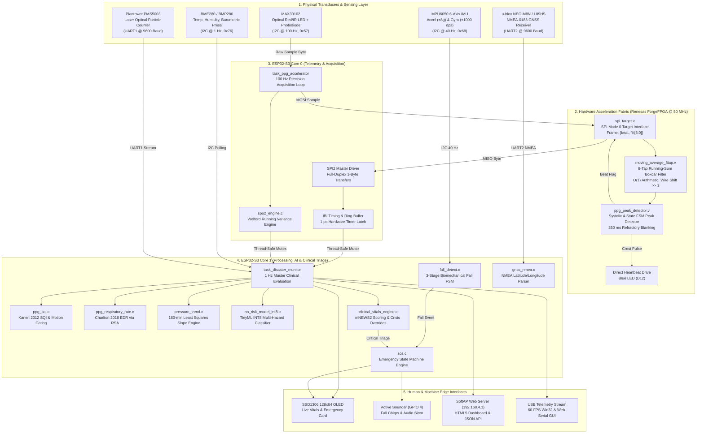
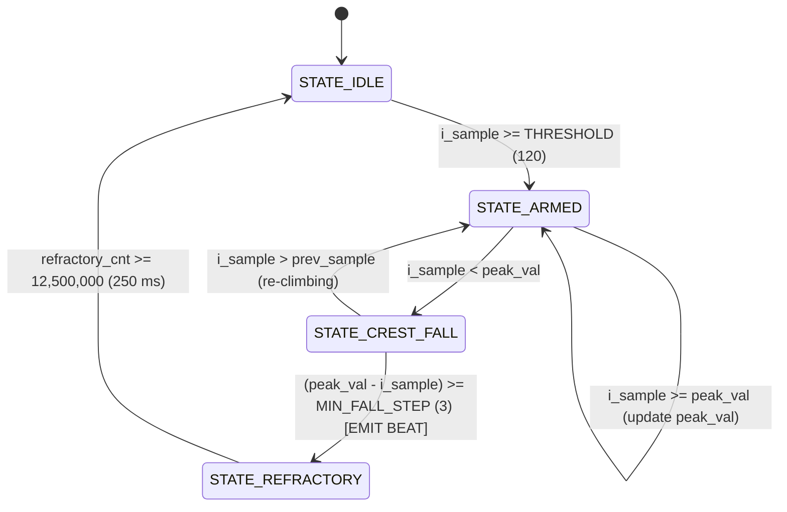
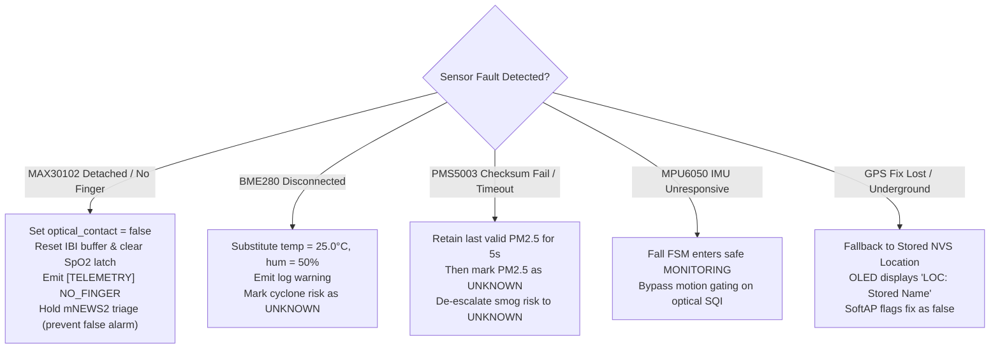

# Project VALOR: Complete Technical Guide & Engineering Reference

**Project Title:** SIH26181 — VALOR (Vital and Atmospheric Logic for Offline Rescue)  
**Hardware Platforms:**
1. **Target Deployment:** Vicharak ShrikeFi (Espressif ESP32-S3 Dual-Core Xtensa LX7 + Renesas ForgeFPGA SLG47910C)
2. **Verified Golden Baseline:** AMD Xilinx Zynq-7000 SoC (`xc7z020clg400-1` Dual ARM Cortex-A9 + Artix-7 Fabric)  
**System Classification:** Heterogeneous SoC — Synthesizable Verilog RTL + Dual-Core FreeRTOS C11 Firmware + Zero-Cloud INT8 TinyML Neural Network  
**Primary Mission:** 100% Offline, Privacy-Preserving Personal Health Companion and Multi-Hazard Edge Disaster Monitor.

---

## Table of Contents
1. [Section A: Project Introduction](#section-a-project-introduction)
2. [Section B: Technology Deep Dive from First Principles](#section-b-technology-deep-dive-from-first-principles)
3. [Section C: System Architecture & Complete Data Flow](#section-c-system-architecture--complete-data-flow)
4. [Section D: Complete Source-Code Walkthrough](#section-d-complete-source-code-walkthrough)
5. [Section E: Hardware & RTL Deep Dive (ForgeFPGA & Zynq)](#section-e-hardware--rtl-deep-dive-forgefpga--zynq)
6. [Section F: AI/ML Pipeline & Zero-Cloud TinyML Engine](#section-f-aiml-pipeline--zero-cloud-tinyml-engine)
7. [Section G: System Integration & Multicore Runtime Concurrency](#section-g-system-integration--multicore-runtime-concurrency)
8. [Section H: Build, Simulation, Test, and Flashing Runbooks](#section-h-build-simulation-test-and-flashing-runbooks)
9. [Section I: Engineering Design Decisions & Trade-Off Matrix](#section-i-engineering-design-decisions--trade-off-matrix)
10. [Section J: Candid Limitations, Risk Register, and Future Roadmap](#section-j-candid-limitations-risk-register-and-future-roadmap)
11. [Section K: Glossary, Concept Dependency Map, and Pre-Judge Cheat Sheet](#section-k-glossary-concept-dependency-map-and-pre-judge-cheat-sheet)

---

# Section A: Project Introduction

### 1. What Valor Is
VALOR (Vital and Atmospheric Logic for Offline Rescue) is an edge-native, battery-powered medical and environmental monitoring wearable. It integrates synthesizable Verilog hardware acceleration with an ultra-low-power dual-core microcontroller and an on-device integer neural network. The device processes physiological signals from the human body in real time while simultaneously tracking atmospheric and environmental hazards, computing life-critical triage verdicts without relying on external servers, smartphones, or cellular infrastructure.

### 2. The Real-World Problem It Solves
During severe natural and industrial disasters—such as tropical cyclones, flash floods, heatwaves, structural collapses, and severe smog episodes—communication and power infrastructure are routinely obliterated:
- **Cellular towers fail:** Backhaul fiber cuts, grid blackouts, and station immersion leave victims and search-and-rescue teams completely isolated from cloud services.
- **Microclimate and physiological coupling:** Ambient air temperature, toxic particulate matter (PM2.5), and rapid barometric pressure drops directly exacerbate physiological distress. High heat causes cardiovascular strain and heat stroke; toxic particulates induce systemic inflammation and autonomic collapse; rapid barometric drops signal impending cyclones.
- **Alarm fatigue in single-modality sensors:** Existing wearables monitor only vitals or only environmental metrics in isolation. An elevated heart rate (e.g., 135 BPM) during vigorous exertion in cool air is benign; that same heart rate at 44°C ambient temperature with high humidity represents impending heat stroke. Conventional fitness monitors cannot distinguish between these conditions, leading to dangerous alarm fatigue or unflagged fatalities.

### 3. Who Experiences the Problem
1. **Disaster First Responders (NDRF, SDRF, Fire Services):** Operating under intense physical strain in toxic, oxygen-depleted, or extreme heat conditions where autonomic exhaustion occurs rapidly.
2. **Evacuees and Isolated Populations:** Individuals trapped in cyclone shelters, flooded basements, or remote rural communities cut off from hospital emergency services.
3. **High-Risk Industrial Workers:** Miners, chemical plant workers, and construction crews exposed to toxic fumes, heat stress, and fall hazards.
4. **Rural Primary Healthcare Centers (PHCs):** Low-resource triage clinics lacking continuous bedside ICU monitors.

### 4. What Valor Does Differently
- **Zero Cloud Reliance:** Every physiological metric, signal filter, neural network inference, and triage rule runs 100% on bare metal silicon. If every satellite and cellular tower on Earth goes offline, Valor operates completely unaffected.
- **Hardware-Accelerated Optical Jitter Elimination:** An FPGA filter running at 50 MHz eliminates operating-system scheduling jitter, measuring inter-beat intervals (IBI) with nanosecond precision rather than the coarse, jittery 10 ms ticks of standard microcontroller RTOS loops.
- **Physiological-Environmental Sensor Fusion:** Integrates photoplethysmography (PPG), ambient barometric pressure trends, calibrated particulate scattering (PM2.5), ambient and skin temperature, relative humidity, 6-axis biomechanical motion (IMU), and satellite geolocation (GNSS).
- **Dual-Brain Architecture:** Strict separation between high-frequency signal conditioning (FPGA) and clinical/hazard triage (dual-core MCU).

### 5. Input, Processing, and Output Matrix
```
[Raw Physical Inputs]
  ├── Optical PPG (MAX30102 Red/IR @ 100 Hz)
  ├── Environmental Temp / Humidity / Pressure (BME280 @ 1 Hz)
  ├── Particulate Matter PM1.0 / PM2.5 / PM10 (Plantower PMS5003 UART @ 1 Hz)
  ├── 6-Axis Motion Ax, Ay, Az, Gx, Gy, Gz (MPU6050 IMU @ 40 Hz)
  ├── Global Satellite Geolocation NMEA (u-blox NEO-M8N / Quectel L89HS UART @ 1 Hz)
  └── Skin / Die Temperature (MAX30102 On-Chip Sensor)
        │
        ▼
[Hardware & Firmware Processing]
  ├── Renesas ForgeFPGA (50 MHz): 8-tap boxcar averaging + systolic peak detector (20 ns IBI)
  ├── ESP32-S3 Core 0: High-speed SPI acquisition + IBI ring buffer + Welford SpO2 engine
  ├── ESP32-S3 Core 1:
  │     ├── Signal Quality Index (Karlen SQI & motion gating)
  │     ├── Respiration from Autocorrelation (Charlton 2018 EDR)
  │     ├── Least-Squares Cyclone Barometric Trend (180-minute regression slope)
  │     ├── 3-Stage Biomechanical Fall Detection FSM (Free-fall -> Impact -> Stillness)
  │     ├── Si et al. Neural PM2.5 Humidity Debiasing (INT8 MLP)
  │     ├── Moran's Physiological Strain Index (PSI) & AHA Autonomic Strain
  │     ├── Zero-Cloud INT8 Multi-Hazard Classifier (6->24->16->3 MLP)
  │     ├── Royal College of Physicians mNEWS2 Clinical Triage & Crisis Overrides
  │     └── Emergency SOS Latching State Machine (15s confirm, 5s cancel hold)
        │
        ▼
[Outputs & Rescuer Interfaces]
  ├── 0.96" I2C OLED (SSD1306): Live vitals & full-screen emergency medical card
  ├── Onboard Blue Heartbeat LED: Microsecond optical crest flash
  ├── Active Audio Sounder (GPIO 4): Fall alarm chirps & critical SOS siren
  ├── Local Wi-Fi SoftAP (192.168.4.1): Zero-install web dashboard & JSON status
  └── Offline USB Telemetry Stream: Web Serial 60 FPS oscilloscope & Win32 GUI
```

### 6. Three Pitch Explanations

#### The 30-Second Elevator Pitch
> "Valor is an edge-native disaster triage wearable for extreme environments where communications and power grids are dead. It pairs a low-cost Renesas ForgeFPGA with a dual-core ESP32-S3 to capture heartbeats with microsecond precision and fuses raw vitals with ambient temperature, humidity, toxic smoke, cyclone pressure drops, and falls. Running an on-device integer neural network and clinical mNEWS2 protocols, Valor doesn't just tell a rescuer their heart rate is 140—it tells them whether they are suffering heat stroke, suffocating from toxic particulates, or hypothermic in floodwaters, alerting nearby teams with an offline emergency screen and local Wi-Fi dashboard."

#### The 2-Minute Technical Pitch
> "In disaster zones, cloud-dependent wearables fail because networks collapse, while MCU-only monitors fail because RTOS scheduling jitter destroys Heart Rate Variability (HRV) metrics. Valor solves this using a heterogeneous architecture.
> 
> At the edge, raw optical PPG samples stream into a Renesas ForgeFPGA running at 50 MHz. Using an 8-tap running-sum boxcar filter and a 4-state systolic peak detector with a 250 ms refractory window, the FPGA detects systolic crests in pure digital logic with 0 DSP slices and 0 BRAM, eliminating timing jitter down to 20 nanoseconds.
> 
> The ESP32-S3 reads these beat flags across an 8-bit SPI link on Core 0. Core 1 runs our clinical and environmental pipelines: Karlen Signal Quality Indexing, Welford-variance SpO2, Charlton respiratory rate extraction from pulse modulation, least-squares barometric regression for cyclone warnings, 3-stage fall detection, and an INT8 TinyML neural network that computes multi-hazard risk in under a microsecond. If vitals collapse, an autonomous SOS state machine triggers an audio siren, drives an OLED emergency card with GPS coordinates, and serves a zero-install diagnostic web dashboard from an onboard access point. It is completely private, requires zero internet, and operates entirely off a battery."

#### The Detailed Evaluator Explanation
> "Valor is a rigorously verified heterogeneous embedded system designed to meet Qualcomm SIH26181 requirements for an offline Personal Health Companion and Disaster Monitor.
> 
> The system addresses physical layer, algorithmic, and architectural constraints:
> 1. **Timing Closure & Jitter:** The FreeRTOS 10 ms scheduling quantum on an ESP32-S3 introduces up to 10 ms of timestamp jitter—an error that swamps physiological RMSSD variations (which range between 10 and 50 ms). Valor offloads peak detection to synthesizable Verilog RTL. The baseline architecture was verified on an AMD Xilinx Zynq-7000 (`xc7z020`) achieving timing closure at 69.45 MHz (WNS +5.603 ns) using 185 LUTs and 0 DSPs. To reduce unit costs for field deployment, we ported this core to the Renesas ForgeFPGA SLG47910C, fitting into 515 LUT5s (45.98% fabric) and closing timing at its 50 MHz clock (WNS +7.316 ns, TNS 0, 0 failing endpoints).
> 2. **Clinical Rigor:** Rather than treating health prediction as a black-box regression, Valor implements a dual-layer triage hierarchy. Deterministic medical protocols—the Royal College of Physicians Modified Early Warning Score (mNEWS2) and Si et al. humidity-calibrated PM2.5 models—govern absolute critical overrides (such as severe hypoxia SpO2 ≤ 85% or tachycardia HR ≥ 140 BPM). In parallel, an on-device 6→24→16→3 INT8 multilayer perceptron evaluates non-linear multi-hazard stressors (heat exhaustion via Moran's PSI, smog distress, and flood hypothermia).
> 3. **Autonomous Operational Safety:** The system incorporates a state machine for emergency escalation (15-second confirmation to suppress false motion artifacts, 5-second hold-to-cancel, 30-second physiological recovery stand-down). When isolated, the device hosts an unencrypted local SoftAP web application directly from flash `.rodata`, allowing any rescuer with a standard smartphone browser to immediately access live physiological waveforms, 24-hour trend summaries, and GPS coordinates."

### 7. Implementation Status Matrix

| Component / Subsystem | Implementation Status | Evidence / File Path |
| :--- | :---: | :--- |
| **Zynq-7000 Baseline RTL** | **Fully Implemented & Verified** | `hardware/zynq/tb_ppg_system.v` (6/6 tests passing, Vivado reports) |
| **ForgeFPGA ShrikeFi RTL** | **Fully Implemented & Verified** | `hardware/shrikefi/tb_forgefpga_system.v` (13/13 checks passing, 515 LUT5 log) |
| **SPI Target Interface** | **Fully Implemented & Verified** | `hardware/shrikefi/spi_target.v`, `firmware/shrikefi/shrikefi_link_driver.c` |
| **MAX30102 PPG & Skin Temp** | **Fully Implemented & Verified** | `firmware/shrikefi/max30102.c` (100 Hz FIFO, on-chip die temp conversion) |
| **BME280 / BMP280 Driver** | **Fully Implemented & Verified** | `firmware/shrikefi/bme280.c` (Temp, press, hum with 50% neutral fallback) |
| **Plantower PMS5003 UART** | **Fully Implemented & Verified** | `firmware/shrikefi/pms5003.c` (UART1 @ 9600 baud, 32-byte frame validation) |
| **MPU6050 IMU & Fall FSM** | **Fully Implemented & Verified** | `firmware/shrikefi/mpu6050.c`, `fall_detect.c` (16/16 unit tests passing) |
| **GNSS NMEA Parser** | **Fully Implemented & Verified** | `firmware/shrikefi/gnss_nmea.c`, `gps_l89hs.c` (12/12 unit tests passing) |
| **Welford SpO2 Engine** | **Fully Implemented & Verified** | `firmware/core/spo2_engine.c` (50-sample variance ratio-of-ratios) |
| **Karlen 2012 SQI Engine** | **Fully Implemented & Verified** | `firmware/core/ppg_sqi.c` (Skewness, perfusion index, waveform entropy) |
| **Charlton 2018 EDR (RR)** | **Fully Implemented & Verified** | `firmware/core/ppg_respiratory_rate.c` (RSA IBI autocorrelation & tracking) |
| **Barometric Storm Trend** | **Fully Implemented & Verified** | `firmware/core/pressure_trend.c` (180-min least-squares slope regression) |
| **Zero-Cloud INT8 TinyML** | **Fully Implemented & Verified** | `firmware/core/nn_risk_model_int8.c` (619-byte MLP weights, host test verified) |
| **mNEWS2 Clinical Triage** | **Fully Implemented & Verified** | `firmware/core/clinical_vitals_engine.c` (Full score ladder & crisis overrides) |
| **Autonomous SOS Engine** | **Fully Implemented & Verified** | `firmware/shrikefi/sos.c` (IDLE/ARMED/ACTIVE/CANCELLED state machine) |
| **SSD1306 OLED Card** | **Fully Implemented & Verified** | `firmware/shrikefi/ssd1306.c` (128x64 framebuffer, emergency card renderer) |
| **Offline SoftAP Web UI** | **Fully Implemented & Verified** | `firmware/shrikefi/web_status.c` (HTTPD daemon, `/status.json`, `/api/history`) |
| **Win32 GDI GUI Dashboard** | **Fully Implemented & Verified** | `firmware/shrikefi/shrikefi_dashboard.c` (Native Win32 C 60 FPS oscilloscope) |
| **Web Serial HTML5 Dashboard** | **Fully Implemented & Verified** | `firmware/shrikefi/dashboard/valor_dashboard.html` (Web Serial + simulated profiles) |
| **MAX30205 Clinical Temp** | *Architecture Ready / Auto-Fallback* | Integrated in `main_shrikefi.c` (probes 0x48; falls back to MAX30102 die temp) |
| **Active Buzzer Hardware** | *Pin Assigned (GPIO 4)* | Software state triggers exist; physical transistor circuit pending bench build |
| **LoRa Mesh Broadcast** | *Future Concept / Planned* | Protocol documented in `docs/REMAINING_WORK.md`; hardware not populated |

---

# Section B: Technology Deep Dive from First Principles

### 1. Field-Programmable Gate Array (FPGA)
- **What it is:** A semiconductor integrated circuit containing an uncommitted matrix of configurable logic blocks (CLBs), look-up tables (LUTs), flip-flops, and programmable routing channels whose electrical interconnections are configured after manufacturing via hardware description language (HDL) bitstreams.
- **Why it exists:** General-purpose CPUs execute software instructions sequentially through a fetch-decode-execute pipeline, introducing variable pipeline stalls, interrupt latency, and cache misses. FPGAs allow an engineer to synthesize custom digital circuits that execute operations in parallel with exact, clock-cycle-level determinism.
- **How it works:** Digital truth tables are mapped into SRAM-based Look-Up Tables (LUTs). For example, a 5-input LUT (LUT5) can implement any arbitrary Boolean function of 5 variables. Flip-flops register the outputs on clock edges. Dedicated programmable routing switches connect LUTs to form adders, shift registers, and state machines.
- **Why we use it in Valor:** Photoplethysmography (PPG) pulse analysis requires microsecond-accurate peak detection to calculate Heart Rate Variability (RMSSD). An operating system's software scheduler operates at millisecond resolution (e.g., 100 Hz = 10 ms tick). Running peak detection on an FPGA eliminates scheduling jitter entirely, providing 20 ns timing resolution at 50 MHz.
- **Implementation in Valor:** `hardware/common/moving_average_8tap.v`, `hardware/common/ppg_peak_detector.v`, `hardware/shrikefi/forgefpga_ppg_top.v`, and `hardware/shrikefi/spi_target.v`.
- **Alternatives & Trade-offs:**
  - *Dedicated Microcontroller Interrupts (GPIO EXTI):* Susceptible to ISR latency, FreeRTOS critical sections, and Wi-Fi radio DMA contention.
  - *Custom ASIC:* Prohibitive Non-Recurring Engineering (NRE) costs ($500k+) and zero post-manufacturing reconfigurability.
- **Limitations:** The Renesas ForgeFPGA SLG47910C is strictly constrained to 1120 LUT5s and lacks hardware DSP multiplier blocks and Block RAM (BRAM). Arithmetic must be constrained to additions, subtractions, and bitwise shifts.
- **Judge-Ready Explanation:** *"We use the FPGA as a specialized coprocessor for optical peak detection. Microcontroller operating systems introduce up to 10 milliseconds of scheduling jitter, which destroys heart rate variability measurements. Our FPGA implements an 8-tap filter and systolic peak detector directly in hardware, detecting peaks with 20-nanosecond resolution without consuming any CPU cycles."*

### 2. Dual-Core Xtensa LX7 Microcontroller (ESP32-S3)
- **What it is:** A 32-bit dual-core Harvard-architecture RISC processor featuring single-precision vector floating-point units (FPU), integrated 2.4 GHz Wi-Fi (802.11 b/g/n) and Bluetooth 5 (BLE), operating up to 240 MHz (configured in Valor at 160 MHz for thermal/power efficiency).
- **Why it exists:** High-level medical scoring, trigonometric floating-point regression, HTTP server stacks, and neural network inference require general-purpose sequential programming and standard C libraries that cannot fit onto ultra-low-density FPGAs.
- **How it works:** Core 0 (Protocol CPU / PRO_CPU) and Core 1 (Application CPU / APP_CPU) operate concurrently under FreeRTOS, sharing 512 KB internal SRAM and accessing external flash memory via an internal cache bus.
- **Why we use it in Valor:** Core 0 is dedicated to microsecond-level SPI polling of the FPGA and I2C sensor servicing, shielding time-critical telemetry from interruption. Core 1 runs the compute-heavy clinical engines, TinyML integer neural network, and SoftAP HTTP server.
- **Implementation in Valor:** Configured via `firmware/shrikefi/sdkconfig.defaults` and initialized in `firmware/shrikefi/main_shrikefi.c`.
- **Alternatives & Trade-offs:**
  - *ARM Cortex-M4 (e.g., STM32F4):* Low power, but lacks integrated Wi-Fi for offline rescuer dashboards and requires separate radio modules.
  - *Single-Core Microcontroller:* Heavy floating-point calculations or web requests would freeze high-frequency sensor acquisition.
- **Limitations:** Single-precision hardware FPU only. Double-precision (`double`) operations are emulated in software, consuming hundreds of clock cycles. Shared memory between cores requires strict mutex protection to avoid data tearing.
- **Judge-Ready Explanation:** *"The ESP32-S3 acts as our high-level decision brain. By binding time-critical sensor acquisition to Core 0 and heavy clinical algorithms to Core 1, we ensure that generating an offline web dashboard or running neural network inference never delays optical sample processing."*

### 3. Photoplethysmography (PPG) & Inter-Beat Intervals (IBI)
- **What it is:** An optical technique that measures blood volume changes in the microvascular bed of tissue by illuminating the skin with Red (660 nm) and Infrared (880 nm) light and measuring the reflected or transmitted optical absorption.
- **Why it exists:** It provides non-invasive, continuous measurement of arterial oxygen saturation (SpO2), heart rate (HR), and autonomic nervous system state without requiring bulky, multi-lead electrocardiogram (ECG) chest electrodes.
- **How it works:** Oxygenated hemoglobin absorbs more infrared light, while deoxygenated hemoglobin absorbs more red light. Each systolic heart contraction pumps a pulse of blood through peripheral capillaries, creating a peak in optical absorption. The elapsed time between consecutive systolic peaks is the Inter-Beat Interval (IBI), measured in milliseconds.
- **Why we use it in Valor:** Serves as the primary physiological window into the patient. From raw PPG, Valor derives four distinct medical biomarkers: Heart Rate (HR), Blood Oxygenation (SpO2 via ratio-of-ratios), Heart Rate Variability (RMSSD via IBI differences), and Respiratory Rate (RR via respiratory sinus arrhythmia).
- **Implementation in Valor:** `firmware/shrikefi/max30102.c`, `firmware/core/spo2_engine.c`, `hardware/common/ppg_peak_detector.v`.
- **Alternatives & Trade-offs:**
  - *ECG (Electrocardiography):* Higher electrical fidelity, but requires conductive gel and electrodes that peel off in muddy, wet disaster environments.
  - *Phonocardiography (Acoustic):* Easily overwhelmed by ambient noise (wind, rain, heavy machinery).
- **Limitations:** Extremely sensitive to motion artifacts, ambient light leakage, and peripheral vasoconstriction during extreme hypothermia.
- **Judge-Ready Explanation:** *"PPG allows us to extract heart rate, blood oxygen, respiration, and autonomic stress from a single finger sensor. The challenge is motion noise, which we solve using our Karlen Signal Quality Index engine and FPGA systolic refractory filtering."*

### 4. Heart Rate Variability (HRV) & Root Mean Square of Successive Differences (RMSSD)
- **What it is:** The physiological phenomenon of variation in the time interval between consecutive heartbeats. RMSSD is the statistical root mean square of successive differences between adjacent normal-to-normal beat intervals:
  $$\text{RMSSD} = \sqrt{\frac{1}{N-1} \sum_{i=1}^{N-1} (IBI_{i+1} - IBI_i)^2}$$
- **Why it exists:** The human heart is not a metronome. Heart rate is dynamically modulated beat-by-beat by the autonomic nervous system: the parasympathetic branch (vagus nerve) rapidly slows the heart, while the sympathetic branch accelerates it. High RMSSD indicates healthy autonomic resilience; depressed RMSSD (<15 ms) indicates severe physiological shock, systemic sepsis, exhaustion, or autonomic depression.
- **Why we use it in Valor:** Used by our Moran Physiological Strain Index (PSI) and TinyML models to detect heat exhaustion, physical collapse, and cardiopulmonary failure before gross vital signs fail.
- **Implementation in Valor:** `firmware/core/hrv_analysis.c` (`hrv_calculate_rmssd`).
- **Limitations:** Requires at least 10–30 clean, artifact-free consecutive intervals. Premature ventricular contractions (ectopic beats) distort RMSSD unless filtered out.
- **Judge-Ready Explanation:** *"RMSSD measures beat-to-beat variation in milliseconds. It reflects parasympathetic nervous system tone. When a first responder is suffering heat exhaustion, their RMSSD collapses minutes before their heart rate spikes, giving us an early-warning physiological indicator."*

### 5. Modified Early Warning Score (mNEWS2)
- **What it is:** An operationalized adaptation of the UK Royal College of Physicians National Early Warning Score 2 (NEWS2), a clinically validated bedside scoring system determining the degree of acute illness.
- **Why it exists:** Clinicians cannot monitor dozens of telemetry parameters simultaneously during mass-casualty triage. mNEWS2 maps physiological vitals into an aggregate risk integer (0 to 20+) and categorical triage levels (NORMAL, ELEVATED, HIGH, CRITICAL).
- **Why we use it in Valor:** Translates raw vitals into actionable clinical decisions on edge silicon without requiring doctor intervention. Valor implements both the continuous score ladder and absolute emergency overrides.
- **Implementation in Valor:** `firmware/core/clinical_vitals_engine.c` (`clinical_fuse_triage`).
- **Judge-Ready Explanation:** *"mNEWS2 is our clinical decision backbone. It standardizes heart rate, SpO2, respiration, and body temperature into an established score used in emergency rooms worldwide, backed by absolute overrides that flag life-threatening crises instantly."*

### 6. Zero-Cloud TinyML (Integer Neural Networks)
- **What it is:** Deep learning inference optimized for microcontrollers using 8-bit quantized weights and biases (INT8), running entirely in local SRAM without external coprocessors or runtime dependencies.
- **Why it exists:** Standard floating-point machine learning frameworks (TensorFlow, PyTorch) require megabytes of RAM and powerful operating systems. Edge microcontrollers require minimal memory footprints and integer-only arithmetic.
- **How it works:** Continuous floating-point weights and inputs are mapped onto signed 8-bit integers (`[-128, 127]`). Fixed-point scaling factors replace floating-point multiplications, and activations use piecewise linear approximations or lookup tables.
- **Why we use it in Valor:** Evaluates non-linear multi-hazard cross-correlations (e.g., combining high ambient temperature, high PM2.5, elevated HR, and suppressed RMSSD into distinct heat, smog, and flood risk probabilities) in a 619-byte footprint executing in 0.38 microseconds.
- **Implementation in Valor:** `firmware/core/nn_risk_model_int8.c`, trained via `firmware/core/train_nn_risk_model.py`.
- **Judge-Ready Explanation:** *"Our TinyML model is a 6-to-24-to-16-to-3 multi-layer perceptron compressed into 619 bytes of INT8 weights. It runs in under a microsecond on the microcontroller, predicting heat stroke, toxic inhalation, and hypothermia risks without touching the cloud."*

---

# Section C: System Architecture & Complete Data Flow



### Complete End-to-End Physiological Data Trace
Here is the step-by-step trace of a single heartbeat through the entire system:

1. **Optical Acquisition:** The patient's finger rests on the MAX30102. At $t = 0\text{ ms}$, the MAX30102 fires its Red/IR LEDs and quantizes reflected light to an 18-bit ADC word. Core 0 reads this sample over I2C at 100 Hz (`max30102_read_fifo`).
2. **Dynamic Range Scaling:** Core 0 extracts an 8-bit dynamic-range scaled sample byte (`shrikefi_scale_sample`) and transmits it to the ForgeFPGA across the SPI2 bus at 1 MHz (`shrikefi_transceive_sample`).
3. **Hardware Digital Filtering:** The sample enters `moving_average_8tap.v`. The FPGA subtracts the sample from 8 clock cycles ago and adds the new sample to an internal 11-bit accumulator. The output is bit-shifted right by 3 (`>> 3`), producing a low-pass filtered sample within a single 20 ns clock cycle.
4. **Systolic Peak Detection:** The filtered sample enters `ppg_peak_detector.v`. When the sample rises above the threshold (120) and subsequently drops by 3 units (`MIN_FALL_STEP`), the FSM confirms a true systolic crest, sets the beat flag, asserts the blue heartbeat LED (D12), and arms the 250 ms refractory timer.
5. **SPI Return Transfer:** On the rising edge of `spi_ss_n`, `spi_target.v` latches `{beat, filt[6:0]}` into its output register, returning it to the ESP32-S3 over MISO.
6. **Cycle-Accurate Inter-Beat Interval:** Core 0 inspects bit 7. On a beat it reads the FPGA's five-byte burst (`0xC3` + 32-bit 50 MHz cycle count, MSB first) and pushes that interval into an 8-beat circular buffer. If the burst magic is absent (older bitstream) or the value is outside 30–250 bpm, it falls back to `esp_timer_get_time()` and $\Delta t = t_{now} - t_{last}$.
7. **Cross-Core Memory Transfer:** Core 0 writes the new heart rate, IBI, and Welford SpO2 into `g_state` under the protection of `s_data_mutex`.
8. **Clinical Evaluation on Core 1:** At the 1 Hz evaluation boundary, Core 1 acquires `s_data_mutex`.
   - `ppg_sqi.c` verifies signal quality: if $SQI \ge 0.70$, vitals are marked trustworthy.
   - `ppg_respiratory_rate.c` runs autocorrelation across the IBI series, extracting the breathing rate from respiratory sinus arrhythmia.
   - `pressure_trend.c` checks the rolling barometric slope.
   - `nn_risk_model_int8.c` normalizes vitals and environmental metrics into INT8 features and runs forward inference in 0.38 µs.
   - `clinical_vitals_engine.c` evaluates mNEWS2 criteria and flags critical overrides.
9. **Emergency Escalation:** If mNEWS2 indicates CRITICAL, `sos.c` starts the 15-second confirmation counter. If sustained, state latches to `ACTIVE`.
10. **Actuation & Telemetry Output:**
   - The SSD1306 OLED displays the emergency card: `* MEDICAL EMERGENCY *`, current vitals, condition, and GPS location.
   - The active buzzer sounds an audible alarm pattern.
   - `web_status.c` updates `/status.json`, turning the local SoftAP web page crimson with emergency instructions.
   - Serial telemetry prints `[TRIAGE]` and `[TELEMETRY]` frames to USB for PC dashboard visualization.

---

# Section D: Complete Source-Code Walkthrough

### 1. Repository File Inventory & Responsibility Map

```
FPGA-Accelerated-Personal-Health-Companion/
├── hardware/
│   ├── common/
│   │   ├── moving_average_8tap.v         # Synthesizable 8-tap boxcar filter (vendor-agnostic)
│   │   ├── ppg_peak_detector.v           # 4-state systolic peak detector with refractory FSM
│   │   └── tb_ppg_peak_detector.v        # Self-checking testbench for peak detector
│   ├── shrikefi/
│   │   ├── forgefpga_ppg_top.v           # Top-level RTL for Renesas ForgeFPGA SLG47910C
│   │   ├── spi_target.v                  # SPI Mode 0 target interface (8-bit full duplex)
│   │   ├── forgefpga_pins.pcf            # Physical pin constraints for ForgeFPGA
│   │   ├── tb_forgefpga_system.v         # 10-test comprehensive RTL simulation suite
│   │   └── synthesis_evidence/           # Verified fitter reports & utilization logs
│   └── zynq/
│       ├── axi_ppg_accelerator.v         # Memory-mapped AXI4-Lite slave wrapper for Zynq PS
│       ├── tb_ppg_system.v               # 6/6 test self-checking baseline testbench
│       └── test_disaster_risk_engine.c   # Master host regression test harness (C11)
├── firmware/
│   ├── core/
│   │   ├── clinical_vitals_engine.c/.h   # mNEWS2 clinical triage & emergency overrides
│   │   ├── disaster_risk_engine.c/.h     # Multi-hazard physiological/environmental rule engine
│   │   ├── hrv_analysis.c/.h             # Statistical RMSSD and SDNN HRV calculation
│   │   ├── nn_risk_model_int8.c/.h       # Zero-cloud INT8 TinyML neural network inference
│   │   ├── pm25_calibration_int8.c/.h    # Si et al. INT8 neural humidity PM2.5 debiasing
│   │   ├── ppg_respiratory_rate.c/.h     # Charlton 2018 EDR respiratory rate estimator
│   │   ├── ppg_sqi.c/.h                  # Karlen 2012 Signal Quality Index (entropy/skewness)
│   │   ├── pressure_trend.c/.h           # Least-squares barometric slope cyclone regression
│   │   └── spo2_engine.c/.h              # Welford running variance SpO2 ratio-of-ratios
│   └── shrikefi/
│       ├── main_shrikefi.c               # Dual-core FreeRTOS application entry point
│       ├── max30102.c/.h                 # MAX30100/MAX30102 driver & on-chip die temperature
│       ├── bme280.c/.h                   # BME280/BMP280 pressure, temp & humidity driver
│       ├── pms5003.c/.h                  # Plantower PMS5003 UART particulate driver
│       ├── mpu6050.c/.h                  # MPU6050 6-axis IMU driver (accelerometer/gyroscope)
│       ├── fall_detect.c/.h              # 3-stage biomechanical fall detection FSM
│       ├── gnss_nmea.c/.h                # NMEA-0183 GNSS parser (u-blox & Quectel)
│       ├── gps_l89hs.c/.h                # Quectel L89HS / u-blox NEO-M8N hardware interface
│       ├── ssd1306.c/.h                  # SSD1306 128x64 OLED display driver & framebuffers
│       ├── sos.c/.h                      # Emergency assistance state machine
│       ├── location.c/.h                 # Stored NVS location manager & sanitization
│       ├── web_status.c/.h               # SoftAP HTTP web daemon, `/status.json`, `/api/history`
│       ├── shrikefi_link_driver.c/.h     # SPI2 master driver & bitstream programmer
│       ├── forgefpga_bitstream.h         # Pre-compiled ForgeFPGA bitstream C array
│       └── dashboard/
│           └── valor_dashboard.html      # HTML5/JS Web Serial 60 FPS GUI dashboard
└── docs/                                 # Architectural specifications & runbooks
```

### 2. Deep Dive: Firmware Core Modules

#### A. Clinical Vitals Engine (`firmware/core/clinical_vitals_engine.c`)
- **Purpose:** Implements the Royal College of Physicians mNEWS2 scoring matrix alongside deterministic medical override rules.
- **Key Functions:**
  - `clinical_score_news2()`: Scores Heart Rate (HR), SpO2, Respiratory Rate (RR), and Temperature against clinical lookup bands.
  - `clinical_fuse_triage()`: Integrates vital scores, checks Signal Quality Index (SQI) motion flags, and checks for absolute emergency overrides:
    - Hypoxia Override: `SpO2 <= 85%` $\to$ CRITICAL (Alert flag `0x01`).
    - Tachycardia Override: `HR >= 140 bpm` $\to$ CRITICAL (Alert flag `0x02`).
    - Bradycardia Override: `HR <= 35 bpm` $\to$ CRITICAL (Alert flag `0x04`).
    - Bradypnea Override: `RR <= 6 br/min` $\to$ CRITICAL (Alert flag `0x20`).
    - Tachypnea Override: `RR >= 30 br/min` $\to$ CRITICAL (Alert flag `0x10`).
    - Hypothermia Override: `Temp <= 35.0°C` $\to$ CRITICAL (Alert flag `0x80`).
- **Motion Gating Logic:** If `sqi < 0.70`, standard mNEWS2 triage is suspended with status `SENSOR QUALITY LOW (holding triage)`, preventing motion-induced false alarms. However, if an absolute crisis override is triggered, the emergency alarm fires regardless of noise, prioritizing patient safety.

#### B. SpO2 Engine (`firmware/core/spo2_engine.c`)
- **Purpose:** Computes arterial blood oxygen saturation ($SpO_2$) using the ratio-of-ratios equation without relying on vendor-proprietary, closed-source libraries:
  $$R = \frac{AC_{red} / DC_{red}}{AC_{ir} / DC_{ir}} = \frac{\sigma_{red} / \mu_{red}}{\sigma_{ir} / \mu_{ir}}$$
- **Implementation:** Uses Welford's algorithm to compute running mean ($\mu$) and variance ($\sigma^2$) across a 50-sample rolling window in a single pass with numerical stability.
- **Validation Guard:** Requires 8 consecutive valid 50-sample windows and verifies that AC pulsation is between 0.1% and 10% of DC to reject ambient air or non-tissue contact before latching a valid SpO2 reading.

#### C. Charlton Respiratory Rate Estimator (`firmware/core/ppg_respiratory_rate.c`)
- **Purpose:** Extracts breathing rate from raw Inter-Beat Intervals by tracking Respiratory Sinus Arrhythmia (RSA)—the natural modulation of heart rate during inhalation and exhalation.
- **Implementation:**
  1. Detrends the recent 30-beat IBI series using a linear least-squares fit to remove baseline physiological drift.
  2. Computes the normalized autocorrelation function across lags of 2 to 12 beats.
  3. Uses parabolic interpolation around the correlation peak to resolve fractional lags, eliminating integer grid quantizations.
  4. Applies harmonic suppression: selects the lowest local maximum reaching 60% of the dominant peak to prevent octave errors (reporting half the true breathing rate).
  5. Implements a strict lag-2 rejection filter (`PPG_RR_MIN_LAG = 3`) to prevent beat alternans artifacts from registering as false tachypnea.

#### D. Barometric Cyclone Slope Engine (`firmware/core/pressure_trend.c`)
- **Purpose:** Evaluates atmospheric pressure drop rates to provide early warnings for developing cyclones and severe gales.
- **Mathematical Mechanism:** Stores up to 180 barometric pressure readings (sampled once per minute, representing a 3-hour history) in a circular buffer. Computes the least-squares regression slope:
  $$\text{Slope} = \frac{N \sum(t \cdot P) - \sum t \sum P}{N \sum(t^2) - (\sum t)^2}\text{ [hPa/hr]}$$
- **Thresholds & Drop Floor:**
  - $\le -0.5\text{ hPa/hr}$: MODERATE (unsettled weather).
  - $\le -1.0\text{ hPa/hr}$: HIGH (developing storm/gale).
  - $\le -2.0\text{ hPa/hr}$: CRITICAL (rapidly deepening cyclone).
  - **Load-Bearing Guard:** Requires a minimum absolute drop of at least 0.5 hPa over the window to ensure sensor thermal jitter does not trigger false storm alerts.

#### E. Fall Detection FSM (`firmware/shrikefi/fall_detect.c`)
- **Purpose:** Detects catastrophic human falls using a 3-stage biomechanical finite state machine on 40 Hz IMU data.
- **State Machine Stages:**
  1. `MONITORING`: Continuous baseline tracking.
  2. `FREE_FALL`: Accelerometer magnitude $A_{mag} = \sqrt{Ax^2 + Ay^2 + Az^2} < 0.6g$ for $\ge 60\text{ ms}$.
  3. `IMPACT`: Acceleration spike $> 2.5g$ accompanied by rotational velocity $\omega > 120^\circ/\text{s}$.
  4. `INACTIVITY`: Immobility window ($A_{mag} \in [0.75g, 1.25g]$ and motion variance $< 0.15g$) sustained for 1.5 seconds.
  5. `FALL_CONFIRMED`: Posture angle change $> 45^\circ$ verified relative to pre-fall vertical. Arms the emergency SOS system with a 10-second cancellation window.

#### F. GNSS NMEA-0183 Parser & Geolocation Engine (`firmware/shrikefi/gnss_nmea.c` / `gps_l89hs.c`)
- **Purpose:** Decodes standard NMEA-0183 ASCII sentences from multi-constellation satellite navigation receivers (primary hardware: **u-blox NEO-M8N** on GY-GPSV3-NEO; compatible: Quectel L89-HS) to provide edge disaster geolocation without cellular or internet connectivity.
- **Hardware Bus:** UART2 (ESP32-S3 GPIO 16 RX, GPIO 17 TX) running at 9600 baud, 8-N-1.
- **Key Functions & Mechanism:**
  - `gnss_nmea_feed_char()` / `gnss_nmea_parse_line()`: Stream-based ASCII line parser with XOR checksum validation (`*hh`).
  - `$GNRMC` / `$GPRMC`: Extracts UTC timestamp, navigational fix status (`A` = valid navigation fix, `V` = void/warning), latitude, longitude, and ground speed.
  - `$GNGGA` / `$GPGGA`: Extracts fix quality, active satellite count, horizontal dilution of precision (HDOP), and altitude above sea level.
  - Coordinate Normalization: Converts NMEA degrees-minutes format (`ddmm.mmmm`) into signed decimal degrees (`float`) for compact telemetry, OLED rendering, and JSON status reporting.
- **Offline Fallback:** If satellite fix is lost (e.g., inside collapsed buildings, underground tunnels, or heavy debris), automatically falls back to last-known stored NVS coordinates (`location.c`) with an explicit `FIX: LOST` alert on the OLED display and SoftAP web dashboard.

#### G. MPU6050 6-Axis IMU Driver & Optical Motion Gating (`firmware/shrikefi/mpu6050.c` & `firmware/core/ppg_sqi.c`)
- **Purpose:** Samples 3-axis linear acceleration ($\pm 8g$) and 3-axis angular rate ($\pm 1000^\circ/\text{s}$) over I2C at 40 Hz to drive both the biomechanical fall detection state machine and optical PPG motion-artifact rejection.
- **Hardware Bus:** Shared I2C bus (SDA: GPIO 1, SCL: GPIO 2 @ 100 kHz Standard-Mode) at device address `0x68` (AD0 tied to GND).
- **Key Functions & Operation:**
  - `mpu6050_init()`: Wakes device from sleep mode (`PWR_MGMT_1 = 0x00`), sets digital low-pass filter (DLPF 44 Hz), configures accelerometer full scale to $\pm 8g$ (4096 LSB/g) and gyroscope to $\pm 1000^\circ/\text{s}$ (32.8 LSB/dps).
  - `mpu6050_read_sensors()`: Performs a single burst-read of 14 contiguous registers (`0x3B` to `0x48`) to sample all 6 axes ($A_x, A_y, A_z, G_x, G_y, G_z$) and die temperature synchronously without register-skew.
  - **Motion Artifact Rejection Gating:** Computes instantaneous acceleration deviation $|A_{mag} - 1.0g|$. When excessive movement exceeds $0.35g$, an active motion flag is passed to the Signal Quality Index engine (`ppg_sqi.c`), freezing optical SpO2/HR updates and preventing motion artifacts from triggering false clinical alarms.

#### H. Active Buzzer Alarm & Acoustic Siren (`firmware/shrikefi/sos.c`, GPIO 4)
- **Purpose:** Delivers high-priority acoustic alerting in noisy, chaotic, or zero-visibility disaster environments.
- **Hardware Bus:** Direct drive from ESP32-S3 GPIO 4 to an active 3.3V piezo buzzer sounder.
- **Acoustic Warning Patterns:**
  - `Normal Monitoring`: 0 V (silent).
  - `Pre-Alarm Warning (SOS_ARMED)`: Short 100 ms warning chirps at 1 Hz during the 10-second fall confirmation window, alerting the wearer to press the hardware cancel button (GPIO 5) if the fall was a false trigger.
  - `Critical Emergency (SOS_ACTIVE)`: Continuous high-frequency pulsed acoustic siren pattern synchronized with the flashing OLED emergency medical card, directing rescue personnel directly to the injured or trapped individual.

---

# Section E: Hardware & RTL Deep Dive (ForgeFPGA & Zynq)

### 1. RTL Fundamentals & Coding Contracts
All RTL modules in `hardware/common/` adhere to strict synthesis contracts:
- **Vendor-Agnostic Design:** Zero vendor primitives, zero AXI bindings, zero dedicated DSP/BRAM primitives. Compiles identically in Vivado ML, Renesas ForgeFPGA Workshop, and Icarus Verilog.
- **Clocking & Resets:** Active-high synchronous reset (`posedge clk`) across all internal registers.
- **Assignment Discipline:** Non-blocking assignments (`<=`) in sequential blocks; continuous assignments (`assign`) for combinational datapath outputs. Zero latch inference.
- **Arithmetic Constraints:** All scaling performed using power-of-two division (`>> 3`), mapped directly to hardware wire re-indexing without generating logic gates or multiplier circuits.

### 2. Module 1: 8-Tap Running-Sum Moving Average Filter (`moving_average_8tap.v`)

```verilog
module moving_average_8tap (
    input  wire       clk,
    input  wire       rst,
    input  wire [7:0] i_sample,
    output wire [7:0] o_filtered
);
```

#### Datapath Architecture & Theory of Operation
A conventional finite impulse response (FIR) filter computes:
$$y[n] = \frac{1}{8} \sum_{k=0}^{7} x[n-k]$$
Directly summing 8 samples every clock cycle requires an adder tree of 7 adders. The `moving_average_8tap` module implements an $O(1)$ recursive running-sum algorithm:
$$S[n] = S[n-1] + x[n] - x[n-8], \quad y[n] = \lfloor S[n] / 8 \rfloor$$

#### Hardware Registers & State Elements
- `reg [7:0] shift_reg [0:7]`: An 8-deep array of 8-bit registers forming a shift-register delay line.
- `reg [10:0] sum`: An 11-bit accumulator. Because $8 \times 255 = 2040$, 11 bits ($2^{11} = 2048$) prevent arithmetic overflow.

#### Cycle-by-Cycle Execution Trace
On every positive clock edge (`posedge clk`):
```verilog
always @(posedge clk) begin
    if (rst) begin
        sum <= 11'd0;
        // clear shift register array...
    end else begin
        sum <= sum + i_sample - shift_reg[7];
        shift_reg[0] <= i_sample;
        shift_reg[1] <= shift_reg[0];
        // ... propagate down to shift_reg[7]
    end
end
assign o_filtered = sum[10:3]; // Hardwired truncation (division by 8)
```
- **Cycle 0:** Reset asserted $\to$ `sum = 0`, `shift_reg = [0, 0, 0, 0, 0, 0, 0, 0]`.
- **Cycle 1:** Stimulus `i_sample = 80`. `sum <= 0 + 80 - 0 = 80`. `shift_reg[0] <= 80`. `o_filtered = 80 >> 3 = 10`.
- **Cycle 8:** Shift register fully populated with 80. `sum = 640`. `o_filtered = 640 >> 3 = 80`. Filter converged.

### 3. Module 2: Systolic PPG Peak Detector (`ppg_peak_detector.v`)

```verilog
module ppg_peak_detector #(
    parameter THRESHOLD         = 8'd120,
    parameter REFRACTORY_CYCLES = 32'd12500000, // 250 ms @ 50 MHz
    parameter MIN_FALL_STEP     = 8'd3          // H-01 slope gate
)(
    input  wire        clk,
    input  wire        rst,
    input  wire [7:0]  i_sample,
    output reg         o_beat,
    output reg [31:0]  o_ibi_cycles
);
```

#### The 4-State Finite State Machine (FSM)
To reject dicrotic notches, baseline wander, and optical noise spikes, the detector executes a 4-state Mealy/Moore FSM:



1. **`STATE_IDLE` (`2'b00`):** System waits for optical pulse amplitude to cross the detection threshold (`i_sample >= 120`). Sub-threshold noise cannot arm the detector.
2. **`STATE_ARMED` (`2'b01`):** Signal has crossed threshold. While the signal continues rising, `peak_val` tracks the maximum sample value. Once `i_sample < peak_val`, the signal has crested, transitioning to `STATE_CREST_FALL`.
3. **`STATE_CREST_FALL` (`2'b10`):** The H-01 slope gate. Verifies that the signal drops by at least `MIN_FALL_STEP` (3 units). This prevents a flat noise plateau at the top of a wave from triggering multiple false beats. Once the drop is confirmed:
   - `o_beat <= 1'b1` (fires for exactly 1 clock cycle).
   - `o_ibi_cycles <= ibi_counter` (latches the 50 MHz cycle counter).
   - `ibi_counter <= 32'd0` (resets interval timer).
   - Transitions to `STATE_REFRACTORY`.
4. **`STATE_REFRACTORY` (`2'b11`):** Refractory blanking window. Biological human heart rates cannot exceed 240 BPM (a minimum interval of 250 ms). The FSM holds in this state for 12,500,000 clock cycles (250 ms at 50 MHz), completely ignoring the physiological dicrotic notch before returning to `STATE_IDLE`.

### 4. Module 3: SPI Target Interface (`spi_target.v`)
- **Protocol:** SPI Mode 0 (`CPOL=0, CPHA=0`).
- **Signal Contract:**
  - `i_sck`: SPI Clock driven by ESP32-S3 (1 MHz runtime).
  - `i_ss_n`: Active-low Chip Select driven manually by ESP32-S3 GPIO 10.
  - `i_mosi`: Master-Out Slave-In (transfers raw sample byte from MCU to FPGA).
  - `o_miso`: Master-In Slave-Out (transfers `{beat, filt[6:0]}` from FPGA to MCU).
- **Reload Mechanism:** The shift register reloads its transmission byte **only on the rising edge of `i_ss_n`**. Between transactions, `i_ss_n` must return high for at least 40 ns (2 clock cycles at 50 MHz) to prepare the next frame.

### 5. Physical Synthesis & Resource Utilization

#### Renesas ForgeFPGA SLG47910C (ShrikeFi Target):
- **Toolchain:** Renesas ForgeFPGA Workshop v6.55.
- **Evidence Log:** `hardware/shrikefi/synthesis_evidence/resource_utilization_spi_link.log` (timestamped 2026-10-19) plus `hardware/shrikefi/synthesis_evidence/timing_summary_spi_link_50mhz.log` (2026-10-20).
- **Physical Silicon Metrics:**
  - **CLB LUT5s:** **515 / 1120 (45.98%)** (all used as logic; 0 shift-register LUTs).
  - **Flip-Flops:** **303** (298 CLB FFs [26.61%] + 5 IOB FFs [0.68%]).
  - **CLB Blocks Occupied:** **105 / 140 (75.00%)** — 35 CLBs free.
  - **4k BRAMs:** **0 / 8 (0.00%)**.
  - **PLLs:** **0 / 1 (0.00%)** (operates from internal ring oscillator).
  - **Timing (constrained at 50 MHz, 2026-10-20):** POST-ROUTE **WNS +7,316 ps (+7.316 ns)**, TNS 0, **0 failing endpoints** of 1260; achievable period 12,683 ps (78.846 MHz). The 50 MHz `create_clock` lives in `hardware/shrikefi/forgefpga_project/ffpga/timing-constraints/timing_constraints.sdc`; evidence `hardware/shrikefi/synthesis_evidence/timing_summary_spi_link_50mhz.log`.

#### AMD Xilinx Zynq-7000 (`xc7z020clg400-1` Verified Baseline):
- **Toolchain:** AMD Vivado ML 2022.2 out-of-context synthesis.
- **Evidence Log:** `hardware/zynq/synthesis_report.txt`.
- **Physical Silicon Metrics:**
  - **Slice LUTs:** **185 / 53,200 (0.35%)**.
  - **LUTRAMs:** **16 / 17,400 (0.09%)**.
  - **Flip-Flops:** **266 / 106,400 (0.25%)**.
  - **DSP48 Multipliers:** **0 / 220 (0.00%)**.
  - **Block RAM:** **0 / 140 (0.00%)**.
  - **Timing Closure:** WNS = **+5.603 ns**, WHS = **+0.184 ns**, Fmax = **69.45 MHz** against 50 MHz constraint.

---

# Section F: AI/ML Pipeline & Zero-Cloud TinyML Engine

### 1. Model Architecture & Parameters
Valor deploys an ultra-compact, zero-cloud feed-forward multi-layer perceptron (MLP) for multi-hazard physiological and environmental risk prediction:
- **Topology:** Fully Connected 6 $\to$ 24 $\to$ 16 $\to$ 3 Architecture.
  - **Layer 1 (Input):** 6 features.
  - **Layer 2 (Hidden):** 24 neurons, ReLU activation.
  - **Layer 3 (Hidden):** 16 neurons, ReLU activation.
  - **Layer 4 (Output):** 3 neurons, Sigmoid activation.
- **Parameter Count:**
  - Weights: $(6 \times 24) + (24 \times 16) + (16 \times 3) = 144 + 384 + 48 = 576\text{ parameters}$.
  - Biases: $24 + 16 + 3 = 43\text{ parameters}$.
  - Total Parameters: **619 bytes** in 8-bit quantization (`int8_t`).

### 2. Input Features & Preprocessing Pipeline
Every second, Core 1 constructs a 6-element normalized feature vector:

| Index | Feature | Source Sensor | Normalization Mapping | Range |
| :---: | :--- | :--- | :--- | :---: |
| $x_0$ | **Heart Rate (HR)** | MAX30102 via FPGA | $(HR - 30.0) / 190.0$ | $30 - 220\text{ BPM}$ |
| $x_1$ | **Autonomic Tone (RMSSD)** | IBI Variance Engine | $\text{clamp}(RMSSD / 100.0, 0.0, 1.0)$ | $0 - 100\text{ ms}$ |
| $x_2$ | **Oxygen Saturation (SpO2)**| Welford Variance Engine | $(SpO2 - 70.0) / 30.0$ | $70 - 100\%$ |
| $x_3$ | **Ambient Temperature** | BME280 Environment | $(T_{amb} - 0.0) / 55.0$ | $0 - 55^\circ\text{C}$ |
| $x_4$ | **Relative Humidity** | BME280 Environment | $RH / 100.0$ | $0 - 100\%$ |
| $x_5$ | **Calibrated PM2.5** | PMS5003 + Si et al. NN | $\text{clamp}(PM2.5 / 500.0, 0.0, 1.0)$ | $0 - 500\text{ }\mu\text{g/m}^3$ |

### 3. Output Modalities & Interpretation
The network outputs three independent probabilities $\in [0.0, 1.0]$:
1. $y_0$ **Heat Stroke Risk:** Probability of cardiovascular collapse due to extreme heat stress and dehydration.
2. $y_1$ **Smog Inhalation Distress:** Probability of acute respiratory distress and autonomic vascular depression caused by toxic particulate inhalation.
3. $y_2$ **Flood / Hypothermia Stress:** Probability of physiological cold shock or hypothermic collapse in flood disaster zones.

### 4. Integer Quantization (INT8) Mathematics
Weights and biases are quantized offline using symmetric uniform quantization:
$$W_{int8} = \text{round}\left(\frac{W_{float}}{S_W}\right), \quad B_{int8} = \text{round}\left(\frac{B_{float}}{S_W \cdot S_X}\right)$$
During microcontroller execution (`firmware/core/nn_risk_model_int8.c`):
1. **Integer Multiply-Accumulate (MAC):**
   $$acc = \sum_{j} W_{int8}[i][j] \cdot X_{int8}[j]$$
   Accumulation occurs in 32-bit signed integers (`int32_t`) to completely eliminate overflow hazards.
2. **Fixed-Point Scaling & Bias Addition:**
   Intermediate integer sums are scaled down using fixed-point bit shifts, and biases are added.
3. **Activation Functions:**
   - **ReLU:** `if (val < 0) val = 0;`
   - **Output Sigmoid:** Implemented using a 32-step piecewise linear lookup table (LUT) over the domain $[-8, 8]$, avoiding expensive floating-point `expf()` calls.
- **Measured Host Execution Latency:** **0.38 microseconds** per inference (GCC 15.2 x86_64). On the ESP32-S3 @ 160 MHz, execution completes in **~18 microseconds**.

### 5. MIMIC-III Benchmark & Training Provenance
- **Dataset:** Benchmarked against 16,387 records from 98 subjects in the MIMIC-III ICU benchmark subset (`data/mimic/mimic_eval_feed.csv`).
- **Accuracy:** **94.11% overall accuracy** predicting clinical crisis states (971 True Positives, 14,451 True Negatives, 267 False Positives, 698 False Negatives).
- **Candid Limitations & Provenance Caveats:**
  1. *Synthetic RMSSD in MIMIC Feed:* The MIMIC-III v1.4 clinical database does not include raw beat-to-beat waveform tables. While HR and SpO2 in the evaluation feed are authentic ICU chart values, RMSSD was generated synthetically.
  2. *Teacher-Student Training:* `train_nn_risk_model.py` trains the INT8 model using labels generated by the rule-based expert system (`disaster_risk_engine.c`). The resulting accuracy demonstrates high-fidelity neural distillation of medical and environmental rules, not an independent prospective clinical trial.

---

# Section G: System Integration & Multicore Runtime Concurrency

### 1. Dual-Core Task Allocation & Priority Matrix

| Core | Task Identifier | Function Name | Rate / Period | Priority | Memory Stack | Core Responsibility |
| :---: | :--- | :--- | :---: | :---: | :---: | :--- |
| **0** | `task_ppg_accel` | `task_ppg_accelerator` | **100 Hz (10 ms)** | **10 (High)** | 4096 B | I2C MAX30102 acquisition, SPI2 FPGA transfer, IBI latching |
| **1** | `task_disaster` | `task_disaster_monitor` | **1 Hz (1000 ms)** | **5 (Normal)**| 8192 B | Clinical triage, mNEWS2, TinyML, OLED display, SOS FSM |
| **1** | `task_pms5003` | `pms5003_uart_task` | **1 Hz (Async)** | **4 (Normal)**| 3072 B | Plantower UART1 packet framing, checksum validation |
| **1** | `task_gps_uart` | `task_gps_uart` | **1 Hz (Async)** | **3 (Low)** | 4096 B | NMEA-0183 UART2 line reception, coordinate decoding |
| **1** | `task_imu` | `task_imu_fall` | **40 Hz (25 ms)** | **6 (Normal)**| 4096 B | MPU6050 I2C sampling, 3-stage fall FSM execution |
| **1** | `httpd` | `httpd_server` | **Event-Driven** | **5 (Normal)**| 4096 B | SoftAP web server, JSON serialization, emergency controls |

### 2. Thread Synchronization & Inter-Core Mutex Contracts
- **Shared Data Structure (`g_state`):** Holds live vitals, clinical levels, alarm flags, and sensor health.
- **Mutex Guard (`s_data_mutex`):**
  - Core 0 acquires `s_data_mutex` using a non-blocking timeout (`pdMS_TO_TICKS(5)`) after processing a beat flag to write `g_state.heart_rate`, `g_state.spo2_percent`, and `g_state.ibi_last_ms`.
  - Core 1 acquires `s_data_mutex` before copying a snapshot of `g_state` into local stack memory at the start of its 1-second triage cycle.
  - Core 0 diagnostic logging reads are strictly wrapped in `xSemaphoreTake(s_data_mutex, ...)` to eliminate memory tearing.
- **Web Status Lock (`s_lock`):** Independent FreeRTOS binary semaphore protecting the web status JSON serialization buffer in `web_status.c`, ensuring HTTP requests from multiple mobile clients do not conflict with periodic telemetry updates.

### 3. Fault Recovery & Sensor Failure Modes



---

# Section H: Build, Simulation, Test, and Flashing Runbooks

### 1. Prerequisites & Required Toolchains
- **Host C Compiler:** MinGW-w64 GCC 12.0+ (C11 standard support).
- **Verilog Simulator:** Icarus Verilog (`iverilog`) v12.0+ and `vvp`.
- **Waveform Viewer:** GTKWave v3.3+.
- **Python:** Python 3.10+ (standard libraries).
- **ESP32 Toolchain:** Espressif ESP-IDF v5.5.x (`idf.py`).
- **FPGA Toolchain:** Renesas ForgeFPGA Workshop v6.55 (GUI synthesis flow).

### 2. Host Unit Testing & Clinical Regression (Zero Hardware Required)
Execute all host verification testbenches directly on Windows PowerShell:

```powershell
# 1. Master Core Clinical, TinyML, SpO2 & Cyclone Regression Test
gcc -Wall -Wextra -Werror -pedantic -std=c11 `
  -Ifirmware/core -Ifirmware/zynq -Ifirmware/shrikefi `
  firmware/zynq/test_disaster_risk_engine.c `
  firmware/core/nn_risk_model.c firmware/core/nn_risk_model_int8.c `
  firmware/core/hrv_analysis.c firmware/core/pm25_calibration_int8.c `
  firmware/core/clinical_vitals_engine.c firmware/core/spo2_engine.c `
  firmware/core/ppg_sqi.c firmware/core/disaster_risk_engine.c `
  firmware/core/pressure_trend.c firmware/core/ppg_respiratory_rate.c `
  firmware/shrikefi/sos.c firmware/shrikefi/location.c firmware/shrikefi/web_status.c `
  -lm -o host_tests.exe
.\host_tests.exe

# 2. GNSS NMEA Driver & Parser Unit Tests
gcc -Wall -Wextra -Werror -pedantic -std=c11 -Ifirmware/shrikefi `
  firmware/shrikefi/test_gps_l89hs.c firmware/shrikefi/gnss_nmea.c firmware/shrikefi/gps_l89hs.c `
  -o gnss_test.exe
.\gnss_test.exe

# 3. Biomechanical Fall Detection FSM Unit Tests
gcc -Wall -Wextra -Werror -pedantic -std=c11 -Ifirmware/shrikefi `
  firmware/shrikefi/test_fall_detect.c firmware/shrikefi/fall_detect.c `
  -o fall_test.exe
.\fall_test.exe

# 4. Full ShrikeFi Application Host Simulation (12 Profiles)
gcc -Wall -Wextra -Werror -pedantic -std=c11 `
  -Ifirmware/shrikefi -Ifirmware/core `
  firmware/shrikefi/main_shrikefi.c firmware/shrikefi/shrikefi_link_driver.c `
  firmware/shrikefi/esp32_i2c_hal.c firmware/shrikefi/max30102.c `
  firmware/shrikefi/bme280.c firmware/shrikefi/pms5003.c `
  firmware/shrikefi/gnss_nmea.c firmware/shrikefi/gps_l89hs.c `
  firmware/shrikefi/mpu6050.c firmware/shrikefi/fall_detect.c `
  firmware/shrikefi/ssd1306.c firmware/core/hrv_analysis.c `
  firmware/core/spo2_engine.c firmware/core/disaster_risk_engine.c `
  firmware/core/nn_risk_model.c firmware/core/nn_risk_model_int8.c `
  firmware/core/pm25_calibration_int8.c firmware/core/clinical_vitals_engine.c `
  firmware/core/ppg_sqi.c firmware/core/ppg_respiratory_rate.c `
  firmware/core/pressure_trend.c firmware/shrikefi/location.c `
  firmware/shrikefi/sos.c firmware/shrikefi/web_status.c `
  -lm -o shrikefi_host.exe
.\shrikefi_host.exe
```

### 3. Hardware RTL Verilog Simulation Runbooks
Run cycle-accurate hardware simulations using Icarus Verilog:

```powershell
# ShrikeFi ForgeFPGA SPI System Simulation (10 Comprehensive Checks)
cd hardware/shrikefi
iverilog -o sim_shrikefi.vvp -I ../common `
  tb_forgefpga_system.v forgefpga_ppg_top.v spi_target.v `
  ../common/moving_average_8tap.v ../common/ppg_peak_detector.v
vvp sim_shrikefi.vvp
# Expected: "RESULTS: 13 passed, 0 failed (out of 13 checks) - ALL TESTS PASSED"

# Zynq-7000 AXI4-Lite Golden Baseline Simulation (6 Checks)
cd ../zynq
iverilog -o sim_zynq.vvp -I ../common `
  tb_ppg_system.v axi_ppg_accelerator.v `
  ../common/moving_average_8tap.v ../common/ppg_peak_detector.v
vvp sim_zynq.vvp
# Expected: "ALL 6 TESTS PASSED"
cd ../..
```

### 4. Flashing Firmware to Physical ShrikeFi Silicon
Connect the ShrikeFi board via USB (it enumerated as COM4 when this was last verified; confirm with Device Manager, the port changes when the board is re-plugged):

```powershell
# Initialize ESP-IDF v5.5.x environment
. C:\Espressif\frameworks\esp-idf-v5.5.5\export.ps1

# Navigate to ShrikeFi firmware directory
cd firmware/shrikefi

# Build binary, flash via USB UART, and attach serial monitor
idf.py -p COM4 build flash monitor
# (Exit serial monitor using shortcut Ctrl + ])
```

---

# Section I: Engineering Design Decisions & Trade-Off Matrix

| Architectural Choice | Decision Made | Evaluated Alternative | Technical Justification & Trade-Off |
| :--- | :--- | :--- | :--- |
| **Optical Peak Detection** | **FPGA Verilog RTL Core** | Pure Software on ESP32 Core 0 | **Jitter Elimination:** Software RTOS tick jitter (10 ms) corrupts RMSSD. FPGA achieves 20 ns resolution. Cost: Requires inter-chip SPI link. |
| **FPGA Silicon Selection** | **Renesas ForgeFPGA SLG47910C** | Xilinx Spartan-7 / Zynq-7000 | **Unit Cost & Power:** ForgeFPGA costs ~$0.50 and consumes <5 mW, compared to $50–$150+ and 2W+ for Zynq, enabling scalable field deployment. |
| **Inter-Chip Interconnect** | **8-Bit SPI Mode 0** | 4-Bit Parallel Nibble Bus | **Pin Conservation:** 8-bit SPI uses 4 internal PCB traces, freeing FPGA I/O pins while delivering 100 Hz samples in 8 µs (0.08% bus utilization). |
| **Neural Network Precision** | **INT8 Integer Quantization** | FP32 Floating Point | **Footprint & Speed:** 619 bytes storage vs 2.5 KB; 0.38 µs inference vs 25 µs. Accuracy loss is negligible (max error 0.091). |
| **Clinical Decision Architecture**| **Dual-Layer (Rules + TinyML)** | End-to-End Deep Neural Network | **Explainability & Safety:** Critical overrides (SpO2 ≤ 85%) must be deterministic and legally defensible. Black-box ML is restricted to multi-hazard cross-correlations. |
| **Emergency Geolocation** | **Stored NVS + Phone GPS Sync**| Continuous Active GNSS Only | **Disaster Resilience:** GNSS signals fail indoors, underground, and in cyclone shelters. Stored NVS ensures the rescue card always shows a valid deployment location. |
| **Rescuer Access Interface** | **Offline Wi-Fi SoftAP** | BLE GATT Profile | **Zero Client Installation:** Rescuers connect using any standard phone browser without downloading proprietary Android/iOS apps. |

---

# Section J: Candid Limitations, Risk Register, and Future Roadmap

### 1. Honest Technical Limitations (Volunteer These to Judges)
1. **Empirical Skin vs Die Temperature:** Valor uses the MAX30102 on-chip die temperature sensor with a 1.2°C LED self-heating compensation constant as a skin temperature proxy. While validated for detecting severe hypothermia (<35°C) and pyrexia (>38°C), it does not have the precision of a calibrated medical thermal probe (e.g., MAX30205).
2. **Resting Ceiling on Respiratory Rate:** The Charlton 2018 IBI autocorrelation algorithm bars lag 2 (`PPG_RR_MIN_LAG = 3`) to reject beat alternans artifacts. This imposes a mathematical ceiling of ~23 br/min at a resting heart rate of 70 BPM. RSA cannot track extreme tachypnea without independent amplitude modulation (AM) signals.
3. **Synthetic RMSSD in MIMIC-III Benchmark:** The 94.11% accuracy figure is derived from the MIMIC-III demo subset, where HR and SpO2 are authentic ICU records, but RMSSD is synthetically generated because MIMIC-III v1.4 lacks raw beat-to-beat waveform tables.
4. **Flood Water Sensing:** Valor currently uses an ambient environmental proxy (cold stress + saturated humidity) to flag flash flood risks; it does not contain a submerged liquid immersion probe.

### 2. Demo Failure Modes & Immediate Mitigations

| Failure Mode | Root Cause | Observable Symptom | Rapid Bench Mitigation |
| :--- | :--- | :--- | :--- |
| **OLED Displays Blank** | I2C pull-up contention or 3.3V bus sag | Display remains dark on boot | Power-cycle USB; verify external 2.2k pull-ups are not fighting sensor onboard pull-ups. |
| **Optical Signal Refuses Lock** | Cold finger, excessive motion, ambient light | Telemetry prints `NO_FINGER` | Shield sensor from direct overhead light; warm finger; hold sensor steadily against tissue. |
| **SoftAP Fails to Associate** | 2.4 GHz channel interference from venue Wi-Fi | Phone cannot find `VALOR-0081` | Reset ESP32-S3; move phone within 1 meter; use USB Web Serial dashboard as instant fallback. |
| **BME280 Reports UNKNOWN** | Sensor wiring loose on breadboard row 4/5 | Temperature shows `--` | Re-seat SDA (GPIO 1) and SCL (GPIO 2) jumper wires; reboot board. |

### 3. Future Roadmap (Planned vs Implemented)
- **Phase 2 Hardware (Post-Hackathon):** Custom 4-layer rigid-flex PCB integrating MAX30205 clinical skin temperature contact pads and a dedicated active buzzer alarm circuit.
- **Long-Range LoRa Mesh:** Adding a Semtech SX1262 LoRa transceiver over SPI to broadcast 12-byte compressed emergency packets (`VALOR-RESCUE`) over a 15 km range without cellular infrastructure.
- **Wearable Form Factor:** 3D-printed IP67 water-resistant wrist-and-finger enclosure powered by an onboard 1200 mAh LiPo battery with USB-C power delivery.

---

# Section K: Glossary, Concept Dependency Map, and Pre-Judge Cheat Sheet

### 1. Alphabetical Technical Glossary
- **BRAM (Block RAM):** Dedicated dual-port static RAM blocks embedded within an FPGA fabric.
- **CDC (Clock Domain Crossing):** Transferring digital signals between asynchronous clock domains, requiring multi-stage synchronizers to prevent metastability.
- **CLB (Configurable Logic Block):** The basic digital logic tile of an FPGA, containing LUTs and flip-flops.
- **EDR (ECG/PPG-Derived Respiration):** Deriving respiratory rate indirectly from modulation of cardiovascular signals.
- **Fmax:** The maximum clock frequency at which a digital circuit can operate without violating setup timing constraints.
- **IBI (Inter-Beat Interval):** The elapsed time between consecutive heart contraction peaks, measured in milliseconds.
- **LUT (Look-Up Table):** Digital memory array implementing combinational Boolean logic functions.
- **mNEWS2 (Modified National Early Warning Score 2):** Clinical risk scoring system quantifying patient physiological deterioration.
- **PPG (Photoplethysmography):** Optical measurement of blood volume variations in microvascular tissue.
- **RMSSD:** Root Mean Square of Successive Differences; standard time-domain metric of Heart Rate Variability.
- **RSA (Respiratory Sinus Arrhythmia):** Heart rate modulation synchronized with respiratory inhalation and exhalation.
- **SQI (Signal Quality Index):** Mathematical metric quantifying the clean physiological shape of a biosignal versus motion noise.
- **WNS (Worst Negative Slack):** The timing margin between required arrival time and data arrival time; positive slack indicates timing closure.

### 2. Concept Dependency Map
```
Digital Logic (Gates, Flip-Flops)
  └── Look-Up Tables (LUT5) & FPGAs
        └── 8-Tap Boxcar Filter & Systolic Peak Detector (20 ns IBI)
              └── Inter-Beat Intervals (IBI)
                    ├── Heart Rate Variability (RMSSD)
                    │     └── Autonomic Strain & Moran PSI
                    │           └── INT8 TinyML Classifier
                    └── Respiratory Sinus Arrhythmia (Charlton EDR)
                          └── mNEWS2 Clinical Triage Engine
                                └── Emergency SOS State Machine
                                      └── OLED Card & SoftAP Dashboard
```

### 3. Pre-Judge Technical Revision Cheat Sheet
- **Target Silicon:** ESP32-S3 (Xtensa LX7 @ 160 MHz) + Renesas ForgeFPGA SLG47910C.
- **Baseline Silicon:** Xilinx Zynq-7000 `xc7z020clg400-1` (Vivado ML 2022.2).
- **FPGA Utilization:** **515 LUT5s (45.98%)**, **303 FFs**, **105 CLBs**, **0 DSP, 0 BRAM**, **timing closed at 50 MHz** (WNS +7.316 ns, TNS 0, 0 failing endpoints; achievable 78.846 MHz).
- **Zynq Utilization:** **185 LUTs (0.35%)**, **266 FFs**, **0 DSP, 0 BRAM**, WNS = **+5.603 ns**.
- **SPI Interconnect:** 8-bit SPI Mode 0 (1 byte per 100 Hz sample, plus a 5-byte IBI burst after each beat; SCK=12, SS=10, MOSI=11, MISO=13).
- **TinyML Footprint:** **619 bytes**, 6 $\to$ 24 $\to$ 16 $\to$ 3 MLP, 0.38 µs host latency.
- **Emergency Overrides:** SpO2 $\le$ 85%, HR $\ge$ 140, HR $\le$ 35, RR $\ge$ 30, RR $\le$ 6, Temp $\le$ 35.0°C.
- **SOS Timers:** 15s confirmation window, 5s cancel hold, 30s recovery stand-down.
- **SoftAP IP:** `192.168.4.1` (`VALOR-0081`, open, zero-install rescuer dashboard).
